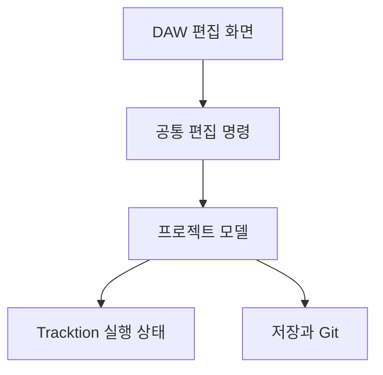

작곡을 하다 보면 같은 곡의 편곡을 여러 방향으로 바꾸게 돼요. 보컬은 어제 만든 버전이 마음에 드는데, 드럼은 오늘 바꾼 버전이 더 좋을 수도 있죠. 두 작업본을 받아 원하는 변경만 골라 합치는 일은 결국 사람이 직접 해야 해요.

개발을 시작하고 Git으로 협업하는 경험을 하면서 음악 프로젝트에도 이런 작업 방식이 있으면 좋겠다고 생각했어요. 그렇게 시작한 어엿비(Ayotbi)는 녹음과 편곡, 버전 관리와 협업을 연결하는 데스크톱 DAW예요.

[어엿비 macOS 베타 다운로드](https://github.com/whizzkid1452/ayotbi-downloads/releases)


*개발 후반의 실제 macOS 데모 앱. 타임라인, 재생 제어, 샘플 탐색을 하나의 작업 공간에 배치했어요.*


이번 시리즈는 이 화면을 완성하기까지 거쳤던 설계와 구현 과정을 소개해요. 우선 왜 웹에서 시작했다가 네이티브 앱을 만들게 됐는지부터 이야기해 볼게요.

## [sort1] 1. 편집 엔진을 만들기 시작했어요

개발자가 되기 전부터 MIDI로 작곡했고, 대학원에서 뉴미디어음악을 공부했어요. 이후 멀티트랙 미디어 편집기를 개발하며 익숙한 문제를 다시 만났어요. 어떤 화면에서든 파형을 그리는 것뿐 아니라 클립의 원본을 유지하고 위치를 바꾸고, 재생 중인 소리와 편집 상태를 맞춰야 했거든요.

먼저 이런 규칙을 TypeScript로 재사용하고 싶어서 daw-engine을 만들었어요. Session, Track, Region, Source를 정의하고 재생 환경을 어댑터로 분리한 편집 코어였어요. 관련 고민은 [TypeScript DAW 엔진 구현기](/posts/daw-engine-series-intro)에 정리해 두었어요.

어엿비에서는 여기서 한발 더 나아가 음악가가 직접 녹음하고 믹싱하고, 작업본을 비교할 수 있는 제품을 만들고 싶었어요.

## [sort1] 2. 웹에서 편집 요청을 보내는 프로토타입

초기에는 웹에서 오디오 브리지를 연결하는 형태로 실험했어요. 웹 화면에서 입력한 요청을 로컬 네이티브 프로그램이 받아 소리를 처리하고, 설치된 플러그인과 파일에는 내 컴퓨터에서 접근하는 구조였어요.


*초기 개발 중 Chrome에서 촬영한 웹 화면. 브리지 연결과 자연어 편집 계획을 시험하던 시점이에요. 입력 토큰은 비어 있어요.*

웹 인터페이스를 계속 확장하는 방식도 가능했지만 제작 환경에는 물리 오디오 장치, 입력 모니터링, VST3 및 AU 호스팅이 필요했어요. 웹 UI와 네이티브 브리지 사이에서 곡의 원본과 재생 상태를 일치시키는 문제도 해결해야 했죠.

그래서 제작 앱은 C++20과 JUCE로 만들고, 웹은 협업자의 변경 확인과 WAV 청취에 집중하기로 했어요. 새로운 UI와 모델을 구축하는 비용을 들이는 대신 편집 원본과 오디오 실행 상태를 같은 네이티브 앱의 제어 경계에서 다룰 수 있어요. 이 결정은 언어 간 속도 벤치마크가 아니라 제품 요구사항을 기준으로 내린 것이에요.

## [sort1] 3. 음악의 구조부터 표현하기

JUCE가 네이티브 UI와 오디오 장치, 플러그인 환경을 제공해도 실제 DAW의 편집 규칙까지 자동으로 생기는 건 아니에요. Tracktion Engine을 실행 백엔드 후보로 검증하면서도 곡을 저장할 모델은 직접 만들기로 했어요.

음악 프로젝트를 텍스트 파일처럼 비교하려면 트랙의 배열 위치가 아니라 안정적인 객체 ID를 가지고 있어야 해요. 파일의 경로 대신 내용 해시를 참조하면 같은 WAV를 여러 클립에서 사용할 수 있고요.

현재 프로젝트 모델의 핵심 필드를 실제 C++ 코드에서 발췌했어요. 설명과 관계없는 필드는 생략했어요.

```cpp
struct Project {
    Id id;
    int ticksPerQuarter = 960;
    int sampleRateHz = 48000;
    std::vector<Id> trackOrder;
    std::map<Id, Track> tracks;
    std::map<Id, AudioClip> audioClips;
    std::map<Id, Pattern> patterns;
    std::map<Id, MidiClip> midiClips;
    std::map<Id, Route> routes;
};
```

트랙, 클립, MIDI 패턴과 라우팅을 같은 프로젝트에 기록하지만 재생 객체와는 구분해요. 트랙 순서도 ID 목록으로 별도 관리했어요.



Tracktion 내부 문서를 그대로 저장 원본으로 쓰는 것보다 매핑과 검증 코드가 더 필요해요. 대신 파일 포맷과 음악 객체의 변경 비교, Undo를 제품에서 직접 제어할 수 있어요.

## [sort1] 4. 정말 소리가 나는 앱으로 발전시키기


*초기 개발 당시 실제로 실행한 데스크톱 창. 아직 편집 UI가 없었어요.*

첫 데스크톱 창에는 제목밖에 없었어요. 이 단계에서는 UI를 풍성하게 만들기보다 모델과 엔진 연결에서 실제로 의도한 소리가 나는지 확인하는 것이 우선이었어요.

고정한 Tracktion v3.2.0과 JUCE 8.0.6으로 합성 WAV를 렌더하고 모델에서 게인을 변경해 봤어요.

| 검증 항목 | 결과 |
| --- | --- |
| -6 dB 게인 적용 후 출력 진폭 비율 | 약 0.5011873 |
| Undo 후 기준 렌더의 최대 샘플 차이 | 0 |

이후 오디오 파일을 가져오고 트랙, 클립, 마스터 출력 연결을 한 편집 명령으로 등록하는 화면을 만들었어요. 원본 샘플레이트를 유지하고, I/O 스레드에서 WAV를 읽은 뒤 JUCE 파형 캐시로 보이는 구간을 그렸어요. 이 초기 타임라인 구현에서 macOS CTest 14/14와 헤드리스 CTest 8/8을 통과했어요.

그 위에 MIDI, 녹음, 믹서, 저장 및 Git을 단계별로 연결했어요. 아직 물리 오디오 장치의 왕복 지연이나 대규모 실시간 부하는 별도의 검증이 필요해요.

다음 편에서는 트랙과 클립을 움직일 때 곡의 모델과 실제 재생 상태를 일치시키는 편집 엔진을 살펴볼게요.
