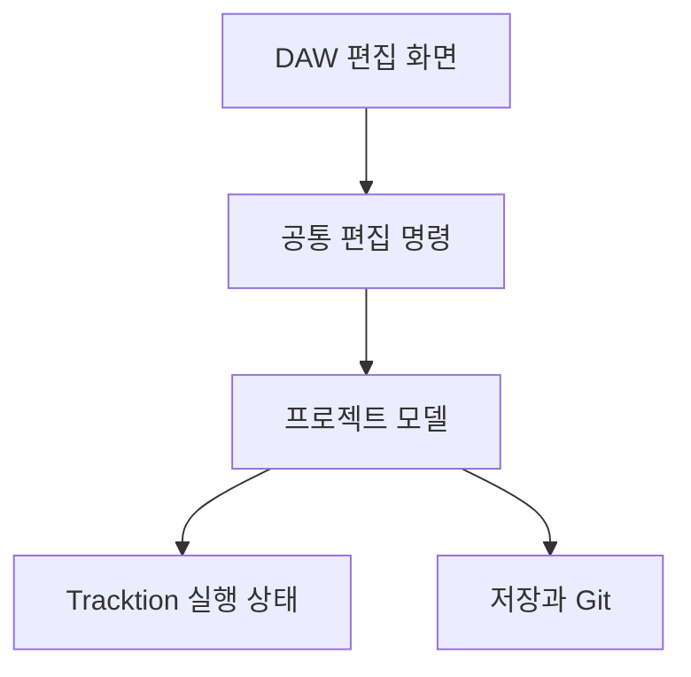

작곡을 하다 보면 같은 곡을 여러 방향으로 편곡해 보게 돼요. 보컬은 어제 녹음한 버전이 나은데, 드럼은 오늘 바꾼 버전이 더 좋을 때도 있죠. 그런데 두 작업본에서 원하는 트랙만 골라 합치는 일은 결국 사람이 직접 파일을 열어 옮겨야 해요.

개발을 시작하고 Git으로 협업하면서 음악 프로젝트도 이렇게 다룰 수 있으면 좋겠다는 생각이 들었어요. 그렇게 만들기 시작한 어엿비(Ayotbi)는 녹음과 편곡, 버전 관리, 협업을 함께 다루는 데스크톱 DAW예요.

[어엿비 macOS 베타 다운로드](https://github.com/whizzkid1452/ayotbi-downloads/releases)


*개발 후반의 실제 macOS 데모 앱. 타임라인, 재생 제어, 샘플 탐색을 하나의 작업 공간에 배치했어요.*

이번 글에서는 이 화면을 만들어가면서 고민한 설계와 구현 과정을 나눠보려고 해요. 먼저 웹에서 출발해 네이티브 앱을 만들게 된 이유부터 시작할게요.

## [sort1] 1. 편집 엔진을 만들기 시작했어요

개발을 시작하기 전부터 MIDI로 곡을 썼고, 대학원에서는 뉴미디어음악을 전공했어요. 나중에 멀티트랙 미디어 편집기를 개발하면서 친숙한 문제들을 다시 접하게 되었죠. 어떤 화면이든 파형을 그리는 일 이상으로, 클립 원본을 안전하게 유지하고 위치를 옮기며 재생 소리와 편집 상태를 계속 맞추는 작업이 필요했어요.

우선 이런 구조를 TypeScript로 재사용하고 싶어서 daw-engine을 만들었어요. Session, Track, Region, Source를 정의하고 재생 환경을 어댑터로 분리한 코어 엔진이었어요. 자세한 고민 과정은 [TypeScript DAW 엔진 구현기](/posts/daw-engine-series-intro)에서 확인하실 수 있어요.

어엿비에서는 한 걸음 더 나아가, 음악가가 녹음부터 믹싱, 작업본 비교까지 한곳에서 할 수 있는 제품을 만들고 싶었어요.

## [sort1] 2. 웹에서 편집 요청을 보내는 프로토타입

처음에는 웹 브라우저와 오디오 브리지를 연결하는 방식으로 실험을 시작했어요. 웹 UI에서 보낸 요청을 로컬 프로그램이 받아 소리를 처리하고, 내 컴퓨터에 설치된 플러그인과 파일에 접근하는 형태였죠.


*초기 개발 중 Chrome에서 촬영한 웹 화면. 브리지 연결과 자연어 편집 계획을 시험하던 시점이에요. 입력 토큰은 비어 있어요.*

웹 인터페이스를 확장하는 방법도 검토했지만, 음악 제작 환경에서는 다음과 같은 네이티브 기능이 꼭 필요했어요.
- 물리 오디오 장치 제어와 입력 모니터링
- VST3 및 AU 플러그인 호스팅
- 웹 UI와 로컬 브리지 간 상태 동기화 복잡도 해소

결국 메인 제작 앱은 C++20과 JUCE 기반 네이티브로 개발하고, 웹은 작업본 확인과 WAV 듣기에 집중하기로 정리했어요. 덕분에 편집 원본과 오디오 실행 상태를 하나의 네이티브 앱 안에서 안정하게 관리할 수 있게 되었어요. 단순한 성능 벤치마크가 아니라, 실제 요구사항에 맞춘 결정이었죠.

## [sort1] 3. 음악의 구조부터 표현하기

JUCE가 UI나 오디오 장치 연결을 지원해주더라도, DAW의 핵심 편집 규칙을 저절로 만들어 주지는 않아요. Tracktion Engine을 백엔드로 검증하면서도, 곡 데이터 모델만큼은 직접 구축하기로 결정했어요.

음악 프로젝트를 텍스트처럼 비교하려면, 단순 트랙 위치가 아니라 고유한 객체 ID를 기반으로 관리해야 해요. 파일 경로 대신 내용 해시를 참조하도록 설계하면 하나의 WAV 파일을 여러 클립에서 효율적으로 재사용할 수도 있죠.

현재 프로젝트 모델에서 핵심이 되는 주요 필드는 다음과 같아요 (이해를 돕기 위해 일부 코드는 생략했어요).

```cpp
struct Project {
    Id id;
    int ticksPerQuarter = 960;
    int sampleRateHz = 48000;
    std::vector<Id> trackOrder;
    std::map<Id, Track> tracks;
    std::map<Id, AudioClip> audioClips;
    std::map<Id, Pattern> patterns;
    std::map<Id, MidiClip> midiClips;
    std::map<Id, Route> routes;
};
```

트랙, 클립, MIDI 패턴과 라우팅을 한 프로젝트 안에 기록하되, 재생 객체와는 철저히 분리했어요. 트랙 순서 역시 독립된 ID 목록으로 다뤘어요.



Tracktion의 내부 문서를 저장 파일로 직접 쓰는 것에 비해 매핑과 검증 로직이 추가로 들어가지만, 파일 포맷 제어와 변경 사항 비교, 실행 취소(Undo)를 직접 정교하게 핸들링할 수 있다는 확실한 장점이 있어요.

## [sort1] 4. 정말 소리가 나는 앱으로 발전시키기


*초기 개발 당시 실제로 실행한 데스크톱 창. 아직 편집 UI가 없었어요.*

첫 데스크톱 창에는 타이틀바만 존재했어요. 이 시기에는 UI를 채우는 것보다 데이터 모델과 엔진 연동이 올바르게 동작해서 제대로 된 소리가 나는지 검증하는 것이 가장 중요했거든요.

Tracktion v3.2.0과 JUCE 8.0.6을 설정한 뒤, 합성 WAV를 렌더링하고 모델의 게인 변경 값을 테스트해보았어요.

| 검증 항목 | 결과 |
| --- | --- |
| -6 dB 게인 적용 후 출력 진폭 비율 | 약 0.5011873 |
| Undo 후 기준 렌더의 최대 샘플 차이 | 0 |

이어서 오디오 파일을 불러오고 트랙, 클립, 마스터 출력 연결을 단일 편집 명령으로 수행하는 화면을 다듬어 나갔어요. 원본 샘플레이트를 유지하면서 I/O 스레드에서 WAV를 읽고, JUCE 파형 캐시로 화면을 그려내었죠. 이 초기 타임라인 단계에서 macOS와 헤드리스 환경의 자동화 테스트를 모두 통과했어요.

그 기반 위에 MIDI, 녹음, 믹서, 저장 및 Git 연동을 차근차근 붙여나갔어요. 오디오 장치의 지연 시간이나 고부하 상황에서의 안정성은 계속 검증을 이어나갈 계획이에요.

다음 글에서는 트랙과 클립을 이동할 때 모델과 재생 상태를 어떻게 동기화하는지 본격적인 편집 엔진 구조를 살펴볼게요.

## [sort1] 시리즈 읽기
- 다음 글 [\[Part 2.\] DAW의 편집 엔진은 어떻게 동작할까?](/posts/ayotbi-edit-engine)
- [\[Part 3.\] 오디오와 MIDI를 동시에 녹음하는 엔진 구현기](/posts/ayotbi-recording-rendering)
- [\[Part 4.\] Local-first DAW의 저장과 복구 시스템 구축기](/posts/ayotbi-project-storage-recovery)
- [\[Part 5.\] 음악 프로젝트에 Git과 3-way Merge 구현하기](/posts/ayotbi-git-collaboration)
- [\[Part 6.\] LangChain으로 자연어 음악 편집 기능 구현하기](/posts/ayotbi-langchain-editing)
- [\[Part 7.\] 서로 다른 플러그인 환경에서도 협업할 수 있는 DAW 만들기](/posts/ayotbi-missing-plugins)
