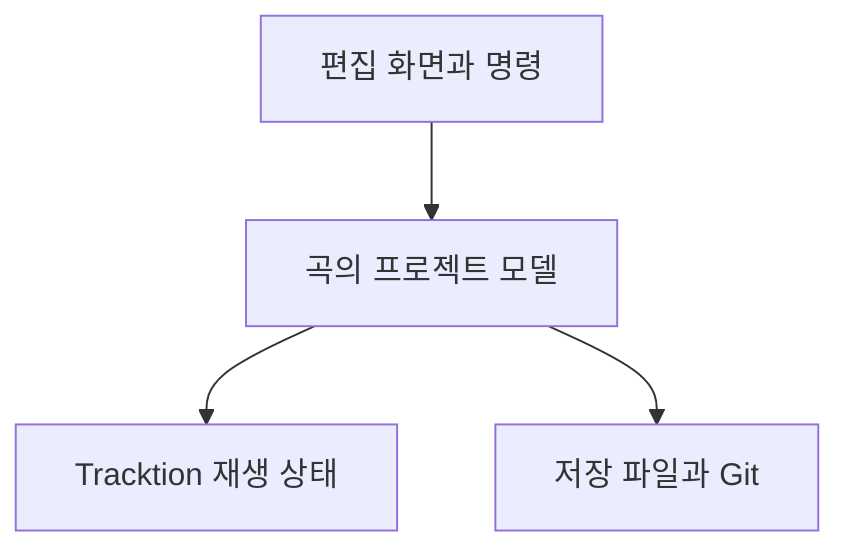

곡을 만들 때 늘 최종 버전이 하나인 것은 아니에요. 후렴의 보컬은 첫 번째 편곡이 좋은데, 드럼은 두 번째 편곡이 더 좋을 수 있죠. 혹시 파일 이름 끝에 `final`, `final_2`, `진짜최종`을 붙여본 적 있으신가요?

음악을 만들던 제가 개발 일을 하면서 Git을 접했을 때, 곡에도 이런 작업 방식이 있으면 좋겠다고 생각했어요. 다른 버전의 음악을 들어보고 원하는 변경만 골라 합칠 수 있다면 어떨까요? 이 질문에서 출발한 프로젝트가 어엿비(Ayotbi)예요.

[어엿비 macOS 베타 다운로드](https://github.com/whizzkid1452/ayotbi-downloads/releases)

## [sort1] 1. 편곡의 변경을 설명할 수 있는 DAW

저는 개발자가 되기 전에는 MIDI로 작곡했고, 대학원에서는 뉴미디어음악을 공부했어요. 이후 멀티트랙 미디어 편집기를 개발하면서 음악과 개발에서 만나는 공통 문제를 발견했어요.

파형을 옮기고, 파일을 자르고, 트랙을 재생하고, 이전 편집 상태를 복원하는 일에는 제품이 달라져도 비슷한 규칙이 필요했어요. 그래서 TypeScript로 재사용할 수 있는 편집 코어인 daw-engine을 만들었어요. UI와 오디오 실행 환경을 분리하는 경험은 [이전 엔진 구현기](/posts/daw-engine-series-intro)에서도 다룬 적 있어요.

그런데 어엿비는 라이브러리보다 한 단계 더 나아간 제품을 만들고 싶었어요. DAW(Digital Audio Workstation)는 녹음한 소리와 MIDI 노트를 배치하고, 믹싱해서 곡을 완성하는 도구예요. 여기에 Git 방식의 협업까지 더하려면 단순히 파일을 저장하는 것만으로는 부족하겠죠.

예를 들어 아래 두 버전이 있다고 해볼게요.

| 변경 | 내 편곡 | 상대 편곡 |
| --- | --- | --- |
| 보컬 게인 | -3 dB | 유지 |
| 드럼 위치 | 유지 | 한 박 이동 |

완성 WAV에서는 어떤 편곡이 더 좋은지는 들을 수 있어요. 하지만 두 변경을 함께 살리려면 트랙과 노트를 구분할 수 있는 편집 가능한 데이터가 필요해요. 버전 관리의 단위가 파일 이름이 아니라 곡 안의 음악 객체가 되어야 한다고 봤어요.

## [sort1] 2. 익숙한 TypeScript 대신 C++을 선택한 이유

처음부터 데스크톱을 선택한 건 아니에요. 초기에는 웹에서 편집 요청을 보내는 브리지 프로토타입도 만들었어요. 웹 UI는 익숙했고 개발한 기능을 공유하기도 쉬웠거든요.

다만 이번 제품에는 실제 마이크나 MIDI 입력과 녹음 중 모니터링, VST3와 AU 같은 음악 제작용 플러그인 호스팅이 필요했어요. 기존 TypeScript 코어를 Electron에 연결하고 네이티브 어댑터를 추가할 수도 있지만, 편집 원본과 C++ 실행 엔진의 상태를 프로세스 경계에서 일치시키는 일이 또 다른 설계 문제가 돼요.

결국 제작 앱을 C++20과 JUCE로 만들고, 웹은 리뷰에 활용하기로 했어요. 브라우저에서 모든 편집을 지원하는 것보다, DAW 설치 없이 두 편곡을 들어볼 수 있는 경험에 집중하는 쪽이 제품의 목표에 더 잘 맞았어요.

이 결정이 C++이 TypeScript보다 몇 배 빠르다는 벤치마크 결과에서 나온 건 아니에요. 입력 장치, 플러그인, 상태 소유권이라는 요구사항을 기준으로 결정한 것이고, 새로운 프로젝트 모델과 UI를 작성해야 하는 비용은 받아들였어요.

## [sort1] 3. 재생 엔진이 곡의 원본까지 소유해야 할까?

JUCE를 선택했다고 모든 오디오 처리가 해결되는 건 아니었어요. DAW가 되려면 여러 트랙을 재생하고 입력을 받고, 플러그인을 실행하고, 신호를 라우팅해야 해요. 이 전부를 직접 구현하는 대신 Tracktion Engine을 실행 백엔드로 연결하는 실험부터 시작했어요.

여기서 중요한 선택을 하나 더 했어요. Tracktion의 엔진 상태를 그대로 어엿비의 저장 형식으로 사용하지 않고, 곡을 표현하는 모델은 직접 소유하는 거예요.

모델에는 트랙, 오디오 클립, MIDI 노트, 자산 참조처럼 비교하고 싶은 정보가 들어가요. 실행 엔진은 이 곡을 소리로 만드는 역할을 맡아요.

두 상태를 분리하면 음악 객체에 안정적인 ID를 부여하고, 여러 버전에서 같은 클립을 찾아 비교할 수 있어요. 반면 어엿비의 모델을 Tracktion에 매핑하고, 두 상태가 어긋나지 않도록 검증해야 하는 부담이 생겨요.

## [sort1] 4. 모델을 바꿨을 때 실제 소리도 바뀌는지부터

거창한 협업 기능을 붙이기 전에, 이 구조가 소리를 제대로 내는지 확인하고 싶었어요. 고정된 Tracktion v3.2.0과 JUCE 8.0.6 환경에서 합성 WAV를 불러와 모델의 게인을 변경하고 오프라인 렌더를 비교했어요.

| 검증 항목 | 결과 |
| --- | --- |
| -6 dB 적용 후 출력 진폭 비율 | 약 0.5011873 (계산값과 일치) |
| Undo 후 기준 렌더와의 최대 샘플 차이 | 0 |

게인을 변경한 값이 모델에 기록되는 데서 끝나지 않고 실제 출력과 일치했고, Undo로 기존 소리까지 복원됐어요. 이후 가상 입력을 이용한 녹음과 저장, 재열기, WAV 출력으로 검증을 넓혔습니다.

다만 이 실험은 오프라인 렌더의 결과예요. 물리 오디오 인터페이스의 지연이나 대형 프로젝트의 실시간 처리 능력까지 측정한 것은 아니에요.

어엿비에서 가장 중요한 것은 곡을 편집할 수 있다는 사실보다, 그 편집을 신뢰할 수 있느냐였어요. 저장하고 다시 열어도 같은 상태여야 하고, 변경이 실패하면 원래 곡이 남아야 하니까요.

다음 글에서는 이 기준을 실제 편집 명령과 Undo에 어떻게 연결했는지 이야기해 볼게요.
