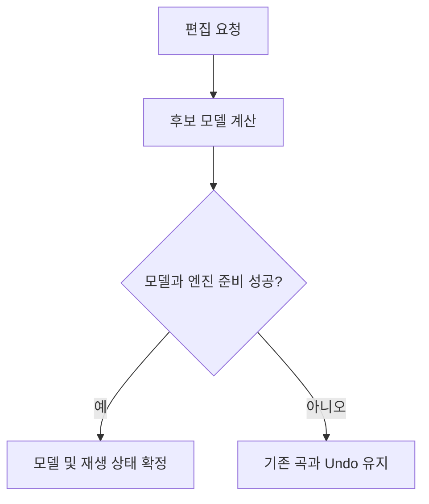

타임라인에서 클립 하나를 살짝 옮기는 일은 아주 단순해 보여요. 하지만 DAW 내부에서는 재생 위치와 곡의 편집 데이터가 동시에 바뀌고, 무엇을 되돌릴지도 알아야 해요.

만약 클립을 옮긴 뒤 오디오 엔진에서 필요한 파일을 열지 못하면 어떨까요? 화면에서는 새로운 편곡을 보고 있는데, 귀에는 이전 편곡이 들릴 수 있어요.

그래서 어엿비에서는 편집 요청을 바로 원본에 적용하지 않고, 변경 후보를 검증하고 실행 엔진을 준비한 뒤 확정하는 구조를 사용했어요.

[어엿비 macOS 베타 다운로드](https://github.com/whizzkid1452/ayotbi-downloads/releases)

## [sort1] 1. 트랙 하나를 추가하는 데도 여러 상태가 바뀌어요

트랙을 추가할 때는 트랙 객체만 만들어서는 안 돼요. 화면의 순서에도 새 ID를 넣고, 마스터로 소리를 전달할 출력 경로도 연결해야 해요. 세 작업 중 두 개만 성공한다면 정상적인 곡이라고 보기 어려워요.

각 작업이 원본을 바로 수정하게 두면 구현은 간단하지만, 중간에 실패했을 때 어디까지 적용됐는지 판단해야 해요. 이때 Undo도 이미 기록했다면 복구할 대상이 더 많아지고요.

그래서 여러 명령을 하나의 트랜잭션, 즉 함께 성공하거나 함께 실패하는 작업으로 묶었어요.

코드에서는 편집 모델을 검증하는 계층과 실행 엔진을 준비하는 세션을 분리했어요. 새 트랙을 추가하더라도 후보의 참조와 범위를 검사하고 엔진 준비까지 성공해야 revision(현재 편집 상태의 번호)과 Undo가 바뀌어요.

후보를 만들어 보는 경로는 나중에 AI의 미리보기에도 활용했어요. 미리보기는 예상 모델과 변경 경로만 반환하며, 실제 WAV를 읽거나 플러그인을 준비하는 과정은 적용할 때 수행해요.

## [sort1] 2. 페이더를 움직였다고 Undo가 수십 개 쌓이면

모든 이벤트를 트랜잭션으로 처리하는 것만으로는 충분하지 않았어요. 예를 들어 믹서의 페이더를 0 dB에서 -6 dB로 드래그하면 중간 값이 계속 들어와요. 하지만 음악가에게는 한 번의 조작이죠.

드래그마다 고유한 Undo 그룹을 부여했어요. 드래그 중에는 게인이 실제 재생에 반영되고 revision도 증가하지만, 인접한 같은 그룹의 변경은 한 번에 되돌릴 수 있어요.

반대로 여러 클립의 연결 트림처럼 전체 범위를 계산해야 하는 편집에서는 후보를 화면에 보여주다가 마우스를 놓을 때 한 묶음으로 적용해요.

엔진을 매번 새로 만드는 것도 적절하지 않았어요. 트랙 구조가 바뀔 때는 실행 상태를 다시 준비해야 하지만, 볼륨이나 팬처럼 연속적으로 조절하는 값에는 기존 실행 상태를 갱신하는 경로를 뒀어요.

편집 요청을 재시도할 때는 같은 requestId와 동일한 본문이라면 이전 결과를 반환해요. 다른 revision을 기준으로 만든 요청은 거절하고요. 이 기록은 현재 프로젝트 활성화 세대의 메모리 안에서만 유지되므로 앱을 재시작해도 중복 실행이 막힌다고 보장하지는 않아요.

## [sort1] 3. 한 박 앞으로 옮기는 것과 오디오의 한 샘플을 읽는 것은 달라요

DAW를 만들며 프론트엔드의 좌표 계산과 다른 점도 있었어요. 음악에서 '한 박'은 일정한 초 단위가 아니에요. 120 BPM에서는 0.5초, 90 BPM에서는 약 0.667초죠.

그래서 프로젝트의 음악적 위치와 파일 안에서 소리를 읽는 위치를 분리했어요.

| 좌표 | 단위 | 쓰임 |
| --- | --- | --- |
| 편곡 시간 | tick (기본 4분음표당 960) | 클립 배치, MIDI 노트, 템포 |
| 소스 시간 | sample frame | 원본 WAV 범위, 트림, 페이드 |

이 구분이 특히 중요한 기능이 Warp예요. 녹음된 세 번의 타격 중 가운데 하나만 앞으로 옮기고 양옆은 그대로 두는 상황을 생각해 보세요. 원본 샘플을 바꾸는 대신 원본 프레임과 음악 시간의 대응점을 저장했어요. 템포 변경 구간과 대응점에 맞춰 SoundTouch로 시간을 변환하고, 재생과 오프라인 렌더가 같은 변환을 사용하게 했어요.

48 kHz 합성 신호를 사용한 시험에서는 0.40초와 1.60초의 타격을 고정하고 1.10초인 가운데 타격을 1.00초로 당겼어요. 저장 후 재열기와 믹스 WAV를 검사했고, 중간에 템포를 120에서 90 BPM으로 바꾼 경우에도 목표 위치와 타격 에너지 중심의 오차가 1샘플 미만이었어요.

## [sort1] 4. 편집 한 번이 곡을 어디까지 바꾸는지 확인했어요

미리보기와 적용 경로를 공유한 통합 검증에서는 macOS Debug CTest 37/37, 헤드리스 Debug CTest 20/20을 통과했어요. 오래된 요청과 중복 재전송, 엔진 준비 실패에서 원본이 유지되는지 확인했어요.

특히 실제 앱에서 외부 CLI를 통해 트랙 게인을 0 dB에서 -6 dB로 바꾸고, 화면의 Undo로 0 dB를 복원하는 것이 가능했어요. 화면이 아닌 다른 경로에서 들어온 명령에도 같은 편집 규칙을 적용한다는 의미예요.

현재 구조는 후보 계산을 위해 전체 모델 사본을 만들어요. 큰 곡에서의 복사 비용과 실시간 재생 중 부하는 별도로 측정해야 합니다.

제가 이 편집 엔진에서 얻은 기준은 입력 이벤트의 단위보다 사용자가 인식하는 작업의 단위에 주목해야 한다는 것이었어요. 상태를 바꾸기 전에 실패할 수 있는 지점을 확인하고, 사용자가 되돌릴 수 있는 범위를 명확히 정하는 것. 이 원칙은 음악 편집기 외의 복잡한 에디터에서도 적용할 수 있다고 생각해요.
