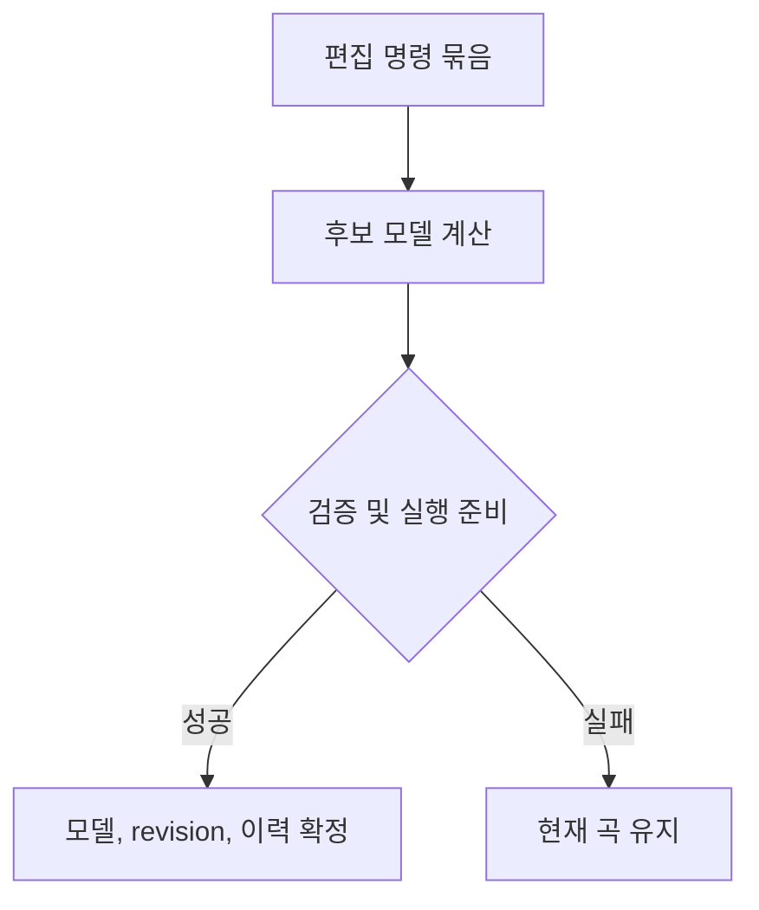

*실제 앱의 연결 클립 편집 화면. 두 오디오 클립에 같은 편집을 적용할 수 있어요.*


타임라인에서 클립 하나를 옮기는 UI는 간단해 보여요. 하지만 여러 클립을 함께 편집하기 시작하면 어디까지 한 번의 작업으로 기록할지, 실패했을 때 곡의 어느 상태를 유지할지 정해야 해요.

이번 글에서는 어엿비의 편집 엔진을 만드는 과정과 실제 구현을 소개할게요.

[어엿비 macOS 베타 다운로드](https://github.com/whizzkid1452/ayotbi-downloads/releases)

## [sort1] 1. 편집 명령이 곡을 바꾸는 과정

새 트랙을 만드려면 트랙 객체와 화면 순서, 마스터로 향하는 출력 경로가 모두 필요해요. 이들을 하나씩 확정하면 중간 단계에서는 불완전한 곡이 될 수 있고, 엔진 준비가 실패하면 화면과 소리가 어긋날 위험도 있어요.

그래서 현재 모델을 직접 바꾸는 대신 먼저 후보를 계산하고, 검증을 통과한 후보만 확정하기로 했어요.



실제 Editor의 `execute()`에서는 Undo 이후의 이력 역시 별도 후보로 준비해요. 핵심 부분을 발췌하면 다음과 같아요.

```cpp
// 후보 이력을 이미 계산한 뒤의 코드
EditResult result {
    true, revision_ + 1,
    std::move(preview.changedPaths), {}
};

if (prepare) {
    auto issues = prepare({nextHistory[nextCursor],
                           generation_, result.revision});
    if (!issues.empty())
        result = {false, revision_, {}, std::move(issues)};
}

if (result.accepted) {
    history_.swap(nextHistory);
    cursor_ = nextCursor;
    revision_ = result.revision;
    undoGroup_.swap(nextUndoGroup);
}
```

원본에서는 확정 전 요청 결과도 기록하고 재전송의 동일성을 검증해요. 위의 발췌는 언제 모델 이력이 바뀌는지 보여주려고 그 경로를 생략했어요.

`ProjectSession`이 전달하는 준비 콜백은 후보 프로젝트의 새 실행 상태를 준비해요. 실패하면 `result.accepted`가 false이므로 기존 모델과 Undo가 유지돼요. 볼륨이나 팬처럼 연속 변경할 값은 전체 엔진 대신 기존 실행 상태를 갱신할 수 있는 경로를 사용해요.

## [sort1] 2. 화면에서 한 번 움직였다면 Undo도 한 번이어야 해요

페이더를 0 dB에서 -6 dB로 드래그할 때 중간 값이 여러 번 들어와요. 각각 실제 소리에 반영해야 하지만 사용자가 느끼는 조작은 한 번이에요.

그래서 편집 요청에 Undo 그룹을 지정했어요. 같은 그룹의 인접한 명령은 첫 조작 전후의 상태를 보존하면서 하나의 Undo 단계로 합쳐요. 클립을 그룹으로 트림할 때는 드래그 과정에서 후보를 보여주고 최종 확정 시 하나의 명령으로 반영해요.

UI의 이벤트 수가 편집 이력 수와 같을 필요는 없다는 걸 보여주는 부분이에요.

실제 44.1 kHz와 48 kHz 오디오의 연결 트림 및 페이드 검증에서는 드래그와 수치 필드로 같은 편집을 입력했을 때 전체 프로젝트 모델이 동일했어요. 100ms 페이드를 추가했을 때 각각 4,410과 4,800샘플이 늘어났고, 그룹 Undo 한 번으로 처음 상태에 돌아왔어요.

## [sort1] 3. 음악의 박자와 파일의 샘플을 분리했어요

120 BPM에서 한 박은 0.5초지만 90 BPM에서는 약 0.667초예요. 곡의 어느 박에 배치할지와 원본 파일에서 어느 샘플부터 읽을지를 같은 단위로 저장하면 템포를 바꿨을 때 편집 의미를 유지하기 어려워요.

실제 `AudioClip` 모델에서 관련 필드를 발췌했어요.

```cpp
struct AudioClip {
    Id trackId;
    std::string assetHash;
    Ticks position;
    Samples sourceOffset;
    Samples sourceLength;
    Samples fadeIn;
    Samples fadeOut;
    std::vector<WarpAnchor> warp {};
};
```

`position`은 곡의 음악 시간, `sourceOffset`과 `sourceLength`는 원본 파일의 샘플 좌표예요. 기본 분해능은 4분음표당 960 tick이고, 템포 및 박자표에 따라 초로 변환해요. 화면과 재생, 오프라인 렌더 모두 같은 시간 맵을 참조하도록 했어요.

## [sort1] 4. Warp로 가운데 타격 하나만 옮기기

세 번의 드럼 타격 중 가운데 것이 늦어서 당기고 싶을 때 클립 전체를 앞당기면 양옆 타격까지 움직여요. 원본의 특정 샘플과 곡의 특정 박을 연결하는 대응점이 필요했어요.


*실제 앱에서 원본 132,300프레임의 대상 위치를 6.875박으로 설정한 예시.*

Warp 마커는 원본 WAV의 절대 샘플과 파일 시작 기준 tick을 쌍으로 유지해요. 시작과 끝을 고정하고 두 좌표가 모두 증가하도록 검증해요. 마커와 템포 변경점에 따라 구간을 나눈 뒤 SoundTouch로 길이를 변환하므로 소스 파일을 별도로 다시 잘라 쓸 필요가 없어요.

실제 48 kHz 합성 신호를 사용한 시험 결과예요.

| 타격 | 원래 위치 | 목표 위치 |
| --- | ---: | ---: |
| 첫 타격 | 0.40초 | 유지 |
| 가운데 | 1.10초 | 1.00초 |
| 마지막 | 1.60초 | 유지 |

저장 및 재열기 뒤 가상 오디오 출력과 WAV를 분석했어요. 중간 템포를 120에서 90 BPM으로 변경한 곡에서도 세 타격의 에너지 중심 오차가 각각 1샘플 미만이었어요.

## [sort1] 5. 편집 경계를 검증하다

미리보기와 적용 경로가 같은 모델 검증을 사용하는지 확인한 단계에서 macOS Debug CTest 37/37, 헤드리스 Debug CTest 20/20이 통과했어요. 미리보기는 엔진을 준비하지 않고 예상 변경만 반환하며 기준 revision이 달라진 요청은 거절해요.

이 경계를 만든 덕분에 외부 CLI로 트랙을 수정하거나 AI가 편집을 제안할 때도 화면과 같은 Undo 및 검증 규칙을 사용할 수 있게 됐어요. 현재 후보 계산은 전체 모델 사본을 사용하므로 큰 곡에서의 복사 비용과 실시간 재생 부하는 별도 측정이 필요해요.

다음 글에서는 녹음에서도 여러 결과를 하나의 편집으로 묶었던 경험을 소개할게요.
