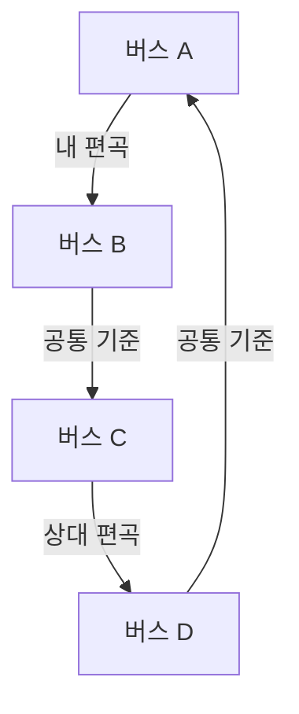

개발자가 코드의 브랜치를 나눠 작업한 뒤 합치는 것처럼, 음악에서도 서로 다른 편곡을 만들고 원하는 변경을 선택해 합칠 수 있으면 좋겠다고 생각했어요.

이전 편에서 만든 프로젝트 모델은 곡의 트랙과 클립, 노트마다 ID를 가지고 있어요. 이 모델을 Git 이력에 연결하면 두 버전이 실제로 어떤 음악을 바꿨는지 설명할 수 있을 것 같았어요.

[어엿비 macOS 베타 다운로드](https://github.com/whizzkid1452/ayotbi-downloads/releases)

## [sort1] 1. Git에 무엇을 저장할까?

Git은 커밋과 브랜치, 이력을 관리하지만 프로젝트의 WAV는 비교적 커요. 그래서 파일 전송에는 공식 Git LFS를 사용하고, 곡의 편집 상태는 정규화한 JSON으로 기록했어요. 오디오와 플러그인 상태는 내용 해시로 참조해요.

Git의 worktree를 이용해 브랜치마다 작업 공간도 분리했어요. 다른 버전으로 전환할 때 기존 브랜치의 미커밋 편집도 남겨둘 수 있어요.

근본적인 고민은 텍스트 diff와 음악 diff가 다르다는 데 있었어요. 트랙이 배열에서 다른 위치로 이동했다고 해서 음악의 모든 속성이 바뀐 것은 아니죠. 이전 편에서 정의한 안정적인 객체 ID를 기준으로 트랙, 클립, 노트와 각 속성의 전후 차이를 계산했어요.

## [sort1] 2. 공통 조상과 두 편곡을 비교하기

내 작업본과 상대 작업본만 비교하면 어느 쪽이 실제 변경한 것인지 알 수 없어요. 그래서 Git의 공통 조상에 해당하는 기준과 두 편곡을 함께 입력으로 받는 3-way merge를 구현했어요.

| 속성 | 공통 기준 | 내 편곡 | 상대 편곡 | 결과 |
| --- | --- | --- | --- | --- |
| 보컬 게인 | 0 dB | -3 dB | 0 dB | -3 dB |
| 드럼 음높이 | 36 | 36 | 38 | 38 |

서로 독립적인 변경은 둘 다 반영해요. 같은 속성을 각자 바꿨다면 기준 및 양쪽 값을 표시하고 선택을 받아요.


*초기 병합 기능 구현 당시 실제 데모 앱. 기준 0 dB, 현재 -3 dB, 상대 -6 dB의 충돌이 표시돼요.*

트랙이나 플러그인의 순서, 템포와 라우팅 같은 관계는 한 속성씩 자동으로 합치기 어려워요. 어떤 속성의 변경이 다른 상태의 의미에 영향을 줄 수 있으니 연관 범위를 같이 판단하도록 했어요.

## [sort1] 3. 각각 유효한 편곡도 합치면 잘못될 수 있었어요

흥미로운 회귀 테스트가 있었어요. 네 개의 버스가 있는 프로젝트를 만들어 공통 기준에는 B에서 C, D에서 A로 연결했어요. 내 작업본에서 A를 B에 연결하고 상대 작업본에서 C를 D에 연결하면 각 작업본은 따로 보면 정상이에요.

하지만 병합한 뒤에는 다음과 같은 순환이 생겨요.



두 사람이 다른 속성을 변경했으므로 단순한 필드 충돌로는 잡을 수 없어요. 그래서 병합 후보 전체의 참조 무결성, 시간축과 라우팅을 검증했어요.

실제 회귀 테스트에서 병합으로 만들어진 순환이 발견되는 부분을 발췌했어요.

```cpp
left.routes.at("out-a").destinationTrackId = "b";
right.routes.at("out-c").destinationTrackId = "d";

result = mergeProjects(base, left, right);
expectConflict(result, "integrity", "");

require(std::any_of(result.issues.begin(),
                    result.issues.end(),
    [](const auto& issue) {
        return issue.code == "routing_cycle";
    }), "Combined routing cycle not diagnosed");
```

충돌을 해결하지 못하거나 최종 검증에 실패하면 후보를 저장하지 않아요. 현재 곡이나 기존 브랜치 참조도 그대로 유지해요.

새 편집 기능이 생길 때마다 병합 규칙을 함께 유지해야 한다는 비용이 있지만, 음악 어플리케이션에서는 Git이 텍스트 줄을 합쳤다는 것보다 실제 재생 가능한 프로젝트가 만들어졌는지를 확인하는 편이 중요했어요.

## [sort1] 4. 두 곡의 소리를 같은 리뷰에서 비교하기

변경된 게인이나 MIDI 노트만 봐서는 곡을 평가하기 어려워요. 따라서 브라우저에서 변경 목록과 두 WAV를 번갈아 듣는 웹 리뷰를 구현했어요. DAW나 플러그인을 설치하지 않고도 들을 수 있게 하고 싶었어요.


*웹 리뷰 기능을 처음 검증할 때 실제 로컬 서버에서 촬영한 테스트 화면. 커밋 ID와 음악 객체 변경을 같이 확인해요.*

리뷰를 만들 때 비교할 두 커밋을 고정하고 렌더도 각각의 커밋에 묶어요. 브랜치가 갱신되더라도 기존 리뷰와 댓글은 보존하고, 병합 전에 기준 커밋이 달라진 오래된 리뷰는 거절해요.

이후 렌더 패키지 매니페스트가 버전 2로 바뀌면서 서버 호환성 업데이트가 필요해졌어요. 별도 로컬 실험에서는 버전 2 호환과 재생 위치가 이어지는 A/B 전환까지 확인했고, 기본 서버 반영을 후속 작업으로 준비하고 있어요.

## [sort1] 5. 병합 커밋의 두 부모까지 확인했어요

병합 기능을 구현한 단계에서 실제 앱에서 마스터 볼륨의 상대 값 -6 dB를 선택하고 병합 커밋을 만들었어요. 같은 곡의 두 부모 커밋인지, 병합 결과의 값과 이전 브랜치 참조가 그대로인지 Git에서 별도로 확인했어요. macOS와 헤드리스 환경의 병합, 검증 테스트를 모두 통과했어요.

웹 리뷰는 격리 PostgreSQL, Git과 LFS를 이용해 고정 커밋의 댓글 유지와 오래된 리뷰 거절, 공유 브랜치 갱신을 확인했어요. 운영 다중 인스턴스와 실제 서로 다른 PC를 통한 장시간 협업은 별도 검증이 필요해요.

이번 구현에서 배운 건 변경을 저장하는 시스템과 변경의 의미를 이해하는 시스템의 역할이 다르다는 점이에요. Git은 전자를, 어엿비의 프로젝트 모델과 편집 검증은 후자를 담당하게 됐어요.

다음 편에서는 Part 2에서 만든 공통 편집 경계 위에 LangChain 기반 자연어 음악 편집 기능을 어떻게 연결했는지 살펴볼게요.

## [sort1] 시리즈 읽기
- 이전 글  [\[Part 4.\] Local-first DAW의 저장과 복구 시스템 구축기](/posts/ayotbi-project-storage-recovery)
- 다음 글  [\[Part 6.\] LangChain으로 자연어 음악 편집 기능 구현하기](/posts/ayotbi-langchain-editing)
- 시리즈 첫 글  [\[Part 1.\] 음악을 만들던 개발자가 DAW를 만들기까지](/posts/ayotbi-architecture)
