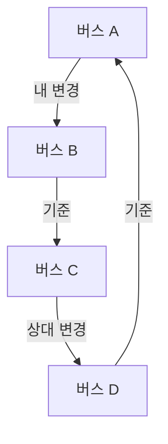

제가 보컬 볼륨을 조절하는 동안 다른 사람이 같은 곡의 드럼을 편집했다고 해볼게요. 서로의 변경을 합치려면 결국 한 사람이 기존 작업본을 열고 상대의 작업을 다시 만들어야 할까요?

처음 어엿비를 만들 때 가장 구현해 보고 싶었던 기능이었어요. 개발자는 Git으로 각자의 브랜치에서 작업한 뒤 변경을 합치잖아요. 음악에도 똑같이 적용하고 싶었죠.

그런데 프로젝트 JSON을 Git에 넣는다고 해결되는 문제는 아니었어요. 각각 정상적으로 재생되는 두 곡을 합쳐도, 합친 곡은 정상적으로 재생되지 않을 수 있었거든요.

[어엿비 macOS 베타 다운로드](https://github.com/whizzkid1452/ayotbi-downloads/releases)

## [sort1] 1. 파일의 차이와 음악의 차이는 다르더라고요

Git은 파일의 버전과 변경 내역을 기록하는 데 강해요. 하지만 음악가가 보고 싶은 변경은 JSON에서 몇 줄이 사라졌는지가 아니라 '보컬 볼륨이 3 dB 내려갔다', '드럼 노트가 한 박 이동했다' 같은 내용이에요.

그래서 Git과 Git LFS는 그대로 사용하되, 비교하는 규칙은 곡의 구조를 이해하는 로직으로 만들었어요. 이전 글에서 자체 프로젝트 모델을 만든 이유가 여기서 드러나요.

트랙, 클립, 노트마다 안정적인 ID가 있으니 배열에서 위치가 바뀌어도 같은 객체를 찾아 속성을 비교할 수 있어요. WAV와 플러그인 상태는 별도 자산 참조로 비교해요.

브랜치에는 Git의 연결 작업 트리(worktree)를 사용했어요. 브랜치마다 편집 문서와 로컬 복구 DB가 있는 별도 작업 공간을 둔 덕분에, 다른 버전으로 전환해도 기존 브랜치의 미커밋 작업을 지우지 않아요.

## [sort1] 2. 두 편곡이 어디에서 갈라졌는지가 중요했어요

두 결과만 놓고 비교하면 어느 쪽이 바꾼 값인지 알 수 없어요. 공통 기준과 각각의 버전을 함께 비교하는 3-way merge가 필요한 이유예요.

| 속성 | 공통 기준 | 내 버전 | 상대 버전 | 결과 |
| --- | --- | --- | --- | --- |
| 보컬 게인 | 0 dB | -3 dB | 0 dB | -3 dB |
| 드럼 노트 음높이 | 36 | 36 | 38 | 38 |

서로 독립적인 두 변경은 자동으로 합칠 수 있어요. 만약 상대도 보컬 게인을 -6 dB로 바꿨다면 기준, 내 값, 상대 값을 보여주고 선택을 받아요.

트랙의 배열 순서에는 개별 속성보다 앞뒤 항목의 관계가 중요해요. 템포 맵도 마찬가지예요. 한 사람은 템포를 바꾸고 다른 사람은 클립의 위치를 바꿨다면, 값을 단순히 합친 뒤 음악적 의미가 달라질 수 있거든요.

그래서 순서와 시간 맥락, 라우팅처럼 관계가 있는 변경에는 함께 판단할 충돌 범위를 따로 계산했어요.

## [sort1] 3. 내 곡도 정상, 상대 곡도 정상인데 병합하면 실패해요

이 구조의 필요성이 가장 잘 드러난 회귀 테스트가 있어요. 네 개의 버스가 있는 프로젝트인데, 공통 버전에는 B에서 C로, D에서 A로 향하는 경로가 있어요.

내 버전에서 A를 B에 연결하고, 상대 버전에서 C를 D에 연결합니다. 둘은 따로 보면 유효한 연결이에요. 그런데 두 편집을 합치면 다음과 같이 순환이 생겨요.

같은 필드를 수정한 충돌이 없는데도 자신의 소리가 다시 입력으로 돌아오는 경로가 만들어진 거예요.

그래서 객체별 변경을 합친 뒤 후보 전체의 참조 무결성, 시간축, 라우팅을 한 번 더 검사해요. 이 회귀 테스트에서는 병합 후보가 라우팅 순환으로 거절되는지를 확인했어요. 실제 macOS 앱에서는 볼륨 충돌을 선택하고, 두 부모를 가진 병합 커밋을 만드는 흐름도 검증했어요.

새 기능을 추가할 때마다 저장 형식뿐 아니라 비교와 병합에서의 의미를 정의해야 한다는 것은 이 구조의 비용이에요. 그러나 '모든 텍스트 줄을 합쳤으니 성공'과 '유효한 곡을 만들었으니 성공'은 다른 기준이더라고요.

## [sort1] 4. 눈으로 본 diff와 귀로 들은 WAV도 같은 버전이어야 해요

음악에서는 변경 목록만으로 편곡을 판단하기 어려워요. 그래서 웹 리뷰에서 두 편곡을 같은 시간 위치에서 번갈아 들어보는 A/B 플레이어를 만들었어요.

비교할 때 브랜치의 최신 곡을 매번 읽으면 같은 링크를 열어도 달라질 수 있어요. 어제 남긴 댓글이 오늘의 WAV에는 맞지 않을 수도 있고요. 그래서 리뷰 생성 시점의 두 커밋을 고정하고, diff와 렌더를 각각 해당 커밋에 묶었어요. 브랜치가 갱신되면 기존 리뷰는 유지하되 병합 전에 오래된 비교인지 확인해요.

여기서 실제로 예상 밖의 문제도 만났어요. 11월 26일 로컬 통합 검사에서 고정 커밋의 변경 내역과 댓글은 표시됐지만, A/B용 WAV를 준비하지 못했어요.

원인은 렌더 작업자의 출력 매니페스트 버전이 2로 바뀌었는데 서버가 아직 버전 1을 기대한다는 것이었어요. 버전 2를 허용한 별도 로컬 실험에선 두 WAV를 전환해도 재생 위치가 유지됐지만, 기본 서버 코드의 매니페스트 호환성은 아직 해결해야 할 부분이에요.

## [sort1] 5. 협업은 변경을 합치는 것에서 끝나지 않아요

격리된 PostgreSQL, 실제 Git과 LFS로 브랜치를 삭제한 뒤에도 리뷰와 댓글이 유지되는지, 오래된 리뷰가 거절되는지, 검증된 병합 결과가 공유 브랜치에 반영되는지 확인했어요.

아직 운영 환경의 다중 인스턴스나 서로 다른 물리 PC의 장시간 협업은 검증해야 해요. 그럼에도 이 구현을 통해 배운 것은 diff와 merge가 파일 포맷뿐 아니라 도메인의 규칙을 알아야 하는 작업이라는 점이었어요.

음악의 경우 최종 기준은 JSON의 모양이 아니라 실제로 재생 가능한 곡이어야 했어요. 다음 편에서는 이처럼 정의한 공통 편집 규칙을 AI에도 적용해 볼게요.
