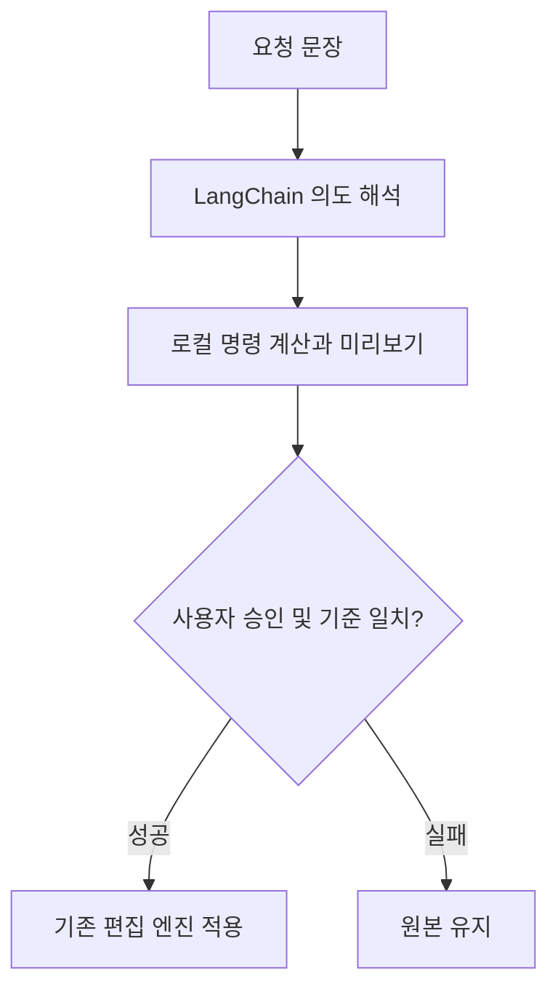

곡을 편집할 때 믹서에서 리드 보컬을 찾고 페이더를 조작하는 대신 다음 문장으로 작업할 수 있다면 어떨까요?

> > 선택한 보컬을 3 dB 내려줘.

어엿비에 이 기능을 추가하려고 했어요. 단순한 게인 변경부터 시작했지만, 이후에는 리듬이나 편곡 후보를 자연어로 시험해 보는 경험으로 발전시키고 싶었어요.

[어엿비 macOS 베타 다운로드](https://github.com/whizzkid1452/ayotbi-downloads/releases)


*개발 당시 실제 JUCE 앱에서 촬영한 자연어 편집 미리보기. 고정 모델 응답을 사용한 로컬 통합 검증 화면이에요.*

## [sort1] 1. OpenAI 직접 호출로 편집 계획을 만들다

초기 웹 브리지 프로토타입에서 OpenAI Responses API에 문장과 제한된 편집 맥락을 전달해, 허용된 편집 계획을 반환받는 방식부터 시험했어요. 이후 데스크톱에서는 모델에 현재 프로젝트 상태를 추측하도록 맡기지 않고 요청 문장의 의미 해석부터 분리했어요.

예를 들어 다음 두 요청은 같은 숫자를 포함하지만 의미가 달라요.

| 요청 | 현재 게인 | 변경값 |
| --- | --- | --- |
| 3 dB 내려줘 | -6 dB | -9 dB |
| -3 dB로 맞춰줘 | -6 dB | -3 dB |

모델은 상대 게인과 절대 게인을 구분하고 대상을 선택했는지 또는 이름을 지정했는지 알려주면 돼요. 실제 객체 ID와 현재 값은 로컬 앱에서 찾아요.

## [sort1] 2. LangChain과 Zod로 의도 해석을 분리하기

단일 턴의 수치 편집에서는 여러 에이전트가 협력하거나 모델을 여러 번 호출할 필요가 없었어요. 직접 API 호출로도 가능했지만, 이후 해석기를 편집 로직과 분리하는 목적으로 LangChain의 OpenAI 어댑터를 연결했어요.

실제 코드의 핵심 부분이에요. 모델 설정 및 오류 처리 일부를 생략했어요.

```ts
const model = new ChatOpenAI({
  model: modelName,
  useResponsesApi: true,
  // API 키와 타임아웃 설정은 생략
}).withStructuredOutput(modelResponseSchema, {
  method: "jsonSchema",
  strict: true,
  name: "ayotbi_edit_intent",
});

const reply = await model.invoke(messages);
const parsed = intentSchema.safeParse(reply);
if (!parsed.success) throw new Error("잘못된 편집 의도");
```

구조화된 결과를 받았다고 바로 실행하지 않아요. Zod에서 게인의 값이 숫자인지, 음소거에는 참 또는 거짓만 들어오는지, 조회와 변경이 섞이지 않았는지 확인해요. 지원하지 않는 요청 또는 수치가 모호한 요청은 안내나 질문으로 반환해요.

현재 지원 범위는 트랙과 오디오 클립의 게인 조회 및 변경, 트랙 음소거와 솔로예요. 모델에 전달하는 사용자 데이터는 입력 문장뿐이고 곡의 선택 상태, 객체 ID, 실제 값은 로컬에 남겨요.

LangChain 어댑터 의존성과 Node.js 실행 환경이 추가되었지만, 모델 응답 형식과 실제 편집 명령이 한 로직에 얽히지 않도록 할 수 있었어요. 현재 구현은 LangGraph나 자율 에이전트, RAG를 사용하지 않아요.

## [sort1] 3. 실제 값과 편집 명령은 앱에서 계산하기

로컬 앱은 모델이 반환한 대상 정보에 따라 현재 선택된 트랙이나 클립을 바로 찾거나, 이름으로 지정된 경우 프로젝트 목록에서 일치하는 객체를 탐색해요. 이름이 없거나 여러 트랙이 겹치면 임의로 바꾸지 않고 안내나 확인 질문으로 돌려보내요. 이렇게 대상을 확정한 뒤 상대값과 절대값을 계산하는 실제 로직을 발췌했어요.

```ts
const currentGainDb = z.number().parse(target.values.gainDb);
const requestedGainDb = z.number().parse(operation.value);
const gainDb = operation.action === "adjust_gain"
  ? currentGainDb + requestedGainDb
  : requestedGainDb;

const command = operation.target === "track"
  ? { name: "track.set_gain", args: { trackId: target.id, gainDb } }
  : { name: "audio.set_gain", args: { clipId: target.id, gainDb } };
```

계산한 명령과 당시 프로젝트의 revision, 활성화 세대, 고유 요청 ID를 읽기 전용 미리보기 API에 전달해요. 모델 응답을 그대로 화면에 보여주는 대신 실제 편집 엔진이 반환한 변경 전후 값을 표시해요.


*동일 데모 곡의 기존 화면. 자연어 패널을 붙이기 전에도 같은 편집 엔진과 Undo를 사용했어요.*

CLI에서 시작한 해석과 미리보기 로직을 데스크톱 패널에서도 공유하도록 했어요. 그래서 UI에 새 동작 경로를 만들지 않고 기존 프로젝트 세션에 연결할 수 있었어요.

## [sort1] 4. 확인했던 내용 그대로만 실행하기

현재 값이 -6 dB일 때 -9 dB로 내리는 미리보기를 만든 뒤, 사용자가 직접 페이더를 바꿔 -8 dB가 되었다면 어떻게 해야 할까요?

다시 계산하거나 오래된 값 그대로 실행하는 대신, 기준 revision을 재검사했어요. 사용자가 승인한 동일한 요청을 보내 적용 티켓을 받은 뒤 실행해요. 실제로 값을 바꾸기 전 모델을 다시 호출하지 않아요.



적용에 성공했는데 응답이 유실될 수 있는 조건도 고려했어요. -3 dB를 내리는 요청을 두 번 새로 실행하면 원래 의도와 다른 값으로 바뀌어요. 그래서 적용 결과가 불확실한 경우 이미 승인한 요청 ID의 실행 결과를 조회하고, 확인할 수 없다면 자동으로 재실행하지 않아요.

이 원장은 현재 곡의 활성화 세대(generation) 안에서 메모리에 유지하므로 앱이 재시작한 경우까지 영속적으로 중복 방지를 보장하지는 않아요.

## [sort1] 5. 실제 앱에서 미리보기부터 Undo까지 확인했어요

| 검증 단계 | 리드 보컬 게인 |
| --- | --- |
| 편집 전 | 0 dB |
| 미리보기 표시 | 0 dB |
| 적용 승인 | -3 dB |
| Undo | 0 dB |

한국어 사례 30개의 고정 모델 응답 및 스키마 검사, 앱 통합, 응답 유실과 Undo 검사까지 AI 편집 테스트 34/34를 통과했어요. macOS 환경의 앱 통합 테스트까지 모두 통과했어요.

API 키가 없는 환경에서 고정 응답으로 실행한 결과이므로 실제 OpenAI의 한국어 해석 정확도나 속도, 비용이 검증됐다는 의미는 아니에요. 초기 프로토타입에 명확한 요청 100개와 모호한 요청 50개의 평가 데이터를 준비했지만 실제 모델로 품질을 측정하는 것은 후속 과제예요.

## [sort1] 6. 앞으로 리듬 후보를 만들 때는 무엇이 달라질까?

초기 웹 실험에서는 외부 생성 모델 대신 C++의 결정적인 규칙으로 여백, 박자 이동, 반복과 채우기라는 리듬 후보를 만들어 봤어요. 예를 들어 킥 스텝 1, 5, 9, 13은 후보 생성 중 유지되고 첫 후보를 적용하면 5, 13만 남았어요. Undo로 복원됐고요.

아직 최신 데스크톱 AI 편집과 연결된 기능은 아니에요. 사용자가 후보를 듣고 선택할 때까지 기다리는 다중 턴 흐름을 구현한다면 직접 상태를 관리하는 방식과 [LangGraph](https://docs.langchain.com/oss/python/langgraph/overview)의 실행 그래프, 체크포인트 방식을 비교할 예정이에요.

어떤 모델이나 에이전트를 선택하더라도 중요한 것은 동일하다고 생각해요. 의도를 해석하는 모델과 실제 상태를 검증하고 확정하는 앱의 역할을 구분하는 것이에요.

다음 편에서는 다시 협업 이야기로 돌아가, 서로 다른 플러그인을 설치한 환경에서도 원본을 훼손하지 않고 함께 작업할 수 있게 만든 과정을 살펴볼게요.

## [sort1] 시리즈 읽기
- 이전 글  [\[Part 5.\] 음악 프로젝트에 Git과 3-way Merge 구현하기](/posts/ayotbi-git-collaboration)
- 다음 글  [\[Part 7.\] 서로 다른 플러그인 환경에서도 협업할 수 있는 DAW 만들기](/posts/ayotbi-missing-plugins)
- 시리즈 첫 글  [\[Part 1.\] 음악을 만들던 개발자가 DAW를 만들기까지](/posts/ayotbi-architecture)
- [함께 읽으면 좋은 기초 글: RAG, LangChain, LangGraph](/posts/rag-langchain-langgraph)
