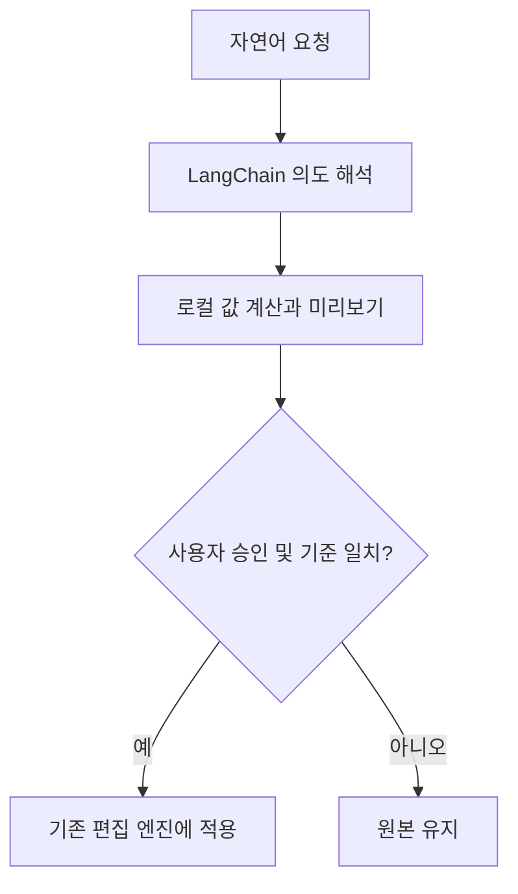

음악 작업을 하다가 믹서에서 보컬 트랙을 찾아 페이더를 조작하는 대신 이렇게 부탁할 수 있다면 어떨까 생각했어요.

> 선택한 보컬을 3 dB 내려줘.

자연어를 편집 명령으로 바꾸는 것 자체는 LLM으로 가능해 보여요. 그런데 정말 어려웠던 부분은 그 명령을 어떻게 곡에 반영하느냐였어요. 모델이 요청을 다르게 해석할 수도 있고, 답변이 오는 사이에 제가 직접 곡을 수정할 수도 있으니까요.

결국 모델에는 문장의 의미를 해석하는 역할만 맡기고, 실제 곡을 변경할지 결정하는 권한은 기존 편집 엔진에 남겼어요.

[어엿비 macOS 베타 다운로드](https://github.com/whizzkid1452/ayotbi-downloads/releases)

## [sort1] 1. -3이라는 숫자를 반환했다고 정답은 아니에요

두 문장을 비교해 볼게요.

| 요청 | 현재 게인 | 바뀌어야 할 값 |
| --- | ---: | ---: |
| 3 dB 내려줘 | -6 dB | -9 dB |
| -3 dB로 맞춰줘 | -6 dB | -3 dB |

두 요청 모두 -3이라는 숫자를 반환할 수 있지만, 하나는 상대값이고 다른 하나는 절대값이에요. JSON 스키마에 맞춰 값을 받는 것과 그 값이 사용자의 의도에 맞는 편집인지는 다른 문제였어요.

초기 웹 프로토타입에서는 OpenAI Responses API를 직접 호출했어요. 이후 데스크톱 구현에서는 지원할 의도를 트랙과 오디오 클립의 게인 조회 및 변경, 트랙 음소거와 솔로로 제한했어요.

'조금 내려줘'처럼 수치가 모호하면 되묻고, 지원하지 않는 기능이 포함되면 부분 편집을 제안하지 않아요. 실제 대상의 ID와 현재 값은 앱에서 찾기 때문에 모델이 프로젝트 데이터를 추측할 필요도 없어요.

## [sort1] 2. LangChain을 사용하고 LangGraph는 사용하지 않은 이유

모델을 부르는 단계에서는 LangChain의 `ChatOpenAI`와 `withStructuredOutput()`을 사용했어요. 직접 API를 호출했을 때보다 모델 응답과 편집 코드를 분리하기 쉬웠고, 이후에는 같은 편집 로직에서 다른 해석기를 붙일 수 있게 했어요.

실제 흐름을 간단히 줄인 TypeScript 예시예요.

```ts
const interpreter = model.withStructuredOutput(responseSchema, {
  method: "jsonSchema",
  strict: true,
});
const response = await interpreter.invoke(messages);
const intent = intentSchema.parse(response);
```

구조화 출력으로 받은 데이터는 Zod에서 한 번 더 의미 규칙을 검사해요. 게인에는 숫자, 음소거에는 불리언만 허용하고 조회와 변경을 한 요청에 섞지 않아요.

이때 모델에 전달하는 사용자 데이터는 요청 문장뿐이에요. 프로젝트의 실제 ID와 값, 선택 상태는 로컬에 남겨요.

지금은 모델 호출 한 번으로 의도를 해석하고, 나머지를 앱의 코드로 처리할 수 있어요. 복잡한 에이전트 실행 그래프는 필요하지 않았습니다. 어댑터 의존성과 Node.js 실행 환경이 늘어난다는 비용도 있으니, 단순한 작업에는 직접 호출도 여전히 합리적인 대안이라고 생각해요.

현재 어엿비의 자연어 편집은 LangChain을 사용하지만 LangGraph, 자율 에이전트 실행 및 RAG는 구현하지 않았어요.

## [sort1] 3. 사용자가 확인한 편집과 실제 실행하는 편집을 같게

예를 들어 미리보기에서 -6 dB인 보컬을 -9 dB로 바꾸려고 했는데, 확인하는 동안 사용자가 페이더를 -8 dB로 바꿨다면 어떨까요?

그때 새 값에서 3 dB를 다시 빼는 건 사용자가 처음 확인한 변경과 다르고, 그냥 -9 dB를 적용하는 것도 새 편집을 덮어버리는 일이 될 수 있어요.

그래서 미리보기에는 기준 revision과 고유 요청 ID를 포함하고, 승인 시점에는 모델을 다시 호출하지 않고 동일한 요청을 검증해 적용 티켓을 얻어요. 기준 revision이 바뀌었다면 이전 미리보기를 거절하고 다시 확인하도록 안내해요.



현재 구현에서 '선택한 보컬을 3 dB 내려줘'는 모델이 상대 게인 변경 의도를 반환하고, 앱이 선택된 트랙을 찾아 값을 계산하는 방식이에요. 같은 이름의 트랙이 여러 개라면 선택지를 보여줘요.

읽기 전용 미리보기는 곡의 revision이나 Undo 이력을 바꾸지 않아요. 여러 편집도 하나의 요청으로 묶어서 승인한 뒤 적용하고, 한 번에 되돌릴 수 있어요.

## [sort1] 4. 성공했는데 응답만 잃어버리면요?

상대값 편집이라면 특히 조심해야 해요. -3 dB를 실제 적용했는데 응답이 유실된 경우, 새 요청으로 다시 실행하면 -6 dB가 내려갈 수도 있으니까요.

적용 결과가 불확실하면 새 편집을 보내는 대신 기존 요청 ID의 처리 결과를 조회하게 했어요. 결과를 확인할 수 없으면 자동 실행하지 않고 불확실한 상태로 안내해요.

편집 엔진의 요청 기록은 메모리에 존재해요. 현재 프로젝트 활성화 세대 안에서는 중복 적용을 방지할 수 있지만, 앱 재시작을 넘는 영속적인 실행 보장까지 제공하지는 않아요.

## [sort1] 5. 실제 앱에서 무엇을 확인했을까?

고정 모델 응답을 연결한 macOS 데모 앱에서 실제 AI 편집 패널을 열어봤어요. 선택한 보컬의 게인이 처음에는 0 dB이고, 3 dB를 내리는 요청에 변경 전후가 표시됐어요.

| 단계 | 보컬 게인 |
| --- | ---: |
| 미리보기 전 | 0 dB |
| 미리보기 표시 | 0 dB |
| 적용 승인 | -3 dB |
| Undo | 0 dB |

한국어 사례 30개에 기대 모델 응답을 고정한 회귀 테스트와 대상 검증, 응답 유실 및 앱 통합 검사를 포함해 AI 테스트 34/34를 통과했어요. 네이티브 macOS Debug CTest도 46/46이었어요.

다만 실제 OpenAI 모델의 한국어 해석 정확도나 응답 속도는 이 검사로 판단할 수 없어요. 고정 응답을 사용해 앱이 의도를 안전하게 반영하는지 검증했기 때문이에요. 명확한 요청 100개와 모호한 요청 50개의 모델 평가 데이터 및 dry-run 보고서는 초기 프로토타입에 준비했지만, 실제 모델을 사용한 품질 평가는 남아 있어요.

## [sort1] 6. 리듬을 만들기 시작하면 LangGraph가 필요할까?

'후렴 앞 두 마디의 킥을 조금 덜어줘'라는 요청은 단순 게인 변경과 달라요. 어떤 킥을 없앨지 정답이 하나가 아니라서 여러 편곡을 듣고 선택하고 싶을 수 있어요.

초기 웹 프로토타입에서는 외부 생성 모델 없이 C++ 규칙으로 여백, 박자 이동, 반복과 채우기 후보를 생성했어요. 원본의 킥 스텝 1, 5, 9, 13은 후보 생성 동안 유지됐고, 첫 후보를 선택하면 5, 13만 남는 결과와 Undo 복원을 확인했어요.

이 실험은 AI가 리듬을 생성한 것도, 최신 데스크톱 자연어 편집에 연결된 것도 아니에요. 이후 사용자의 추가 답변을 받고 후보를 생성해 듣고 고르는 흐름까지 연결한다면, 상태를 직접 관리할지 [LangGraph](https://docs.langchain.com/oss/python/langgraph/overview)의 그래프와 체크포인트를 사용할지 비교해 볼 수 있어요.

다중 턴에서도 기준은 같아요. AI는 의도를 해석하고 후보를 제안할 수 있지만, 곡의 최종 검증과 변경 권한은 프로젝트를 소유한 엔진에 있어야 해요. 저는 이 경계가 모델 선택보다 먼저 설계해야 하는 부분이라고 생각해요.
