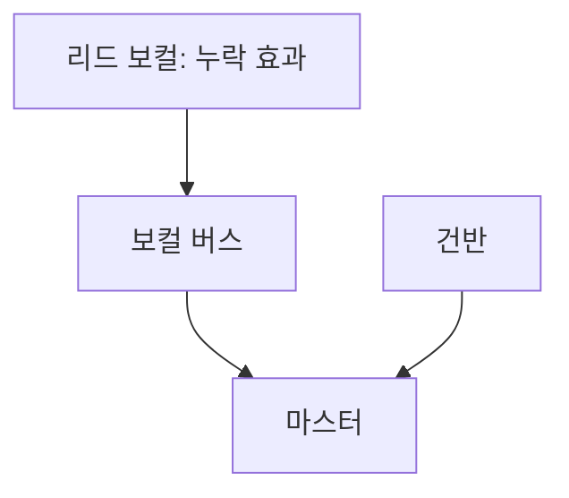

음악가에게서 곡을 전달받았는데 보컬에 걸린 컴프레서가 내 컴퓨터에 없다면 어떻게 해야 할까요? 건반의 볼륨만 바꾸고 싶은데, 플러그인을 모두 설치해야만 작업을 시작할 수 있는 건 불편해요.

어엿비에서도 기존에는 하나라도 누락된 플러그인이 있으면 프로젝트 열기를 중단했어요. 그래서 저장 상태를 유지하되, 현재 환경에서 안전하게 할 수 있는 작업은 이어갈 수 있도록 열기와 편집, 렌더의 규칙을 나눠 구현했어요.

[어엿비 macOS 베타 다운로드](https://github.com/whizzkid1452/ayotbi-downloads/releases)

## [sort1] 1. 누락된 플러그인이 있는 곡을 열기

플러그인을 그냥 빼고 열면 당장은 편집할 수 있겠지만, 전달받은 곡에서 원래 효과 설정이나 자동화, 연결이 사라질 수 있어요. 그 상태로 공유하면 원래 제작자도 의도한 소리를 복원하기 어려워져요.

읽기 전용 렌더 청취는 외부 플러그인 없이 송신자의 음원을 들려줄 수 있지만, 곡의 다른 트랙을 실제 편집한다는 요구를 해결하지는 못했어요.

그래서 원본 프로젝트 모델의 누락 인스턴스, 상태 해시와 설정을 유지하고, 재생용 파생 모델에서만 지금 환경에 없는 플러그인을 제외했어요. 누락 플러그인의 설정과 관계를 훼손하는 편집은 검증 단계에서 거절해요.


*실제 누락 플러그인 테스트 곡을 열었을 때의 화면. 리드 보컬의 누락 인스턴스 및 영향 경로가 표시되고 곡은 열려 있어요.*

## [sort1] 2. 누락의 영향 범위를 그래프로 계산하기

리드 보컬의 컴프레서가 누락됐다면 보컬 트랙만 문제가 있는 걸까요? 보컬이 버스를 거쳐 마스터로 향하면 전체 믹스에도 영향을 미쳐요. 사이드체인과 악기의 보조 출력이 있다면 다른 경로까지 관련될 수 있고요.



실제 코드에서는 영향을 받는 트랙과 누락 플러그인 인스턴스의 쌍을 큐에 넣어 방문해요. 같은 조합이 이미 발견됐으면 다시 넣지 않아요.

```cpp
std::deque<std::pair<Id, Id>> work;
const auto mark = [&](const Id& track, const Id& instance) {
    if (impact.signalsByTrack[track].insert(instance).second)
        work.emplace_back(track, instance);
};
```

초기 누락 인스턴스에서 시작해서 출력, 센드, 사이드체인과 보조 출력으로 범위를 전파해요. 비활성, 고정(Freeze)된 트랙 및 우회 플러그인은 조건에 맞춰 제외하고, 음소거된 트랙도 사이드체인의 입력이 될 수 있다는 점은 별도로 고려해요.

## [sort1] 3. 편집할 수 있는 트랙과 내보낼 수 있는 신호는 달라요

건반 신호는 보컬 플러그인에 의존하지 않을 수 있어요. 따라서 건반의 게인은 바꾸고 저장할 수 있지만 보컬 플러그인이 필요한 전체 믹스는 완전하지 않아요.

렌더를 준비할 때는 실제 출력 대상에 맞춰 라우팅을 분리하고, 활성 신호 경로를 검사해 필요한 플러그인이 누락됐는지 다시 계산해요.


*동일한 누락 플러그인 테스트 곡의 실제 내보내기 화면. 전체 믹스 제외 조건에서 stem-keys.wav만 예정 목록에 표시돼요.*

이렇게 부분적으로 편집하고 결과를 공유할 수 있게 하되, 불완전한 전체 믹스를 정상 출력처럼 전달하는 일을 막았어요.

원래 환경에서 다시 프로젝트를 열면 보존해 둔 플러그인 상태와 자동화, 배선을 복원해요. 그만큼 저장 모델과 재생용 모델 사이의 상태 보존 규칙을 유지해야 하는 비용도 있어요.

## [sort1] 4. 실제 VST3로 복원 결과를 비교했어요

같은 Mac에 플러그인이 등록된 세션과 등록되지 않은 세션을 준비했어요. 누락 환경에서 독립 트랙의 게인을 -6 dB로 바꿔 저장하고 정상 스템의 신호 레벨을 확인했어요. 전체 믹스와 종속 버스 스템은 거절됐어요.

그 뒤 플러그인이 다시 등록된 세션으로 전달해 원래 상태와 자동화 및 배선을 확인했어요. 48 kHz 스테레오 96,000프레임의 기준 스템과 복원본의 PCM을 비교했어요.


*타사 VST3 복원 시험에서 실제로 열어 확인한 네이티브 편집기.*

| 타사 VST3 | 상태 복원 | PCM 비교 |
| --- | --- | --- |
| Kilohearts kHs Gain 2.4.3 | 통과 | 모든 샘플 일치 |
| Kilohearts kHs Filter 2.4.3 | 통과 | 모든 샘플 일치 |
| ValhallaFreqEcho 1.2.8 | 통과 | 판정 보류 |

ValhallaFreqEcho는 누락 복원 이전에도 같은 저장본의 두 렌더가 서로 달랐어요. 플러그인 상태가 복원됐다고 결과 샘플의 동일성을 주장할 수 없었어요. kHs Gain의 Bypass는 두 단계만 지원해서 이전 검사에서 0.25를 기록하면 복원 시 0으로 돌아왔고, 이 문제를 더 잘 진단하도록 파라미터의 전후 값을 보고하게 바꿨어요. 설치된 FabFilter Micro 번들은 x86_64만 포함해 arm64 호스트에선 스캔할 수 없었어요.

## [sort1] 5. 이어갈 수 있는 작업과 완전한 결과를 구분하기

누락 VST3를 보존한 편집 구현 당시 한 Mac에서 카탈로그를 바꾼 왕복 시험을 세 차례 통과했고, macOS와 헤드리스 환경의 관련 테스트를 모두 통과했어요. 물리적으로 다른 협업자의 두 PC, 서로 다른 플러그인 버전과 라이선스, 외부 샘플이 있는 환경은 아직 검증해야 해요.

어엿비를 만들기 시작했을 때에는 곡을 나눠 작업하고 다시 합치는 경험에 집중했어요. 구현해 보니 단순히 곡을 열고 편집하는 것보다 원본을 보존하면서 가능한 작업과 검증된 출력의 조건을 구별하는 것이 중요했어요.

앞으로도 실제 음악 제작 환경에서 이런 조건을 검증하며 제품을 발전시켜 나가고 싶어요.

## [sort1] 시리즈 읽기
- 이전 글  [\[Part 6.\] LangChain으로 자연어 음악 편집 기능 구현하기](/posts/ayotbi-langchain-editing)
- 시리즈 첫 글  [\[Part 1.\] 음악을 만들던 개발자가 DAW를 만들기까지](/posts/ayotbi-architecture)
