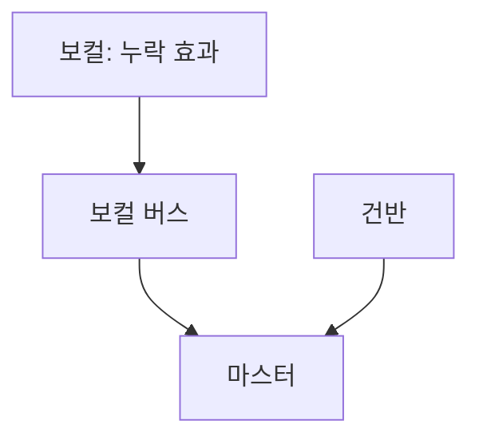

누군가 보낸 곡을 열었는데 보컬에 걸린 컴프레서가 제 컴퓨터에 없다는 메시지가 뜬다고 해볼게요. 저는 건반 볼륨만 바꾸면 되는데, 그 컴프레서를 설치할 때까지 작업할 수 없다면 어떨까요?

어엿비를 만들면서 협업에 필요한 프로젝트 열기 기능을 검증하다가 이 문제를 마주했어요. 기존 구조에서는 실행 엔진이 프로젝트의 플러그인을 모두 준비해야 했어요. 하나라도 누락되면 열기를 중단했죠.

곡을 열 수 있게 만드는 것만으로 해결되는 문제는 아니었어요. 누락된 플러그인의 원래 설정은 보존하면서, 어떤 트랙에 영향이 미치는지 구분해야 했거든요.

[어엿비 macOS 베타 다운로드](https://github.com/whizzkid1452/ayotbi-downloads/releases)

## [sort1] 1. 없다고 그냥 빼버리면 다시 돌려받을 수 있을까?

누락된 플러그인을 제외하고 프로젝트를 열면 정상 트랙을 편집할 수 있어요. 문제는 그 상태로 저장하고 원래 작업자에게 돌려줄 때예요.

재생 가능한 엔진의 플러그인 상태만 저장한다면 실행하지 못한 컴프레서의 파라미터나 자동화, 배선까지 사라질 수 있어요. 컴프레서가 빠진 WAV를 완성된 믹스로 잘못 전달할 수도 있고요.

어엿비에는 이미 플러그인 없이 렌더된 WAV를 듣는 읽기 전용 기능이 있었어요. 듣기만 하면 이 방식이 유용하지만, 새로운 편곡을 만들려는 사람에게는 편집 가능한 곡이 필요했어요.

그래서 저장할 프로젝트 모델과 현재 컴퓨터에서 재생할 실행 상태를 분리했어요. 누락된 플러그인의 상태 해시와 파라미터, 자동화와 연결 정보는 원본 모델에서 유지하고, 실행 상태는 사용 가능한 장치만으로 준비해요.

## [sort1] 2. 영향받는 트랙을 찾는 문제가 더 어려웠어요

보컬 트랙의 컴프레서가 빠졌다고 보컬 트랙 하나만 확인하면 충분할까요?

위와 같이 보컬이 버스를 거쳐 마스터로 향한다면 전체 믹스에도 누락된 효과의 영향이 있어요. 사이드체인처럼 다른 트랙의 신호를 효과의 입력으로 사용하는 경우에는 범위가 더 넓어질 수 있고요.

실제 코드에서는 누락 플러그인을 사용하는 트랙에서 출발해 라우팅, 센드, 사이드체인과 악기 보조 출력을 연결한 그래프를 따라 영향 범위를 계산해요. 마스터 신호에 기여하는 경로도 렌더할 대상과 조건에 맞춰 확인해요.

누락된 플러그인의 상태를 훼손하는 편집은 거절하지만, 그 경로에 의존하지 않는 건반 트랙의 게인은 조절할 수 있어요. 전체 믹스는 불완전할 수 있으니 출력에 필요한 장치가 없다면 막고 사유를 보여줍니다. 정상 트랙의 독립 스템은 내보낼 수 있고요.

이렇게 곡을 여는 조건과 편집하는 조건, 완성본을 출력하는 조건을 따로 설계했어요. 덕분에 사용자가 작업을 계속할 수는 있지만 어떤 소리가 원래 의도와 달라지는지도 알 수 있어요.

## [sort1] 3. 플러그인이 돌아왔을 때 정말 같은 소리가 날까?

2026년 11월 20일 같은 Mac에서 플러그인이 등록된 환경, 등록되지 않은 환경, 다시 등록한 환경으로 곡을 전달하는 검증을 했어요. 누락 상태에서 정상 트랙을 수정하고 저장한 뒤 원래 플러그인의 상태, 자동화와 배선을 복원했어요.

여기서 상태가 복원됐다고 바로 끝내지 않았어요. 같은 저장본으로 두 번 렌더한 기준 스템과 누락 상태를 거쳐 복원한 스템을 48 kHz 스테레오 96,000프레임 조건에서 직접 비교했어요.

| 테스트한 타사 VST3 | 복원 결과 | PCM 비교 |
| --- | --- | --- |
| Kilohearts kHs Gain 2.4.3 | 통과 | 모든 샘플 일치 |
| Kilohearts kHs Filter 2.4.3 | 통과 | 모든 샘플 일치 |
| ValhallaFreqEcho 1.2.8 | 통과 | 기준 출력끼리도 차이가 있어 판정 보류 |

흥미롭게도 ValhallaFreqEcho는 복원 이전부터 같은 저장본을 두 번 출력한 결과에 샘플 차이가 있었어요. 그래서 이 효과까지 동일하게 복원됐다고 주장하지 않았어요. 플러그인의 상태를 복원하는 것과 그 플러그인이 매번 동일한 샘플을 출력하는 것은 별개의 조건이더라고요.

또 다른 환경 제약도 있었어요. 설치된 FabFilter Micro 번들은 x86_64만 포함하고 있어 arm64 호스트가 스캔할 수 없었어요. 플러그인을 찾는 것만으로 호환성이 보장되지 않는다는 점도 확인했습니다.

## [sort1] 4. 작업을 이어갈 수 있다는 것과 결과의 완전성은 달라요

기존 회귀 검사에서는 누락된 VST3가 있는 곡을 열고, 정상 트랙 게인을 -6 dB로 바꿔 저장한 뒤 WAV에 반영되는 것을 확인했어요. 누락 플러그인에 의존하는 출력은 거절됐고, 플러그인이 돌아오면 원래 상태를 다시 사용할 수 있었어요.

다만 같은 Mac의 환경을 바꿔 진행한 시험이에요. 서로 다른 협업자 PC 두 대에서, 다른 플러그인 버전과 라이선스 및 외부 샘플을 함께 사용하는 환경까지 검증한 것은 아니에요.

어엿비 구현기를 시작할 때에는 곡을 여러 사람과 자유롭게 나눠 작업하는 경험을 만들고 싶었어요. 마지막에 와서 더 중요하다고 느낀 건 문제가 있는 상태에서도 사용자가 자신의 편집을 잃지 않고, 불완전한 결과를 완성된 것처럼 오해하지 않는 것이었어요.

이 프로젝트는 앞으로도 그런 경계들을 실제 음악 작업에서 검증하면서 발전시키고 싶어요.
