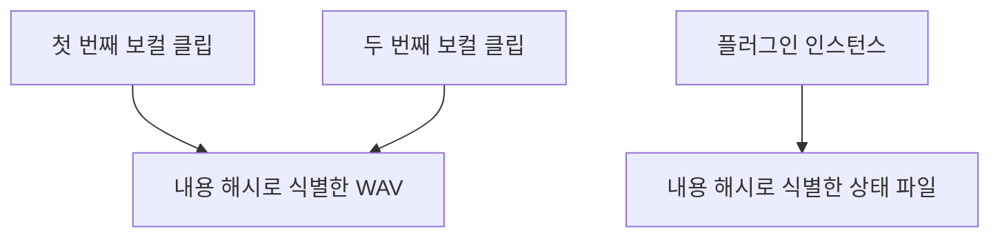
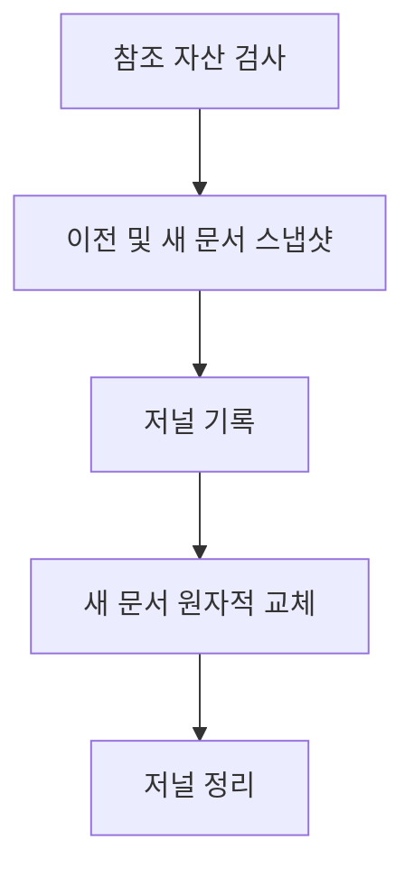

어떤 작업을 하든 저장 버튼을 누른 뒤 앱이 꺼지는 순간만큼 불안한 때는 없죠. 특히 녹음과 편집을 하는 DAW는 프로젝트 파일 하나뿐 아니라 원본 오디오, MIDI, 플러그인의 설정까지 함께 살아 있어야 해요.

어엿비의 저장을 구현하면서 던진 질문은 '어떻게 더 자주 저장할까?'보다 '저장이 중간에 끊겨도 무엇을 다시 열 수 있을까?'에 가까웠어요. 그래서 명시적으로 저장한 곡과 작업 중인 초안을 분리했고, 여러 파일의 관계를 검증하는 저장 경계를 만들었어요.

[어엿비 macOS 베타 다운로드](https://github.com/whizzkid1452/ayotbi-downloads/releases)

## [sort1] 1. project.json은 멀쩡한데 소리가 나지 않는 이유

보컬 파일 하나를 복제해서 후렴에 두 번 배치했다고 생각해 보세요. 클립은 두 개지만 같은 WAV를 참조해요.

프로젝트에 오디오 파일의 외부 절대 경로만 기록하면 간단하지만, 파일을 다른 폴더로 옮기거나 협업자에게 전달했을 때 참조가 깨져요. 그렇다고 각 클립에 WAV를 통째로 넣으면 같은 데이터가 반복돼요.

그래서 원본 파일의 바이트를 SHA-256으로 해시하고, 그 값으로 자산을 식별했어요. 파일을 가져올 때는 임시 영역에 복사하면서 해시를 계산하고, 완료한 자산만 최종 위치에 옮겨요. 동일한 내용은 검증 후 재사용하고, 이미 같은 해시의 경로에 있는 파일이 손상돼 있다면 조용히 덮어쓰지 않아요.

이 구조에서 프로젝트 JSON은 어떤 소리를 어디에 배치하는지 설명하고, 큰 바이너리는 별도로 보관해요. 데이터가 많아지면 해시 검사와 I/O 비용은 생기지만, 곡의 참조가 올바른지 확인할 수 있고 이후 Git LFS를 연결하기도 좋아요.

## [sort1] 2. 원자적 파일 교체만으로는 부족했어요

JSON을 안전하게 쓰는 방법으로 임시 파일에 전부 쓴 다음 이름을 바꿔 교체하는 방식이 있어요. 절반만 써진 JSON을 읽는 상황을 줄일 수 있죠.

하지만 곡에서 중요한 건 JSON 하나가 멀쩡한 것뿐 아니라 파일들이 유효한 상태로 함께 존재하는 것이에요. 저장 요청이 완료됐다는 응답이 오기 전에 프로세스가 끝날 수도 있어요.

그래서 어엿비는 다음 저장을 시작하기 전에 기존 문서와 새 문서의 스냅샷을 준비하고, 이전 해시와 새 해시를 기록한 저널을 남겨요. 저널은 어디까지 저장하려고 했는지 판단할 수 있는 기록이에요.

다시 열 때 남은 저널을 확인해요. 현재 문서가 저널의 이전 또는 새 해시와 일치하고 참조도 유효하면 해당 문서를 유지해요. 문서가 손상된 경우에는 저널이 가리키는 이전 스냅샷(첫 저장이면 새 스냅샷)을 검증하고 복원해요.

그런데 전혀 다른 내용의 문서가 있다면 어떻게 할까요? 다른 프로세스가 수정했을 수도 있어요. 이 경우에는 자동으로 덮어쓰지 않고 충돌을 반환해요. 명시적 저장 시에도 현재 파일의 해시와 처음 열었던 해시가 다르면 저장을 거절하는 이유예요.

## [sort1] 3. 자동 저장은 왜 project.json을 덮어쓰지 않을까?

자동 저장은 사용자가 저장 버튼을 누르는 것과 의미가 달라요. 작업 중인 변경을 복구하고 싶을 수는 있어도 그 변경을 확정된 저장본으로 만들고 싶은 것은 아닐 수 있죠.

그래서 SQLite에 복구 후보를 따로 남겼어요. 자동 저장은 약 10초 간격으로 시도하지만 다른 파일 작업이나 이전 자동 저장이 진행 중이면 미뤄져요. 따라서 최근 10초만 잃는다고 보장하는 구조는 아니에요.

| 구분 | 명시적 저장 | 자동 저장 |
| --- | --- | --- |
| 목적 | 현재 곡 확정 | 작업 중 초안 복구 |
| 위치 | project.json과 자산 | 로컬 SQLite |
| Undo와 Git 이력 | 편집 이력을 그대로 유지 | 변경하지 않음 |

재생 중에는 플러그인의 전체 상태를 수집하지 않고 편집 초안으로 기록해요. 복구할 때는 마지막 수집 상태를 쓴다는 제약을 표시합니다. 정지 상태에서 같은 revision의 모델과 플러그인 상태를 수집하면 더 완전한 복구 후보를 남길 수 있어요.

## [sort1] 4. 저장에 성공했다는 말을 어디까지 믿을 수 있을까?

macOS arm64에서 저장 단계별로 실패를 주입하고 자식 프로세스를 실제 종료해 복구를 검사했어요. 문서와 자산 손상, 오래된 문서의 저장 거절, 자산 쓰기 실패로 부분 파일이 공개되지 않는 경우도 확인했어요.

전원 차단이나 대형 프로젝트에서 전체 해시를 검사할 때의 비용은 별도로 측정해야 해요. 프로세스 종료 시험 결과만으로 파일 시스템과 장치의 전원 차단 내구성을 보장할 수는 없으니까요.

이번 작업을 하면서 저장 빈도와 복구의 신뢰성은 서로 다른 문제라는 생각을 했어요. 무엇이 확정됐는지, 어디까지 복구할 수 있는지, 어느 상황에서 자동 복구하면 안 되는지를 먼저 정의하는 편이 중요했어요.

이렇게 한 곡의 상태를 설명하는 문서가 생겼으니, 다음 글에서는 두 사람이 만든 다른 버전의 곡을 어떻게 합칠 수 있었는지 살펴볼게요.
