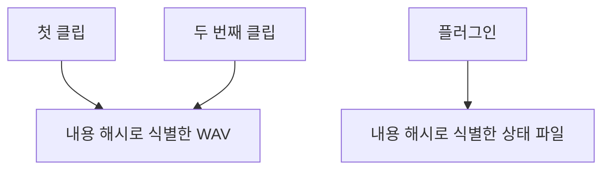

곡을 저장했다는 것을 어떻게 판단할 수 있을까요? DAW에서 프로젝트 JSON 하나가 정상적으로 쓰였더라도 참조하는 WAV가 없다면 곡을 재생할 수 없어요. 플러그인의 설정을 함께 기록하지 못했다면 작업 당시의 소리도 달라질 수 있고요.

어엿비는 인터넷에 연결하지 않아도 제작할 수 있는 Local-first 앱으로 만들고 있었어요. 그래서 로컬의 원본을 신뢰할 수 있도록 저장 규칙부터 정하고, 이후 작업 중 초안 복구를 구현했어요.

[어엿비 macOS 베타 다운로드](https://github.com/whizzkid1452/ayotbi-downloads/releases)

## [sort1] 1. 같은 WAV를 여러 번 사용하는 곡의 파일 구조

후렴의 보컬을 두 번 사용하는 곡이라면 두 클립이 같은 오디오 파일을 참조해요. 외부 파일 경로만 저장하는 방식은 간단하지만 원본 위치가 이동하면 참조가 깨져요. 반대로 JSON에 매번 전체 WAV 데이터를 넣으면 저장본이 불필요하게 커지고요.

그래서 원본 파일의 바이트를 SHA-256으로 해시하면서 임시 영역에 복사하고, 정상적으로 쓰인 자산만 최종 경로에 옮긴 뒤 프로젝트 문서에 해시를 기록하도록 했어요.



곡의 편집 데이터는 JSON, 오디오와 플러그인 상태의 바이너리는 각각 내용 해시 저장소에 둬요. 같은 내용을 다시 가져오면 기존 파일을 검증해 재사용해요. 이미 같은 해시 위치의 파일이 손상됐다면 조용히 덮어쓰지 않아요.

별도 파일을 관리하는 만큼 해시 확인과 I/O 비용은 추가되지만, 이후 Git LFS로 원본 미디어를 버전 관리할 때도 이 구조를 활용할 수 있었어요.

## [sort1] 2. 저장이 중간에 끊기면 어느 곡을 열어야 할까?

임시 파일에 JSON을 모두 쓴 다음 이름을 바꿔 원자적으로 교체하면 중간에 잘린 JSON이 공개되는 위험을 줄일 수 있어요. 그런데 곡에는 여러 파일이 참조돼요. 저장이 끝나기 직전에 앱이 종료되면 언제까지의 상태가 확정됐는지도 알아야 해요.

저장하려는 스냅샷의 참조를 검증한 뒤 기존 문서와 새 문서의 스냅샷을 각각 준비했어요. 이후 교체 전과 후의 해시를 담은 저장 저널을 남겨요.

실제 저장 코드에서 핵심 순서를 발췌했어요. 파일 잠금, 기존 해시 확인 및 오류 처리 등은 생략했어요.

```cpp
storeSnapshot(local, text);
const Json journal {
    {"version", 1},
    {"previousHash", oldHash ? Json(*oldHash) : Json(nullptr)},
    {"nextHash", nextHash},
    {"generation", snapshot.generation},
    {"revision", snapshot.revision}
};
atomicWrite(local / "staging", journalPath,
            journal.dump(2) + "\n");

StagedFile staged(local / "staging");
staged.append({text.data(), text.size()});
staged.finish();
replaceFile(staged.path(), document);
removeFile(journalPath);
```

저널을 남긴 채 종료된 경우, 다시 열면서 현재 문서가 이전 해시나 새 해시 중 어느 것인지 판단해요.

| 중단 후 상태 | 다시 열 때의 동작 |
| --- | --- |
| 기존 문서 유지 | 참조를 검증하고 기존 문서 유지 |
| 새 문서 교체 완료 | 참조 검사 후 새 문서 유지 |
| 문서 손상 또는 누락 | 저널에 기록한 이전 스냅샷, 첫 저장이면 새 스냅샷 검증 후 복원 |
| 유효하지만 저널과 다른 문서 | 외부 수정 가능성이 있으므로 자동 복구 거절 |

현재 문서와 처음 열었을 때의 해시가 달라졌다면 명시적 저장도 거절해요. 다른 프로세스에서 변경한 곡을 덮어쓰면 안 되니까요.

## [sort1] 3. SQLite에 작업 중 초안을 남기기

저장 기능을 만든 뒤 자동 저장을 연결했어요. 그런데 재생 중인 곡을 자동 저장할 때마다 플러그인의 전체 상태를 새로 수집하는 일은 적합하지 않았어요. 명시적 저장본을 주기적으로 덮어쓰면 사용자도 어느 버전을 확정했는지 알기 어려워요.

그래서 `project.json`을 변경하지 않는 별도의 SQLite 복구 저장소를 만들었어요. 약 10초 간격으로 시도하되 작업 중이면 다음 주기로 미루고, 정지 시에는 모델과 같은 revision의 플러그인 전체 상태를 기록해요. 재생 중에는 마지막으로 저장한 플러그인 상태를 참조하는 편집 초안을 남겨요.


*자동 저장 기능의 최초 구현 화면. 정지 상태에서 수집한 편집 및 플러그인 전체 상태가 표시돼요.*


*같은 검증 과정에서 재생 중 초안을 기록한 화면. 플러그인 상태가 미수집됐다는 안내가 있어요.*

SQLite에서는 기록의 payload와 내용 해시를 함께 저장하고 트랜잭션으로 삽입과 오래된 기록 정리를 처리해요. 최근 16개와 가장 최근의 완전한 플러그인 상태 기록을 보존해요. 저장 빈도는 마지막 기록 이후 10초 이하의 손실을 보장한다는 뜻이 아니에요.

복구 후보를 열 때도 같은 모델과 자산 검증을 거쳐 엔진을 준비하고 성공한 경우에만 현재 세션을 바꿔요.

## [sort1] 4. 앱 종료를 직접 발생시켜 검증했어요

자동 저장 구현 당시 macOS arm64에서 SQLite 트랜잭션 시작, 삽입, 커밋 직후 자식 프로세스를 강제 종료하고 재열기 했어요. 손상된 데이터, 누락된 자산과 미지원 스키마에서도 기존 곡이 보존되는지 확인했어요.

11월 8일 통합 검증에서는 macOS CTest 27/27, 헤드리스 CTest 14/14가 통과했어요. 실제 앱에서도 전체 상태 저장, 재생 중 초안 기록, 선택한 상태의 복구, 명시적 저장 및 다시 열기를 검증했어요.

전원 차단과 실디스크 공간 부족, 대형 파일의 해시 검사 비용은 아직 별도 검증이 필요해요.

곡의 상태와 파일의 참조를 이처럼 명시적으로 만들어 뒀기에 브랜치 간에 서로 다른 작업본을 비교할 수 있었어요. 다음 편에서는 실제 Git 이력과 음악 객체의 병합을 어떻게 연결했는지 소개할게요.
