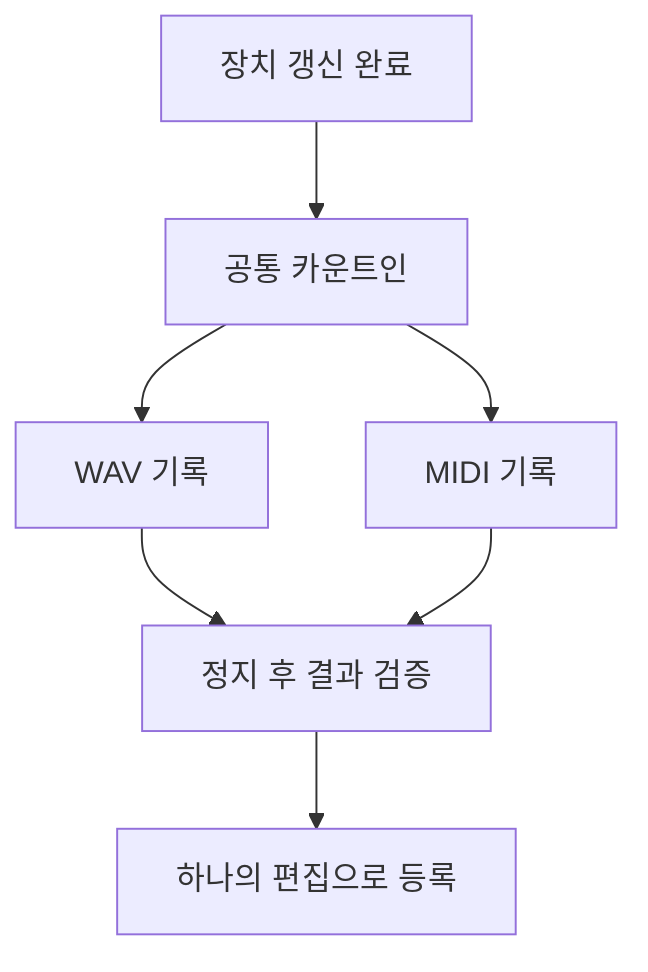

보컬을 녹음하면서 건반으로 반주를 기록할 수 있는 DAW를 만들고 싶었어요. 먼저 각 입력의 녹음 경로를 만들고 나서 두 종류의 입력을 동시에 시작하도록 확장했어요.

두 입력을 모두 준비하는 데서 예상치 못한 문제가 있었어요. MIDI 장치 검색이 뒤늦게 끝나면서 입력 컨텍스트가 다시 생성되어 오디오 녹음이 끊길 수 있었거든요.

[어엿비 macOS 베타 다운로드](https://github.com/whizzkid1452/ayotbi-downloads/releases)

## [sort1] 1. 처음에는 오디오와 MIDI 입력이 따로 있었어요


*동시 입력 기능을 만들기 전의 실제 MIDI 입력 패널. MIDI 녹음 시작 버튼과 화면 건반이 있어요.*

오디오는 일정한 샘플레이트의 파형을 기록하지만 MIDI는 음높이, 벨로시티, 이벤트 시점을 기록해요. 처음에는 각 입력을 따로 녹음하는 경로가 있었고, 이후 여러 오디오 트랙의 동시 녹음까지 구현했어요.

다음 목표는 한 오디오 입력과 MIDI 악기가 같은 시간축에서 기록되는 것이었어요.

## [sort1] 2. 장치 검색이 끝난 다음 같은 Transport에서 시작하기

MIDI 장치 검색은 비동기 작업이에요. 고정한 Tracktion 버전에서는 갱신이 늦어지면 이전 입력 컨텍스트를 바꿀 수 있었어요. 녹음 버튼을 누를 때 고정 시간을 기다리는 것으로는 장치마다 걸리는 시간이 다른 문제를 해결하기 어려워요.

장치 갱신 완료를 확인하고 두 입력을 공통 Transport에 연결했어요. Transport는 재생과 녹음 위치의 진행을 제어하는 역할이에요. 두 입력은 하나의 카운트인과 정지를 공유해요.


*동시 녹음 구현 후 같은 데모에서 촬영한 실제 화면. 오디오 입력 패널에서 MIDI 대상 Keys도 함께 지정해요. 장치를 연결하기 전 설정 화면이에요.*



녹음 중에 장치가 끊기면 불완전한 클립을 활성 곡에 추가하지 않아요. 확보한 WAV와 MIDI 원본을 로컬에 보존하고, 녹음이 완료되었을 때만 두 결과를 하나의 편집으로 등록해요.

## [sort1] 3. MIDI를 곡의 노트로 변환하는 과정

MIDI를 기록한 뒤에는 원래 이벤트를 백업하고, 프로젝트의 템포 맵에 맞춰 시작과 종료 시점을 tick으로 변환해요. 노트 범위를 녹음 클립의 구간 안으로 제한하는 실제 코드 일부예요.

```cpp
const auto left = std::max(position->value, begin->value);
const auto right = std::min(end->value, finish->value);
if (left >= right) continue;

pattern.notes.emplace(newId(), project::Note {
    { left - position->value },
    { right - left },
    note->getNoteNumber(),
    note->getVelocity()
});
```

앞부분에서는 시작과 끝의 시간 변환이 성공했는지 검사해요. 모델에서 표현할 수 없는 SysEx 등의 이벤트가 있으면 지원하지 않는 편집으로 안내하면서 MIDI 백업을 남겨요.

파일을 읽고 해시를 계산하는 작업은 I/O 작업 스레드로 보내요. 오디오 콜백은 이 작업을 기다리면 안 되기 때문이에요. 녹음 중 프로젝트 교체나 실행 상태를 통째로 바꾸는 편집은 제한했어요.

## [sort1] 4. 녹음 이후에도 같은 곡을 WAV로 만들기

편집 앱 안에서 내보내기를 실행할 수도 있지만 타사 플러그인이 멈추면 현재 작업 곡까지 영향을 받을 수 있어요. 그래서 저장된 곡을 읽는 별도 렌더 프로세스를 만들었어요.


렌더 설정과 원본 문서 해시, WAV의 포맷과 프레임 수 및 해시를 다시 확인하고 완성 패키지를 공개해요. 실패한 출력을 취소하더라도 편집 상태를 유지하는 방식이에요. 파일을 다시 읽고 별도 프로세스를 관리하는 비용은 추가됐어요.

이후에는 트랙 고정(Freeze)과 제자리 바운스 결과도 파형으로 확인하도록 발전시켰어요.


*후속 제자리 바운스 구현에서 촬영한 화면. 48,000 Hz, 2채널, 6초의 출력 파형과 Undo 복원 안내가 있어요. 전체 믹스 출력과는 별개의 트랙 렌더 기능이에요.*

## [sort1] 5. 녹음부터 재열기와 출력까지 테스트했어요

| 확인한 시나리오 | 결과 |
| --- | --- |
| 가상 오디오와 MIDI 입력 | 공통 카운트인, 동시 등록 |
| 2초 루프와 펀치 | 완주 및 부분 테이크, 구간 밖 원본 보존 |
| MIDI 연결 중단 | 확보한 원본 유지, 편집은 반영하지 않음 |
| 저장 후 다시 열기 | WAV와 MIDI 클립 복원 |
| Undo와 Redo | 한 편집으로 두 입력 복원 |

동시 녹음 시나리오를 세 차례 반복 검증했고, macOS와 헤드리스 환경의 관련 테스트를 모두 통과했어요. 실물 마이크와 MIDI 건반의 동시 입력, 장시간 부하 및 실제 왕복 지연은 미검증이에요.

녹음 결과가 생겼다는 것과 그것을 곡에 안전하게 등록했다는 것은 다른 일이더라고요. 다음 편에서는 녹음한 원본과 편집한 곡을 저장할 때 이 관계를 어떻게 보존했는지 살펴볼게요.

## [sort1] 시리즈 읽기
- 이전 글  [\[Part 2.\] DAW의 편집 엔진은 어떻게 동작할까?](/posts/ayotbi-edit-engine)
- 다음 글  [\[Part 4.\] Local-first DAW의 저장과 복구 시스템 구축기](/posts/ayotbi-project-storage-recovery)
- 시리즈 첫 글  [\[Part 1.\] 음악을 만들던 개발자가 DAW를 만들기까지](/posts/ayotbi-architecture)
