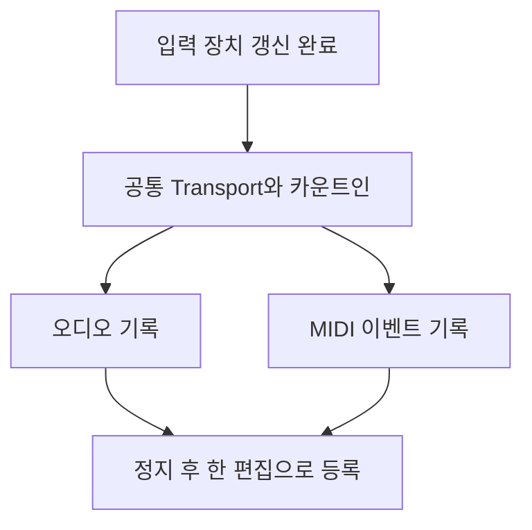

보컬을 녹음하면서 건반으로 연주한 MIDI도 동시에 기록할 수 있는 DAW를 만들고 싶었어요. 화면에서 녹음 버튼 하나를 누르면 자연스럽게 두 입력이 시작될 것 같지만, 실제 구현에서는 같은 출발점을 맞추는 일이 생각보다 까다로웠어요.

특히 고정된 Tracktion Engine에서 늦게 끝난 MIDI 장치 검색이 입력 컨텍스트를 다시 만들면서 오디오 녹음이 끊길 수 있었어요. 두 장치에서 녹음을 시작시키는 것보다 중요한 건 한 곡의 시간축을 공유하고, 장치 준비가 끝난 상태에서 함께 시작하는 것이었어요.

[어엿비 macOS 베타 다운로드](https://github.com/whizzkid1452/ayotbi-downloads/releases)

## [sort1] 1. 장치가 준비되기 전에 시작하면 생기는 일

오디오는 일정한 샘플레이트에서 연속되는 파형이고, MIDI는 어느 시점에 어떤 건반을 얼마나 세게 눌렀는지를 나타내는 이벤트예요. 두 종류의 데이터는 기록 방식부터 달라요.

어엿비에서 확인한 문제는 시작 버튼의 연결 자체가 아니라 장치 갱신의 생명주기였어요. MIDI 목록이 뒤늦게 갱신되면 입력 컨텍스트가 교체되고, 그전에 연결한 오디오 녹음에도 영향을 줄 수 있었거든요.

일정 시간 지연을 넣는 것으로는 장치마다 준비 시간이 다른 문제를 해결하기 어려워요. 그래서 입력 장치 갱신이 완료된 것을 확인하고, 두 입력을 같은 Transport(재생과 녹음의 시간 진행을 제어하는 장치)에 연결한 뒤 공통 카운트인으로 녹음을 시작하도록 했어요.

## [sort1] 2. 녹음이 멈췄다고 기존 곡까지 망가져서는 안 돼요

이전 편에서 편집을 트랜잭션으로 처리했었죠. 녹음도 같은 관점으로 봤어요.

녹음하는 동안엔 새로운 WAV와 MIDI 이벤트가 생겨요. 그런데 아직 잘 닫히지 않은 WAV나 불완전한 MIDI를 이미 완성된 프로젝트에 붙여버리면, 중간에 장치가 끊겼을 때 기존 곡도 영향을 받게 돼요.

그래서 정지한 뒤 두 입력의 결과를 검증하고, 완성된 클립을 하나의 편집으로 등록해요. 도중에 문제가 발생하면 확보한 원본은 로컬에 남기지만 불완전한 편곡은 바로 반영하지 않아요. 녹음 중 프로젝트 교체나 실행 엔진 전체를 다시 만드는 편집도 제한했어요.

이 방식 때문에 녹음 종료부터 타임라인 등록까지 별도 준비 과정이 필요해졌어요. 파일 가져오기와 해시 계산은 I/O 작업 스레드에서 처리하고, 오디오 콜백은 이 작업을 기다리지 않도록 했습니다.

## [sort1] 3. WAV를 출력하는 일은 왜 다른 프로세스에서 할까?

플러그인을 걸어 완성한 곡은 내보내기를 눌렀을 때도 그 효과를 유지해야 해요. 편집 앱에서 바로 출력하는 것이 단순한 방법이지만, 외부 플러그인이 멈추거나 응답하지 않으면 현재 작업 중인 곡도 영향을 받을 수 있어요.

렌더 작업을 별도 프로세스로 분리하고, 저장한 프로젝트를 읽어 출력에 필요한 실행 상태를 새로 만들게 했어요. 출력이 끝났다고 곧바로 결과를 공개하지는 않아요. 부모 프로세스가 WAV의 포맷, 채널, 프레임 수와 해시, 원본 문서와 요청 설정을 확인한 뒤 완성 폴더를 공개해요.

프로세스를 따로 실행하고 결과 파일을 다시 읽는 비용은 늘었어요. 대신 문제 있는 렌더를 취소해도 편집 원본과 Undo가 렌더 결과에 의해 바뀌지 않아요.

스템은 트랙별로 내보낸 WAV를 뜻해요. 버스와 마스터에 공유된 비선형 효과가 있다면 각 스템의 합이 전체 믹스와 꼭 같지는 않아요. 출력이 일치한다는 보장 범위도 이 점을 고려해야 했어요.

## [sort1] 4. 실제로 한 곡을 끝까지 만들어 봤어요

개별 기능만 테스트하는 것으로는 녹음한 결과가 저장과 렌더까지 이어지는지 알 수 없었어요. 그래서 48 kHz 가상 오디오 및 MIDI 입력을 사용하는 통합 시나리오를 구성했어요.

- 서로 다른 드럼 패드 두 개를 MIDI로 기록하고 오디오 세 타격을 녹음했어요.
- 가운데 타격을 1/8박 당긴 뒤 저장하고 다시 열었어요.
- 전체 믹스와 스템 세 개를 내보내고 파일 안의 타격 위치를 확인했어요.
- 렌더 청취를 거쳐 원래 편곡으로 돌아온 뒤 페이더 편집과 Undo를 확인했어요.

2026년 11월 24일 통합본에서 macOS Debug CTest 46/46과 헤드리스 Debug CTest 21/21을 통과했어요. 가상 입력과 실제 WAV의 샘플 위치를 함께 검사했다는 데 의미가 있어요. 물리 마이크, 건반, 오디오 인터페이스 왕복 지연, 장시간 부하 및 Windows는 아직 별도 검증이 필요해요.

이번 구현에서 배운 것은 녹음을 잘한다는 것과 저장 가능한 결과를 만든다는 것은 서로 다른 문제라는 점이에요. 두 과정 사이의 경계를 명확하게 두었기에, 다음 편에서 다룰 저장과 복구까지 연결할 수 있었어요.
