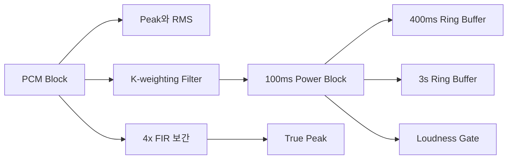

오디오 편집기에서 소리 크기를 표시할 때 가장 먼저 떠올리는 건 Sample Peak예요. 현재 들어온 버퍼에서 절댓값이 가장 큰 샘플 하나만 찾으면 바로 dBFS로 바꿀 수 있어 구현이 아주 간단하거든요.

하지만 실제로 음향을 다루다 보면 곧바로 한계에 부딪혀요. **Sample Peak 수치가 똑같아도 사람 귀에 들리는 음량(Loudness)은 다를 수 있고**, 디지털 샘플 사이를 아날로그 파형으로 복원하는 과정에서 원래 샘플보다 더 큰 **Inter-sample Peak**가 생길 수도 있거든요.

결국 이전 블록의 상태를 계속 유지하며 신호를 처리하는 Meter DSP(Digital Signal Processing, PCM 샘플을 수치적으로 처리하는 로직)가 필요했어요.

이번 구현은 Sample Peak, RMS, IEC 계열 응답, VU, K-metering, LUFS 계열 값, True Peak를 하나의 클래스에서 계산해요. 다만 아직 메인 오디오 실행 경로에는 연결되지 않았고 국제 표준 적합성 테스트도 없어요. 이 글에서는 완성된 표준 미터를 소개하기보다, **구현 구조와 검토 과정에서 발견한 경계 조건을 솔직하게 정리해 보려고 해요.**

## [sort1] 1. 왜 Meter마다 유지해야 할 상태가 달랐을까요?

Sample Peak는 현재 들어온 블록만 확인하면 바로 계산할 수 있어요.

```ts
function measureSamplePeak(samples: Float32Array): number {
  let peak = 0;

  for (const sample of samples) {
    peak = Math.max(peak, Math.abs(sample));
  }

  return peak === 0 ? -Infinity : 20 * Math.log10(peak);
}
```

하지만 나머지 미터들은 모두 과거 입력을 함께 들고 있어야 해요.

| **Meter 종류**      | **유지해야 하는 상태**                 |
| ------------------- | -------------------------------------- |
| Peak Hold           | 이전 최고값과 유지 시간                |
| VU                  | 약 300ms 동안 누적된 에너지            |
| Momentary Loudness  | 최근 400ms의 가중 파워                 |
| Short-term Loudness | 최근 3초의 가중 파워                   |
| Integrated Loudness | 측정 시작 이후 Gate를 통과한 모든 블록 |
| True Peak           | FIR 필터 길이만큼의 이전 샘플 이력     |

그래서 `process(block)`이 값을 바로 반환하는 대신 내부 상태만 갱신하고, UI는 별도의 `getReading()`으로 값을 읽어 가는 구조를 선택했어요.



## [sort1] 2. K-weighting을 두 단계 Biquad 필터로 처리했어요

사람의 귀는 모든 주파수를 같은 비중으로 듣지 않아요. 그래서 Loudness를 잴 때는 주파수별 가중치를 주는 K-weighting 필터를 먼저 통과시켜요. 구현에서는 High-shelf와 High-pass 두 단계의 Biquad 필터로 이를 구성했어요.

Biquad 필터는 현재 입력뿐 아니라 이전 입력과 출력도 함께 사용해 다음 값을 계산해요.

```ts
interface BiquadState {
  x1: number;
  x2: number;
  y1: number;
  y2: number;
}

function processBiquad(coefficients: BiquadCoefficients, state: BiquadState, input: number): number {
  const output =
    coefficients.b0 * input +
    coefficients.b1 * state.x1 +
    coefficients.b2 * state.x2 -
    coefficients.a1 * state.y1 -
    coefficients.a2 * state.y2;

  state.x2 = state.x1;
  state.x1 = input;
  state.y2 = state.y1;
  state.y1 = output;

  return output;
}
```

여기서 꼭 지켜야 할 점이 있어요. **채널마다 필터 상태는 반드시 따로 보관해야 해요.** 왼쪽 채널의 이전 출력이 오른쪽 채널 계산에 섞이면 채널 간 간섭이 생기거든요. Sample Rate가 바뀌면 필터 계수(Coefficient)도 다시 계산해야 해요.

## [sort1] 3. 100ms 블록을 공통 단위로 썼어요

Momentary(400ms)와 Short-term(3초)을 매 샘플마다 전체 합산하면 같은 값을 계속 다시 더하게 돼요. 그래서 K-weighting 이후의 파워를 **100ms 단위 블록**으로 먼저 모았어요.

- **400ms 창**: 100ms 블록 4개
- **3초 창**: 100ms 블록 30개

각 창은 고정 크기의 링 버퍼(Ring Buffer)로 관리해요. 새 블록을 덮어쓰고 write index만 옮기면 되니 매번 배열을 복사할 필요가 없어요.

```ts
writeIndex = (writeIndex + 1) % windowLength;
filled = Math.min(filled + 1, windowLength);
```

Integrated Loudness는 저장된 블록에 두 단계 Gate를 적용해요.

- -70 LUFS보다 작은 블록을 제외해요.
- 남은 블록의 평균보다 10 LU 작은 값을 상대 기준선(Threshold)으로 잡아요.
- 상대 기준선까지 통과한 블록만 다시 평균내요.

현재 코드는 이 수식을 구현해 두었지만, 표준 레퍼런스 신호와 결과를 비교하는 테스트는 아직 없어요. 표준식을 참고해 코드를 작성했더라도, 실제 레퍼런스 신호와 대조해 보기 전까지는 표준 적합성을 장담할 수 없어요.

## [sort1] 4. True Peak는 샘플 사이를 확인해야 했어요

Sample Peak는 저장된 샘플만 검사해요. 반면 True Peak는 샘플 사이의 복원 파형을 근사해서 확인해야 해요.

구현에서는 12 tap씩 4개 phase를 가진 **Polyphase FIR 필터**를 사용했어요. 입력 샘플 하나마다 네 phase를 평가해 4배 오버샘플링 위치의 최댓값을 갱신하는 방식이에요.

```ts
for (let phase = 0; phase < 4; phase++) {
  const taps = firPhases[phase];
  let interpolated = 0;

  for (let tap = 0; tap < taps.length; tap++) {
    interpolated += history[tap] * taps[tap];
  }

  truePeak = Math.max(truePeak, Math.abs(interpolated));
}
```

일반 Sample Peak보다 연산량이 크기 때문에 모든 미터 모드에서 항상 돌리지 않고, True Peak와 LUFS 모드에서만 실행하도록 나눴어요.

## [sort1] 5. 수식보다 까다로웠던 다채널 블록 경계

코드를 검토하다 보니 수식보다 까다로운 지점이 따로 있었어요. 바로 **다채널 블록을 동기화하는 순서**였어요.

현재 구현은 채널을 하나씩 순회하며 처리해요.

```text
processBlock
├─ channel 0 process
└─ channel 1 process
```

같은 100ms 구간에 들어온 모든 채널의 파워를 함께 커밋하려고, 100ms 샘플 카운터는 `channel 0`에서만 올리고 실제 블록 커밋은 마지막 채널에서만 실행하도록 했어요.

문제는 입력 블록이 100ms 경계에 딱 나누어떨어지지 않을 때 생겨요. 48kHz에서 100ms는 4,800 샘플이에요. 누적값이 4,736일 때 128 샘플짜리 블록이 들어오면 `channel 0`은 먼저 64 샘플을 처리해 카운터를 4,800으로 채워요. 아직 64 샘플이 남았는데 카운터를 비워 주는 커밋은 마지막 채널에서만 일어나거든요.

```text
spaceInBlock = 0
toProcess = 0
remaining = 64  // 줄어들지 않고 제자리걸음!
```

이 상태가 되면 `remaining`이 줄지 않는 무한 루프가 생길 수 있어요. 실제로 행(Hang)을 재현한 건 아니고 루프 조건을 따라가며 확인한 정적 분석 결과지만, 웹 오디오의 기본 단위인 128 샘플처럼 4,800의 약수가 아닌 블록 크기를 지원하려면 반드시 고쳐야 하는 경계 조건이에요.

## [sort1] 6. 채널별 처리보다 Frame 범위별 처리가 안전해요

100ms 경계를 채널 반복문 바깥에서 한 번씩 계산하면 이 문제를 피할 수 있어요. 아래는 적용할 수 있는 구조를 단순화한 예시예요.

```ts
function processLoudnessBlock(channels: Float32Array[], blockSize: number): void {
  let offset = 0;

  while (offset < blockSize) {
    const writableSamples = Math.min(blockSize - offset, samplesUntilBoundary);

    for (let channel = 0; channel < channels.length; channel++) {
      accumulateChannelPower(channels[channel], channel, offset, writableSamples);
    }

    offset += writableSamples;
    samplesUntilBoundary -= writableSamples;

    if (samplesUntilBoundary === 0) {
      commitLoudnessBlock();
      samplesUntilBoundary = samplesPer100ms;
    }
  }
}
```

이렇게 바꾸면 같은 Frame 범위를 모든 채널에 먼저 적용한 뒤 한 번만 커밋하게 돼요. 채널 처리 순서 때문에 공통 카운터가 어긋날 일이 없어지죠.

채널마다 독립 카운터를 두고 마지막에 같은 시간 구간끼리 합치는 방법도 있지만, 모든 채널이 같은 블록 크기를 갖는다는 전제가 있다면 Frame 범위 중심 반복이 훨씬 단순해요.

## [sort1] 7. 어떤 테스트가 있어야 완료라고 말할 수 있을까요?

현재 `MeterDSP`는 자동 테스트가 없고 메인 오디오 실행 경로에서도 아직 생성되지 않아요. 최소한 아래 항목들은 검증이 필요해요.

- 무음 입력이 `-Infinity`를 반환하는지
- 1kHz 사인파의 RMS와 Peak가 예상 오차 범위에 들어오는지
- 128, 256, 480 샘플 블록이 100ms 경계를 문제없이 통과하는지
- Mono, Stereo, 5.1 채널에서 채널 가중치가 제대로 분리되는지
- 블록을 한 번에 넣은 결과와 여러 조각으로 나눠 넣은 결과가 같은지
- 알려진 Loudness 레퍼런스 파일과 Integrated Loudness가 허용 오차 안에서 일치하는지
- 샘플 사이 Peak를 가진 픽스처에서 True Peak가 Sample Peak보다 크게 측정되는지

특히 아래 불변 조건이 가장 중요해요.

> “동일한 PCM 데이터라면 블록을 어떻게 나눠 넣어도 같은 측정 결과가 나와야 해요.”

## [sort1] 8. 마치며

오디오 미터를 처음 설계할 때는 ITU-R BS.1770 표준 수식을 코드로 옮기는 일이 가장 어려울 줄 알았어요. K-weighting 계수를 계산하고, 두 단계의 Loudness Gate를 세우고, 4배 오버샘플링 FIR 필터를 얹는 과정 자체가 꽤 묵직했거든요.

하지만 코드를 끝까지 뜯어보며 깨달은 건 조금 달랐어요. 실제 블록 기반 오디오 처리에서는 **수식이 완벽해도 카운터와 채널 순서가 어긋나면 경계에서 바로 무너진다**는 점이었죠. 128샘플 블록이 100ms 경계를 넘는 사소한 순간 하나가 무한 루프로 이어질 수 있다는 걸 확인하고 나니, DSP의 정확성은 공식만이 아니라 **블록 경계와 상태 갱신 순서까지 포함한 실행 모델 전체**라는 사실이 선명해졌어요.

DAW에서 미터가 보여 주는 숫자는 단순한 장식이 아니에요. 작업자는 그 수치를 믿고 볼륨을 줄이고, 리미터를 걸고, 최종 음압을 결정하거든요. 판단의 근거가 되는 숫자를 믿을 수 없다면 그 위의 기능도 신뢰를 잃게 돼요.

그래서 아직은 `MeterDSP`를 메인 오디오 실행 경로에 연결하지 않고 경계 밖에 두고 있어요. 채널별 루프를 Frame 범위 중심 루프로 바꾸고, "같은 PCM 데이터라면 블록을 어떻게 쪼개 넣어도 같은 결과가 나와야 한다"는 불변 조건을 레퍼런스 픽스처 테스트로 고정하는 것이 먼저라고 봤거든요. 그 검증이 끝난 뒤에야 비로소 엔진의 메인 경로로 들여오려고 해요.

지금까지 오디오 신호가 시간 축을 따라 상태를 쌓아 가는 과정을 살펴봤다면, 다음 글에서는 사용자가 직접 그린 파라미터 곡선이 시간에 따라 어떻게 평가되고 덮어쓰이는지, **Automation** 설계 이야기로 이어가 볼게요.

## 참고

- [ITU-R BS.1770-5, Algorithms to measure audio programme loudness and true-peak audio level](https://www.itu.int/rec/R-REC-BS.1770-5-202311-I)
- [EBU R 128, Loudness normalisation and permitted maximum level of audio signals](https://tech.ebu.ch/publications/r128)
- [\[음향\] True Peak와 Inter-sample Peak](https://miing95.tistory.com/46)
- [pyloudnorm: ITU-R BS.1770 알고리즘 구현](https://www.christiansteinmetz.com/projects-blog/pyloudnorm)
