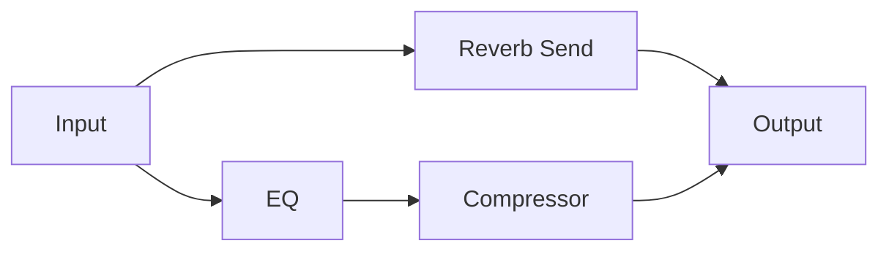

오디오 처리가 언제나 EQ → Compressor → Output처럼 일렬로만 흐른다면 배열 하나로 충분해요. 하지만 실제 DAW 믹서 안은 그렇게 단순하지 않거든요.

하나의 트랙 소리가 리버브 Send로 갈라졌다가(분기), 여러 트랙이 하나의 Mix Bus로 모이고(합류), 다른 트랙의 신호를 받아 동작하는 Sidechain까지 얽혀 있어요. 이런 구조에서 중요한 건 "몇 번째 프로세서인가"가 아니라 "어떤 프로세서가 먼저 끝나야 다음 프로세서가 돌 수 있는가"예요.

그래서 실행 순서를 방향은 있지만 순환(Cycle)은 허용하지 않는 그래프, 즉 DAG(Directed Acyclic Graph)로 모델링했어요.

DAG의 위상 정렬에서는 각 노드의 선행 의존성이 그 노드보다 앞에 와요. [NetworkX의 위상 정렬 문서](https://networkx.org/documentation/stable/reference/algorithms/generated/networkx.algorithms.dag.topological_sort.html)

현재 ProcessingGraph는 노드와 의존성, 위상 정렬, Cycle 탐지, 병렬 실행 후보 그룹을 계산하는 독립 유틸리티예요. 실제 AudioEngine이 이 그래프를 실행하는 경로는 아직 연결되지 않았어요. 이 글은 그래프 알고리즘 구현과 통합 전에 남은 계약을 정리한 기록이에요.

## [sort1] 1. 왜 배열로는 분기와 합류를 표현하기 어려웠을까요?

아래 같은 아주 흔한 믹싱 신호 흐름을 생각해 볼게요.



이걸 배열로 표현하려면 한 프로세서 뒤에 무엇이 실행되는지와 Output이 무엇을 기다리는지를 별도 규칙으로 계속 관리해야 해요. 반면 그래프에서는 노드(Node)와 간선(Edge)이 그 관계를 있는 그대로 표현해 줘요.

다만 현재 API 설계에서 한 가지 주의할 점이 있어요. 지금 addEdge(from, to)는 일반적인 신호 방향과 반대로 from이 to에 의존한다는 뜻으로 되어 있거든요.

```ts
graph.addEdge('eq', 'input');
graph.addEdge('compressor', 'eq');
graph.addEdge('output', 'compressor');
```

그래서 실제 실행 순서는 input → eq → compressor → output이 돼요. 이 방향 규칙을 이름에 드러내지 않으면 호출하는 쪽에서 반대로 연결하기 쉬워요. addDependency(nodeId, dependencyId)처럼 이름에 의미를 담는 편이 더 안전할 거예요.

## [sort1] 2. 노드와 구조 계산을 분리했어요

그래프 노드는 고유 id와 선택적인 process()만 가지고 있어요.

```ts
interface GraphNode {
  id: string;
  process?(): void;
}
```

ProcessingGraph 자체는 process()를 호출하지 않고 실행 순서만 반환해요.

```ts
const order = graph.topologicalSort();

for (const node of order) {
  node.process?.();
}
```

이 분기 덕분에 Web Audio API 없이도 그래프 알고리즘만 따로 검증할 수 있어요. 반대로 실제 오디오 처리에는 버퍼 전달, 채널 수, Sample Rate, Latency, 실패 처리 계약이 더 필요해요. 구조 계산을 독립적으로 떼어냈다고 해서 실제 오디오 그래프 통합까지 끝난 건 아니에요.

## [sort1] 3. Kahn 알고리즘으로 결정적인 실행 순서를 만들었어요

위상 정렬은 모든 의존 노드가 먼저 나오도록 노드를 나열해요. 구현에는 **Kahn 알고리즘**을 썼어요.

- 각 노드가 가진 의존성 수를 in-degree로 계산해요.
- in-degree가 0인 노드를 큐(Queue)에 넣어요.
- 노드를 하나 꺼내 결과에 추가해요.
- 이 노드에 의존하는 노드의 in-degree를 줄여요.
- in-degree가 0이 된 노드를 큐에 추가해요.

```ts
function topologicalSort(nodes: string[], dependencies: Map<string, Set<string>>): string[] {
  const inDegree = new Map(nodes.map(node => [node, dependencies.get(node)?.size ?? 0]));
  const queue = nodes.filter(node => inDegree.get(node) === 0).sort();
  const sorted: string[] = [];

  while (queue.length > 0) {
    const node = queue.shift();
    if (node == null) {
      break;
    }

    sorted.push(node);

    for (const dependent of findDependents(node, dependencies)) {
      const nextDegree = (inDegree.get(dependent) ?? 1) - 1;
      inDegree.set(dependent, nextDegree);

      if (nextDegree === 0) {
        queue.push(dependent);
        queue.sort();
      }
    }
  }

  if (sorted.length !== nodes.length) {
    throw new Error('Processing graph contains a cycle');
  }

  return sorted;
}
```

큐를 ID 오름차순으로 정렬해서 가능한 실행 순서가 여러 개일 때도 결과가 결정적(Deterministic)으로 나오게 했어요. 덕분에 스냅샷 테스트와 로그 비교가 단순해져요. 다만 매 반복마다 큐를 정렬하므로 노드가 매우 큰 그래프에서는 우선순위 큐(Priority Queue)를 검토할 수 있어요. 현재 프로젝트에는 실제 노드 규모 측정값이 아직 없어요.

## [sort1] 4. 정렬되지 않은 노드 수로 Cycle을 판별했어요

노드가 하나 이상인 DAG에는 적어도 하나의 in-degree 0 노드가 있어야 해요. Cycle 안의 노드들은 서로의 in-degree를 줄여 줄 시작점이 없거든요. Kahn 알고리즘이 끝난 뒤 결과 수가 전체 노드 수보다 작으면 Cycle이 존재한다는 뜻이에요.

```ts
if (sorted.length !== nodeCount) {
  throw new Error('ProcessingGraph contains a cycle');
}
```

별도의 detectCycles()도 제공해요. 이 함수는 반복문 기반 DFS(Iterative DFS)와 세 가지 색 상태를 사용해요.

| 색        | 의미                            |
| --------- | ------------------------------- |
| **WHITE** | 아직 방문하지 않은 노드예요.    |
| **GRAY**  | 현재 탐색 경로에 있는 노드예요. |
| **BLACK** | 탐색을 완료한 노드예요.         |

GRAY 노드에서 다시 GRAY 의존성을 만나면 현재 경로로 돌아가는 Back Edge이므로 Cycle이에요. 재귀 대신 명시적인 스택과 백트래킹 마커를 사용해 그래프 깊이가 JavaScript 콜 스택에 직접 의존하지 않게 했어요.

## [sort1] 5. 같은 단계의 노드를 병렬 후보로 묶었어요

위상 정렬은 하나의 순서를 반환하지만, 서로 의존하지 않는 노드들은 같은 단계에서 실행할 수 있어요.

```text
Level 0: Input A, Input B
Level 1: EQ A, EQ B
Level 2: Mix Bus
Level 3: Output
```

getParallelGroups()는 현재 in-degree가 0인 노드들을 한꺼번에 한 그룹(Level)으로 묶고, 그 그룹이 끝난 뒤 다음 Level을 계산해요.

```ts
while (currentLevel.length > 0) {
  groups.push(currentLevel);
  currentLevel = findNextZeroInDegreeNodes(currentLevel);
}
```

여기서 "병렬"은 그래프 의존성만 보면 같은 단계라는 뜻이에요. 아래 조건까지 자동으로 보장하지는 않아요.

- 두 프로세서가 같은 가변(Mutable) 버퍼를 쓰지 않는지
- 오디오 백엔드가 실제 병렬 실행을 지원하는지
- 플러그인이 Thread-safe한지
- 그룹 실행 후 결과를 어떤 순서로 합치는지

따라서 정확한 이름은 **병렬 실행 가능성 후보 그룹**이에요. 그래프 간선이 모든 공유 자원 의존성을 표현한다는 전제가 있어야 실제 병렬 실행이 안전해요.

## [sort1] 6. 노드 삭제에서는 양방향 간선 정리가 필요했어요

노드를 하나 삭제하면 두 관계를 모두 제거해야 해요.

- 삭제된 노드가 의존하던 간선
- 다른 노드가 삭제된 노드에 의존하던 간선

```ts
function removeNode(nodeId: string): void {
  nodes.delete(nodeId);
  dependencies.delete(nodeId);

  for (const nodeDependencies of dependencies.values()) {
    nodeDependencies.delete(nodeId);
  }
}
```

두 번째 정리를 빠뜨리면 존재하지 않는 노드를 의존성으로 가진 Ghost Edge가 남아요. 이후 위상 정렬에서 in-degree는 줄지 않지만 큐에 넣을 실제 노드도 없어 Cycle처럼 보일 수 있어요.

## [sort1] 7. 진짜 '오디오 실행 그래프'가 되려면 무엇이 더 필요할까요?

현재 `ProcessingGraph`는 공개 API로 노출된 구조 계산 유틸리티예요. 기본 엔진이 백엔드로 전달하는 라우팅 정보는 `RoutingSnapshot`과 `RoutingGraph`에서 계산해요. `ProcessingGraph` 자체를 직접 검증하는 자동 테스트는 아직 없어요. [daw-engine의 라우팅 구조](https://github.com/whizzkid1452/daw-engine#routing-graph-utilities)

먼저 독립 유틸리티로서 아래 단위 테스트가 필요해요.

- 선형 체인과 분기와 합류가 있는 그래프의 실행 순서
- 가능한 순서가 여러 개일 때의 결정적 결과
- Self Cycle과 여러 노드 Cycle
- 노드 삭제 후 양방향 간선 정리 여부
- 독립 노드의 병렬 후보 그룹 묶음
- 존재하지 않는 노드를 연결할 때의 정책

그리고 실제 오디오 엔진에 통합하려면 아래 실행 계약들이 더해져야 해요.

- 노드별 입력과 출력 버퍼
- 채널 레이아웃과 Sample Rate
- 프로세서 지연 시간(Latency)과 지연 보상
- 잔향(Tail)과 Bypass 처리
- 실행 중 그래프 변경 정책 (오디오 콜백 도중 그래프를 직접 바꾸면 현재 블록과 다음 블록의 실행 순서가 달라질 수 있으므로 스냅샷이나 안전 지점 대기열 정책이 필요해요)
- 실패한 노드가 전체 그래프에 미치는 영향

## [sort1] 8. 마치며

Kahn 알고리즘과 Cycle 탐지로 계산한 결과는 실행 순서예요. 실제 오디오 엔진에 연결하려면 버퍼 소유권, 지연 보상, 실시간 콜백 도중 그래프를 바꾸는 시점까지 정해야 해요. 병렬 후보 그룹을 실제로 실행하려면 공유 버퍼를 다루는 규칙도 필요하고요.

먼저 단위 테스트로 위상 정렬과 양방향 간선 정리 같은 그래프 불변 조건을 단단히 고정한 뒤, 버퍼와 지연 시간 계약을 갖춘 실행 노드로 확장해 나가려고 해요.

지금까지 오디오 처리의 신호 경로와 실행 의존성을 그래프로 정리했다면, 마지막 글에서는 재생, 정지, 탐색 사이에서 벌어지는 비동기 전환을 Transport FSM(유한 상태 머신)으로 통제한 이야기로 시리즈를 마무리해 볼게요.

## 참고

- [NetworkX, 위상 정렬](https://networkx.org/documentation/stable/reference/algorithms/generated/networkx.algorithms.dag.topological_sort.html)
- [A. B. Kahn, Topological sorting of large networks](https://doi.org/10.1145/368996.369025)
- [Web Audio API 1.1](https://www.w3.org/TR/webaudio-1.1/)
- [방향 비순환 그래프(DAG, Directed Acyclic Graph)](https://jackpot53.tistory.com/84)
- [Topological Sort of Directed Acyclic Graph](https://www.baeldung.com/cs/dag-topological-sort)
