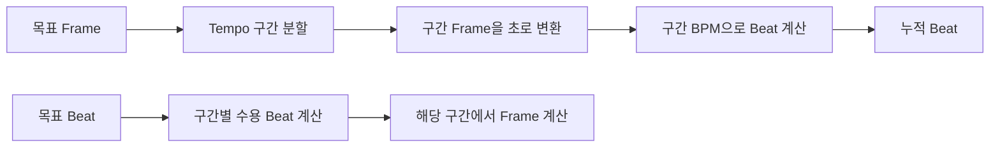

DAW를 만들다 보면 가장 먼저 부딪히는 벽이 바로 **시간**이에요. 오디오 파일과 재생 장치는 1초에 수만 번씩 쪼개지는 Frame 단위로 움직이지만, 음악을 작업하는 사람은 17,280,000 Frame보다 **13마디 2박**을 훨씬 쉽게 이해하거든요.

처음에는 이 변환이 아주 간단해 보였어요. beats \* 60 / bpm \* sampleRate 공식 하나만 있으면 끝날 줄 알았죠. 하지만 이 공식은 곡 전체의 Tempo가 단 하나일 때만 맞아요. 타임라인 중간에 120 BPM이 90 BPM으로 바뀌는 순간 두 좌표의 비율도 달라지거든요. 목표 지점까지 지나온 모든 Tempo 구간을 따로 계산해 더해야만 했어요.

이 글에서는 세 가지 용어를 아래 기준으로 사용할게요.

- **Frame**은 같은 시점에 있는 각 채널의 PCM 샘플을 묶는 시간 단위예요.
- **Beat**는 4분음표를 기준으로 누적한 음악적 위치예요.
- **BBT**는 마디(Bar), 박(Beat), 틱(Tick)으로 위치를 표시하는 방식이에요. 이 구현에서는 4분음표 한 박을 1,920 Tick으로 나눠요.

## [sort1] 1. 왜 고정 BPM 공식은 중간에 깨질까요?

48kHz 프로젝트에서 120 BPM일 때, 한 Beat는 정확히 24,000 Frame이에요.

```text
1 beat = 60 / 120 seconds
frames = 0.5 * 48,000
       = 24,000 frames
```

그런데 4 Beat가 지난 시점에 Tempo가 60 BPM으로 바뀐다면 어떻게 될까요? 6번째 Beat의 위치는 두 구간의 길이를 따로 구해 합쳐야 해요.

```text
앞 4 beat (120 BPM): 4 * 24,000 = 96,000 frames
뒤 2 beat ( 60 BPM): 2 * 48,000 = 96,000 frames
합계:                            192,000 frames
```

만약 현재 시점의 Tempo(60 BPM)만 가져다가 전체 6 Beat에 곱해 버리면, 이미 120 BPM으로 지나온 앞의 4 Beat까지 새 Tempo로 다시 계산하게 돼요. 그러면 화면의 Grid, MIDI 노트, 음악 시간 기반 Region이 서로 다른 위치를 가리키게 되죠.

> “가변 Tempo에서 시간 변환은 지나온 구간을 차곡차곡 더하는 **구간 적분 문제**였어요.”

## [sort1] 2. Tempo와 박자표를 별도 이벤트로 분리한 이유

처음에는 Tempo와 박자표(Meter)를 하나의 이벤트 객체로 묶어 둘까 고민했어요. 하지만 가만 보니 둘의 역할이 완전히 다르더라고요. **Tempo**는 Beat가 얼마나 빠르게 흐르는지를 결정하고, **박자표**는 그 Beat를 몇 개씩 묶어 한 마디로 나눌지를 결정해요. 같은 Frame에서 함께 바뀔 수도 있지만, 둘 중 하나만 바뀌는 경우도 흔하거든요.

그래서 두 이벤트 목록을 깔끔하게 분리했어요.

```ts
interface TempoEvent {
  frame: number;
  bpm: number;
}

interface MeterEvent {
  frame: number;
  beatsPerBar: number;
  beatValue: number;
}
```

각 목록은 항상 frame 오름차순을 유지해요. 특정 Frame에서 지금 활성화된 이벤트가 무엇인지 찾을 때는 `frame <= target`을 만족하는 마지막 위치를 이진 탐색(Binary Search)으로 찾아요.

```ts
function findSegmentIndex<T extends { frame: number }>(events: T[], target: number): number {
  let low = 0;
  let high = events.length - 1;
  let result = -1;

  while (low <= high) {
    const middle = (low + high) >>> 1;

    if (events[middle].frame <= target) {
      result = middle;
      low = middle + 1;
    } else {
      high = middle - 1;
    }
  }

  return result;
}
```

이진 탐색 덕분에 특정 시점의 BPM을 조회하는 비용은 줄어들었어요. 다만 Frame을 Beat로 변환할 때는 어차피 처음부터 목표 위치까지의 Tempo 구간을 순서대로 누적해야 해요. **현재 구간 조회 비용**과 **누적 변환 비용**은 서로 다른 문제라는 점을 이때 명확히 구분하게 됐어요.

## [sort1] 3. Frame과 Beat를 오가는 구간 누적 설계

변환 방식은 생각보다 직관적이에요. 지나온 각 Tempo 구간에서 소비한 Frame을 초 단위로 바꾸고, 그 구간의 BPM을 적용해 Beat를 차곡차곡 누적해요. 이때 첫 번째 Tempo 이벤트는 항상 0 Frame에서 시작한다고 전제해요.

```ts
function framesToBeats(targetFrame: number, sampleRate: number, events: TempoEvent[]): number {
  let remainingFrames = targetFrame;
  let totalBeats = 0;

  for (let index = 0; index < events.length && remainingFrames > 0; index++) {
    const nextFrame = events[index + 1]?.frame ?? Infinity;
    const segmentLength = nextFrame - events[index].frame;
    const segmentFrames = Math.min(remainingFrames, segmentLength);
    const segmentSeconds = segmentFrames / sampleRate;

    totalBeats += segmentSeconds * (events[index].bpm / 60);
    remainingFrames -= segmentFrames;
  }

  return totalBeats;
}
```

반대로 Beat에서 Frame으로 되돌아갈 때도 같은 순서로 진행해요. 각 구간이 수용할 수 있는 Beat를 먼저 계산하면서 지나가다가, 남은 Beat가 속한 구간에 도달하면 그 구간의 BPM으로 Frame을 환산해요.



이 방식의 핵심은 Tempo가 바뀌더라도 이전 구간을 새 Tempo로 다시 계산하지 않는다는 점이에요. 같은 음악적 위치를 Frame으로 다시 되돌렸을 때 제자리를 찾을 수 있는 기반이 바로 여기서 나와요.

## [sort1] 4. BBT 계산에서 마주한 정책의 문제

누적 Beat 값을 구했다고 끝이 아니에요. 화면에 13마디 2박처럼 표시하려면 박자표 구간을 따라 마디(Bar)를 나눠야 하거든요. 예를 들어 4/4박자에서는 한 마디가 4분음표 4개 길이지만, 6/8박자에서는 4분음표 3개 길이에 해당해요.

```ts
const quarterBeatsPerBar = beatsPerBar * (4 / beatValue);
```

박자표가 바뀌는 Frame을 먼저 절대 Beat로 바꿔 두면 각 Meter 구간의 시작점을 같은 좌표계에서 비교할 수 있어요. 이후 완성된 마디 수와 현재 마디 안의 잔여 위치를 나눠 BBT를 만들어요.

그런데 여기서 코드보다 **정책 결정**이 더 중요해지는 순간이 와요. 박자표 변경점이 마디 중간에 들어오면 이전 마디를 강제로 닫고 새 마디를 시작할지, 불완전한 마디를 다음 구간으로 이어 갈지 정해야 하거든요. 현재 구현은 각 구간 안에서 완성된 마디를 기준으로 계산하는 정책을 택했어요.

아직 검증이 남아 있는 부분도 있어요. 현재 BBT 계산은 4분음표 단위 Beat를 쓰면서 화면에 표시할 Beat 번호에도 같은 단위를 적용하고 있어요. 그래서 6/8박자처럼 분모가 4가 아닌 박자표의 Beat 표기는 추가로 확인해야 해요. 코드가 돌아간다고 해서 모든 박자표까지 정확하다고 장담할 수는 없으니까요.

## [sort1] 5. 같은 좌표 변환을 Grid와 Swing에 재사용했어요

타임라인의 Grid는 화면에 세로선을 긋는 UI 기능처럼 보이지만, 실제로는 시간 좌표 변환 모듈의 가장 큰 소비자예요.

- 시작 Frame을 절대 Beat로 바꿔요.
- 현재 분할 단위(subdivision)에 맞는 첫 Beat를 찾아요.
- 각 Beat를 다시 Frame으로 바꿔 선을 그릴 좌표를 구해요.
- 현재 박자표에 따라 다음 간격을 계산해요.

리듬에 그루브를 주는 Swing도 같은 경로를 써요. 짝수 번째 Grid는 유지하고, 홀수 번째 Grid만 다음 On-beat 방향으로 옮겨 주면 돼요.

```ts
const ratio = 0.5 + clampedSwing * 0.5;
const swungFrame = Math.round(previousFrame + ratio * intervalFrames);
```

이렇게 좌표 변환을 공통 경로로 묶어 두면 Tempo가 바뀌어도 Grid와 snap이 항상 같은 기준을 쓰게 돼요. 반대로 변환 규칙에 작은 오류라도 생기면 여러 편집 기능이 한꺼번에 어긋나요. 그래서 이 모듈은 기능을 늘리는 것보다 불변 조건을 검증하는 일이 훨씬 중요해요.

## [sort1] 6. 아직 검증되지 않은 것들

현재 `TempoMap`은 세션이 생성하고, 템포 편집 명령과 세션 저장과 복원 경로에서 사용해요. **TempoMap의 좌표 변환을 직접 검증하는 자동 테스트는 아직 없어요.**

최소한 아래와 같은 왕복(Round-trip) 변환 테스트부터 갖춰야 안심할 수 있어요.

```ts
import { describe, expect, it } from 'vitest';

describe('TempoMap round trip', () => {
  it('여러 Tempo 구간을 통과해도 Frame을 복원한다', () => {
    const tempoMap = new TempoMap(48_000);
    tempoMap.addTempoChange(96_000, 90);

    const sourceFrame = 192_000;
    const beats = tempoMap.framesToBeatsAbsolute(sourceFrame);
    const restoredFrame = tempoMap.beatsToFramesAbsolute(beats);

    expect(restoredFrame).toBe(sourceFrame);
  });
});
```

여기에 더해 아래 경계 조건들도 반드시 확인해야 해요.

- Tempo 변경 Frame의 직전, 정확한 위치, 직후
- 여러 Meter 변경을 통과하는 BBT 왕복 변환
- 3/4, 6/8, 12/8박자의 Beat 번호 표기 정책
- Grid 종료 경계와 Swing 최댓값
- 긴 타임라인에서 누적되는 반올림 오차

이 테스트를 통과하기 전에는 "모든 박자표를 정확히 지원한다"고 말하기 어려워요.

## [sort1] 7. 마치며

지금 TempoMap은 Session의 저장과 복원 경로에 연결되어 실제 동작하고 있어요. 하지만 박자표가 마디 중간에 바뀌는 지점이나 6/8박자의 Beat 표기처럼 정답이 하나가 아닌 경계를 마주할 때마다, 시간축 설계의 본질은 결국 **Frame, Beat, BBT의 정의를 고정하고 일관된 정책을 세우는 일**이라는 걸 체감해요. Grid와 Swing, MIDI 노트가 모두 같은 모듈을 바라보는 만큼 기준이 조금만 흔들려도 편집 기능 전체가 어긋나니까요.

그래서 기능을 더 얹기 전에, 4분음표가 아닌 박자표의 BBT 표기 정책과 왕복 변환의 반올림 오차부터 자동 테스트로 고정해 두려고 해요.

여기까지 DAW에서 시간이 흐르는 기준을 세웠다면, 다음 글에서는 그 시간 축 위로 흐르는 오디오 신호의 크기를 어떻게 정확하게 측정할지, **Meter DSP** 설계 이야기로 이어가 볼게요.

## 참고

- [Web Audio API 1.1](https://www.w3.org/TR/webaudio-1.1/)
- [MIDI Association, Standard MIDI Files](https://midi.org/standard-midi-files)
- [\[Audio\] Python에서 MIDI 파일 다루기](https://tkayyoo.tistory.com/189)
- [Timing in MIDI files](https://sites.uci.edu/camp2014/2014/05/19/timing-in-midi-files/)
