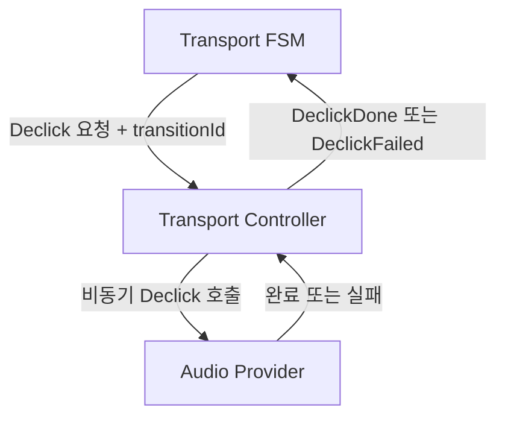

처음 재생 기능을 만들 때는 누구나 `isPlaying` 변수 하나면 충분해 보여요. 재생하면 `true`, 정지하면 `false`로 바꾸면 끝이니까요.

```ts
let isPlaying = false;
```

하지만 DAW의 Transport에는 재생과 정지 사이에 여러 중간 전환이 있어요. 클릭 노이즈를 줄이기 위한 **Declick**, 새 위치로 이동하는 **Locate**, 재생 방향 전환은 즉시 끝나지 않거든요. 이 과정에서 새 입력까지 들어오면 `isPlaying` 하나만으로는 지금 엔진이 무엇을 기다리고 있는지 설명할 수 없게 돼요.

그래서 **현재 진행 중인 전환**을 유한 상태 머신(Finite State Machine, FSM)으로 표현했어요. 공개 코드에서는 `AudioEngine`이 비동기 정지를 실행하고 FSM에 완료를 전달해요. 늦게 도착하거나 끝나지 않는 백엔드 호출에 대비해 `TransportController`, `transitionId`, 타임아웃을 적용하는 설계도 검토했어요.

> “재생 상태에서 중요한 건 소리가 나는가만이 아니라, **지금 어떤 전환을 진행하고 있는가**였어요.”

## [sort1] 1. 왜 isPlaying만으로는 부족했을까요?

`isPlaying`은 결과적인 재생 여부만 나타내요. 아래 질문에는 답할 수 없거든요.

- 정지를 위해 Declick 중인가요?
- Locate 전에 현재 재생을 정리하는 중인가요?
- 새로운 재생 위치가 적용되기를 기다리는 중인가요?
- 전환 중 들어온 입력을 지금 처리해도 되나요?

예를 들어 FSM에서 재생 중 Locate 전환을 처리하면 아래 순서로 상태가 바뀌어요.

```text
재생 중 -> Declick -> 재생 위치 변경 -> 재생 재개 또는 정지 유지
```

두 개의 boolean을 조합하는 방식도 생각해 볼 수 있어요.

```ts
let isPlaying = true;
let isDeclicking = true;
```

하지만 이 구조는 `isPlaying === true && isDeclicking === true`가 정지를 위한 Declick인지, Locate를 위한 Declick인지 구분하지 못해요. boolean을 더 추가할수록 허용하지 않아야 할 상태 조합도 함께 늘어나죠.

FSM은 가능한 상태와 상태 사이의 전이를 명시해요. 현재 상태에서 허용하지 않은 이벤트를 거부하거나 보류할 수 있다는 점이 boolean 조합과 달랐어요.

## [sort1] 2. 동작과 방향을 별도 상태로 분리했어요

Transport 상태를 동작(`MotionState`)과 방향(`DirectionState`)으로 나눴어요.

```ts
export enum MotionState {
  STOPPED = 'STOPPED',
  ROLLING = 'ROLLING',
  DECLICK_TO_STOP = 'DECLICK_TO_STOP',
  DECLICK_TO_LOCATE = 'DECLICK_TO_LOCATE',
  WAITING_FOR_LOCATE = 'WAITING_FOR_LOCATE',
}

export enum DirectionState {
  FORWARDS = 'FORWARDS',
  BACKWARDS = 'BACKWARDS',
  REVERSING = 'REVERSING',
}
```

`MotionState`는 재생, 정지, Locate 전환 단계를, `DirectionState`는 재생 방향과 방향 전환을 나타내요. 두 상태의 수명이 다르기 때문에 하나의 큰 enum으로 합치지 않았어요.

상태를 나누는 것만으로 모든 조합이 유효해지는 건 아니에요. 예를 들어 `STOPPED + REVERSING`을 허용할지는 별도의 전이 규칙으로 제한해야 해요. 분리의 목적은 상태 수를 줄이는 게 아니라 동작과 방향의 변경 규칙을 각각 관리하는 데 있어요.

## [sort1] 3. 전환 중 입력은 FIFO 대기열에 보관했어요

Declick 도중 새 재생, 정지, Locate 이벤트를 즉시 처리하면 진행 중인 전환과 새 전환이 같은 상태를 건드릴 수 있어요. 그래서 Declick 완료 이벤트만 즉시 처리하고, 사용자 입력은 **FIFO(First In, First Out) 대기열**에 보관했어요.

```ts
public enqueue(event: TransportEvent): void {
  if (!this.isDeclicking()) {
    this.processEvent(event);
    return;
  }

  if (event.type === 'DeclickDone') {
    this.processEvent(event);
    return;
  }

  this.deferredEvents.push(event);
}
```

Declick 전환이 끝나면 보관해 둔 이벤트를 입력 순서대로 다시 처리해요(Queued Sequential Execution). 실행 중인 백엔드 작업을 취소하거나 여러 요청을 하나로 합치는 방식은 아니에요.

FIFO가 항상 사용자 의도와 일치하는 것도 아니에요. 짧은 시간에 Locate가 여러 번 들어오면 모든 중간 위치를 거치기보다 마지막 위치만 적용하는 편이 나을 수 있어요. 이 경우에는 큐에 넣기 전에 같은 종류의 이벤트를 병합하는 별도 정책이 필요해요.

## [sort1] 4. FSM과 백엔드 호출의 경계를 뒀어요

FSM은 상태 전이를 결정해야 하지만, 실제 Declick은 비동기 `AudioProvider`에서 실행돼요. `AudioProvider` 호출까지 FSM이 맡으면 순수한 전이 규칙과 I/O 실패 처리가 한 클래스에 섞이게 돼요.

현재 `AudioEngine.stop()`은 같은 정지 요청에 진행 중인 Promise를 재사용해요. 백엔드의 `stopWithDeclick()`을 기다리거나, 이 기능이 없는 백엔드에서는 동기 `stop()`을 호출해요. 호출이 끝나면 요청을 시작한 세션이 여전히 현재 세션인지 확인한 뒤 `finally`에서 정지 전환을 완료해요. 백엔드가 오류를 반환하면 호출자에게도 그 오류가 전달돼요. [AudioEngine 정지 구현](https://github.com/whizzkid1452/daw-engine/blob/main/core/src/audio/AudioEngine.ts)

아래는 이 역할을 별도 `TransportController`로 옮기고 완료와 실패를 명시적 이벤트로 전달하는 설계 예시예요.



- **TransportFSM**: 허용할 이벤트와 다음 상태 결정
- **TransportController**: 비동기 호출, 타임아웃, 실패 복구 담당
- **AudioProvider**: Declick을 실행하고, 실패 시 강제 무음 처리를 지원하는 백엔드

콜백 자체가 문제인 건 아니에요. 다만 백엔드에 전달한 콜백이 FSM을 직접 참조하면 전환 식별과 실패 정책이 호출 지점마다 흩어지게 돼요.

Controller를 사이에 두면 FSM은 `AudioProvider` 인터페이스를 알 필요가 없고, `AudioProvider`도 FSM 상태를 알지 못해요. 둘은 요청과 결과 이벤트의 계약으로만 연결돼요.

## [sort1] 5. transitionId로 늦게 도착한 완료를 구분하는 설계

비동기 작업은 요청 순서와 완료 순서가 다를 수 있어요. 이전 Declick이 늦게 완료됐을 때 그 결과를 현재 전환의 완료로 받아들이면 FSM이 의도하지 않은 상태로 이동할 수 있어요.

이 설계에서는 전환마다 `transitionId`(상관관계 식별자)를 붙이고, 완료 이벤트에 같은 ID를 담아요.

```ts
private handleDeclickDone(event: DeclickDoneEvent): void {
  if (event.transitionId !== this.activeTransitionId) {
    return;
  }

  this.completeActiveTransition();
}
```

현재 기다리는 ID와 일치하는 결과만 상태 전이에 반영하고, 나머지는 무시해요.

다만 이 검사가 이전 작업을 취소하지는 않아요. 같은 백엔드 자원을 동시에 변경할 수 있다면 취소 신호, 단일 실행 제한, 또는 백엔드 내부의 세대 검사도 별도로 필요해요. `transitionId`가 보장하는 범위는 낡은 완료 이벤트가 현재 FSM 상태를 변경하지 못하게 하는 것까지예요.

## [sort1] 6. 타임아웃으로 FSM의 대기 시간을 제한하는 설계

`AudioProvider`의 Promise가 끝나지 않으면 FSM은 `DECLICK_TO_STOP`에 머물 수 있어요. 아래 예시에서는 Controller가 Declick 완료를 제한 시간까지만 기다려요. 백엔드 호출이 실패하거나 시간을 넘기면 강제 무음을 요청하고 실패 이벤트를 보내요.

```ts
const DECLICK_TIMEOUT_MS = 150;

private async handleDeclickRequested(request: DeclickRequest): Promise<void> {
  try {
    await this.withTimeout(
      this.audioProvider.declickToSilence(request.transitionId),
      DECLICK_TIMEOUT_MS,
    );

    this.transportFSM.enqueue({
      type: 'DeclickDone',
      transitionId: request.transitionId,
    });
  } catch {
    this.audioProvider.forceMute();
    this.transportFSM.enqueue({
      type: 'DeclickFailed',
      transitionId: request.transitionId,
    });
  }
}
```

`150ms`는 예시 정책값이에요. 실제 값은 Declick 길이, 오디오 백엔드 응답 시간 분포, 사용자가 허용할 수 있는 조작 지연을 측정해 정해야 해요. 타임아웃은 FSM이 완료를 기다리는 최대 시간을 제한할 뿐 이미 시작한 `declickToSilence()`를 자동으로 중단하지는 않아요. 백엔드 작업도 중단해야 한다면 `AbortSignal` 같은 취소 계약을 추가해야 해요.

## [sort1] 7. 무엇을 검증해야 이 구조를 신뢰할 수 있을까요?

현재 코드에는 FSM 상태 전이와 FIFO 처리, 백엔드 Declick 완료 후 정지, 대기 중 들어온 재생 요청, 동기 정지 대체 경로, 백엔드 오류를 검증하는 테스트가 있어요. [Transport FSM 테스트](https://github.com/whizzkid1452/daw-engine/blob/main/core/src/domain/TransportFSM.test.ts), [AudioEngine 테스트](https://github.com/whizzkid1452/daw-engine/blob/main/core/src/audio/AudioEngine.test.ts)

별도 Controller를 도입할 때는 아래 동작을 추가로 검증해야 해요.

- 연속 Locate 요청을 모두 처리할지 마지막 요청만 적용할지
- 이전 전환의 완료가 현재 FSM 상태에 영향을 주지 않는지
- 백엔드 오류 또는 미완료 시 실패 이벤트를 받고 제어권을 되찾는지
- 타임아웃 뒤에 끝난 작업이 현재 재생이나 공유 오디오 자원에 영향을 주는지
- 동작과 방향의 허용된 조합만 전이를 통과하는지

각 장치가 맡을 판단과 별도로 필요한 동작을 정리하면 아래와 같아요.

| **장치**                | **줄여 주는 위험**                 | **보장하지 않는 것**       |
| ----------------------- | ---------------------------------- | -------------------------- |
| **FSM**                 | 허용되지 않은 상태 전이            | 백엔드 작업 성공           |
| **FIFO Event Queue**    | 전환 도중 사용자 입력의 즉시 개입  | 중복 입력 병합             |
| **TransportController** | 상태 전이와 비동기 I/O 책임의 결합 | 백엔드 내부 자원 안전성    |
| **transitionId**        | 낡은 완료 이벤트의 현재 상태 반영  | 진행 중인 이전 작업 취소   |
| **타임아웃**            | FSM의 무기한 완료 대기             | 백엔드 Promise 자체의 종료 |

이 설계에서 타임아웃은 FSM이 실패 경로로 이동할 시점을 정해요. 백엔드 작업도 제한 시간에 끝내려면 별도의 취소 계약이 필요해요.

## [sort1] 8. 마치며

재생 상태를 **시간에 따라 이어지는 전환 규칙**으로 보니, FSM이 받아들일 입력과 백엔드가 끝내야 할 작업을 따로 다룰 수 있었어요. 정지 구현은 백엔드에서 돌아온 결과를 현재 세션에 반영하는 경계를 갖췄어요. 전환 식별자와 타임아웃을 적용한다면 다음 검증 대상은 늦은 완료가 도착한 뒤에도 현재 재생이 이어지는지예요.

Part 0에서 출발해 시간축, Meter DSP, Automation, MIDI, Export, Processing Graph, 그리고 Transport FSM까지 일곱 개의 문제를 훑고 나니 한 가지 공통점이 남아요. DAW Core를 만드는 일은 화려한 오디오 기능을 하나씩 쌓는 작업이라기보다, **경계에서 무너지지 않을 계약과 불변 조건을 먼저 세우는 일**에 가까웠어요. 아직 테스트와 통합이 남아 있는 모듈도 많지만, 그 빈칸까지 솔직하게 드러낸 이 기록이 브라우저나 TypeScript로 오디오 엔진을 고민하는 분들께 작은 이정표가 되길 바라요.
