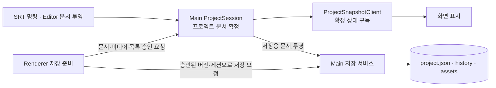

> 2026-10-28 보완: 이 글은 공유 프로젝트 문서의 확정 권한을 Main에 둔 배경을 다룹니다. 현재 Editor에는 로컬 Store와 문서 투영 경로가 남아 있습니다. 저장·복구·클라우드 전송의 현재 구현은 [후속 글](/posts/electron-main-process-ssot-save-recovery)에서 이어서 설명합니다.

목차 펼쳐보기

- [1. 문제의 본질: 동기화 누락이 아니라 '소유권'의 부재](#문제의-본질-동기화-누락이-아니라-소유권-의-부재)
- [2. 대안의 함정: 로컬 파일은 왜 기준점이 될 수 없었나?](#대안의-함정-로컬-파일은-왜-기준점이-될-수-없었나)
- [3. 핵심 결정: Main Process를 단일 진실 공급원(SSOT)으로](#핵심-결정-main-process를-단일-진실-공급원-ssot-으로)
- [4. 도구 선택의 디테일: 이유 있는 기술 스택](#도구-선택의-디테일-이유-있는-기술-스택)
  - [4-1. Main Process에는 왜 Vanilla Zustand 대신 Class를 썼을까?](#main-process에는-왜-vanilla-zustand-대신-class를-썼을까)
  - [4-2. Renderer 화면에는 왜 새로 Store를 안 파고 TanStack Query를 썼을까?](#renderer-화면에는-왜-새로-store를-안-파고-tanstack-query를-썼을까)
  - [4-3. 스크롤, 하이라이트 같은 UI 이벤트는 왜 따로 뺐을까?](#스크롤-하이라이트-같은-ui-이벤트는-왜-따로-뺐을까)
  - [4-4. 현재 자동 저장과 Editor 문서 투영은 어떻게 구분할까?](#현재-자동-저장과-editor-문서-투영은-어떻게-구분할까)
- [5. 💡 회고를 마치며](#회고를-마치며)

시리즈 전체 글 바로가기

1. [Part 1. Electron에서는 공유 데이터를 어디에 둬야 할까?](/posts/electron-main-process-ssot-decision)
2. [Part 2. Main SSOT를 저장까지 확장한 과정](/posts/electron-main-process-ssot-save-recovery)

> "SRT 자막을 한참 수정하고 점심을 먹고 왔는데, 수정한 내용이 다 날아갔어요!"

모든 것은 이 아찔한 제보에서 시작되었습니다. 자동 저장(Auto-save) 기능은 분명 정상적으로 돌고 있었고, 파일 쓰기 에러 로그도 없었습니다. 그런데 왜 사용자가 방금 입력한 최신 자막이 과거의 데이터로 덮어써지는 기현상이 발생했을까요?

로그를 추적하며 깨달은 사실은 충격적이었습니다. 문제는 '저장 실패'가 아니라, '어느 창(Window)에 남아있던 오래된 상태(Snapshot)가 그대로 파일에 저장되고 있다는 것'이었습니다.

_문제가 반복될 때마다 이번 디버깅이 나를 더 강하게 만들 거라고 되뇌었습니다._

이 글은 이 끔찍한 데이터 유실 버그를 추적하며, Electron 멀티 윈도우 환경에서 공유 데이터의 단일 진실 공급원(SSOT, Single Source of Truth)을 Main Process로 재설계하게 된 치열한 고민과 선택의 이유를 담은 회고입니다.

---

## [sort1] 1. 문제의 본질: 동기화 누락이 아니라 '소유권'의 부재

처음에는 단순히 창(Renderer)들 간의 상태 동기화가 누락된 버그라고 생각했습니다. SRT 자막 패널, 에디터, 어드민 화면 등 여러 창이 각자의 Zustand Store를 가지고 있었고, 한 곳에서 변경이 일어나면 다른 창들로 이벤트를 쏘아 상태를 맞추는 방식이었죠.

_오래된 Renderer Snapshot이 로컬 프로젝트 파일에 기록되는 흐름 (AS-IS)_

하지만 곰곰이 생각해보니 기존 방식(Renderer 간 동기화)은 근본적인 결함을 안고 있었습니다.

- **왜 Renderer 간 Store 동기화를 포기했는가?**
- **확장성의 한계:** 창이 하나 추가될 때마다 기존 창들과의 동기화 경로(IPC)를 전부 새로 뚫어야 합니다.
- **기준점 부재:** 동시에 여러 창에서 수정이 발생하거나 메시지 도착 순서가 꼬이면, "도대체 누구의 Store가 진짜 최신인가?"를 결정할 판사가 없습니다.
- 결국, 여러 Renderer가 각자의 복사본을 쥐고 있는 한, 땜질식 동기화로는 언젠가 또 데이터가 엇갈릴 수밖에 없었습니다.

_동기화가 누락될 때마다 IPC를 하나씩 추가하는 방식으로는 문제에서 손을 뗄 수 없었습니다._

문제는 '어떻게 동기화할까?'가 아니라 **'누가 최종 상태를 확정할 것인가?'** 였습니다.

## [sort1] 2. 대안의 함정: 로컬 파일은 왜 기준점이 될 수 없었나?

그렇다면 가장 직관적인 공통 분모, '로컬 프로젝트 파일'을 SSOT로 삼으면 어떨까요? 창에서 변경이 일어나면 무조건 파일에 쓰고, 다른 창들은 파일을 다시 읽어와 화면을 그리는 방식입니다. 하지만 이 역시 빠르게 선택지에서 제외했습니다.

- **왜 파일을 SSOT로 삼지 않았는가?**
- **역할의 섞임:** 파일 시스템의 본질은 앱 종료 후의 '영속성 보장'입니다. 1초에도 수차례 발생하는 실시간 UI 변경 상태를 관리하기엔 I/O 비용이 너무 큽니다.
- **비동기 타이밍 이슈:** 파일 쓰기가 끝나기 전에 다른 창에서 파일을 읽어버리면 여전히 과거 데이터를 보게 됩니다. 화면 갱신이 파일 I/O 속도에 종속되는 것은 최악의 UX를 만듭니다.

실행 중인 찰나의 '메모리 상태'와 영구적인 '파일 상태'는 분리되어야 했습니다.

## [sort1] 3. 핵심 결정: Main Process를 단일 진실 공급원(SSOT)으로

돌고 돌아 제가 내린 결론은 **공유 프로젝트 문서의 최종 변경을 Main Process의 `ProjectSession`에서 승인하는 것**이었습니다.

_프로젝트 문서의 확정 권한과 저장 요청 경로를 구분한 현재 구조_

- **왜 Main Process를 선택했는가?**

1. **창과 분리된 수명:** 앱이 실행되는 동안 Main Process는 특정 Renderer 창과 별도로 프로젝트 문서를 관리할 수 있습니다. 공유 문서의 확정 권한을 개별 UI 창의 Store에 맡기지 않기로 했습니다.
2. **변경 승인 경로:** SRT와 공유 프로젝트 문서의 변경은 Main이 세션과 기준 revision을 검사해 확정합니다. Editor의 로컬 편집 상태는 별도 문서 투영을 거칩니다. Main의 승인과 화면 갱신, 디스크 쓰기는 서로 다른 단계입니다.
3. **저장 기준 명시:** 저장 준비를 Main에서 승인한 뒤 그 버전의 문서와 미디어 목록을 고정해 기록합니다. 저장 중 추가 편집이 발생하면 화면은 더 새로울 수 있으며, 그 변경은 다음 미저장 버전으로 구분합니다.

## [sort1] 4. 도구 선택의 디테일: 이유 있는 기술 스택

아키텍처가 바뀌니, 이를 구현할 도구들도 제자리를 찾아갔습니다.

### [sort2] 4-1. Main Process에는 왜 Vanilla Zustand 대신 Class를 썼을까?

Main Process에 상태를 둘 때 Zustand의 도입을 고민했지만, 최종적으로는 **Class의 private field**를 활용했습니다.

- **이유:** 당시 Main Process에는 복잡한 구독(Subscribe) 모델이나 미들웨어가 필요하지 않았습니다. 오직 외부에서 데이터를 함부로 조작하지 못하도록 캡슐화하고, 정해진 `dispatch` 메서드로만 변경을 허용하는 **엄격한 API 경계**가 필요했기 때문에 이 변경 경로를 Class의 공개 메서드로 제한했습니다. 현재는 확정 이벤트 발행과 Undo/Redo 관리도 이 경계에 연결돼 있습니다.

### [sort2] 4-2. Renderer 화면에는 왜 새로 Store를 안 파고 TanStack Query를 썼을까?

Main이 원본을 가졌다고 해서 화면(Renderer)에 데이터가 아예 없는 것은 아닙니다. 렌더링을 위한 '복사본'이 필요하죠. 하지만 이를 위해 `useSyncExternalStore`나 별도의 전역 상태를 만들지 않았습니다.

- **이유:** Main에서 확정한 공유 문서를 화면에 표시할 때는 기존 **TanStack Query Cache**를 활용할 수 있었습니다. 확정 이벤트의 순서와 누락 복구는 ProjectSnapshotClient가 담당합니다. 다만 Editor Store, 입력 중인 값, 재생 객체까지 모두 읽기 전용 캐시로 바꾼 것은 아닙니다.

### [sort2] 4-3. 스크롤, 하이라이트 같은 UI 이벤트는 왜 따로 뺐을까?

자막을 클릭했을 때 화면이 스크롤되거나 하이라이트 되는 이벤트는 이 거대한 `ProjectSession` 흐름에서 제외했습니다.

- **이유:** 보존할 필요가 없는 일시적 상호작용을 프로젝트 문서 변경이나 디스크 저장과 연결하지 않기 위해서입니다. 이런 이벤트는 UI 전용 경로로 전달합니다. 일부 UI 설정은 문서에 보존하므로, 모든 UI 상태를 저장 대상에서 제외한 것은 아닙니다.

### [sort2] 4-4. 현재 자동 저장과 Editor 문서 투영은 어떻게 구분할까?

현재 수동·자동·종료 전 저장은 Renderer의 공통 저장 조정기를 거칩니다. 자동 저장은 입력·드래그·비동기 작업의 완료 신호로 요청하며, 고정 3초 debounce를 사용하지 않습니다. Editor 문서를 Main 메모리에 투영하는 50ms 대기는 디스크 저장 간격과 다릅니다.

저장 준비에서는 Editor 문서와 Script 내용, 미디어 전송 목록을 같은 명령으로 승인받습니다. 실제 저장 시작 요청은 승인된 버전과 프로젝트 식별자를 전달합니다. 이 경계와 로컬 이력·미디어·클라우드 전송의 연결은 [후속 글](/posts/electron-main-process-ssot-save-recovery)에서 자세히 다룹니다.

---

## [sort1] 5. 💡 회고를 마치며

이번 트러블슈팅을 통해 얻은 가장 큰 깨달음은 "상태 관리 라이브러리가 데이터의 소유권까지 대신 결정해 주지는 않는다"는 것입니다.

Zustand, TanStack Query 같은 훌륭한 도구들을 어떻게 쓸지 고민하기 전에, "이 데이터는 진짜 누구의 것인가?", "값이 충돌할 때 무엇을 믿어야 하는가?"라는 본질적인 아키텍처 질문에 먼저 답해야 했습니다.

_문서의 변경 승인과 저장 완료는 서로 다른 경계로 다뤄야 했습니다._

공유 문서의 확정 권한을 정한 뒤에는 저장이 어느 버전을 읽고, 완료 응답을 어느 변경까지 반영할지 확인할 수 있게 됐습니다. 이 구조만으로 데이터 유실이 모두 사라졌다고 단정할 수는 없습니다. 다중 창 충돌, 저장 중 편집, 실제 파일 복구는 각각의 실행 조건으로 검증해야 합니다.
