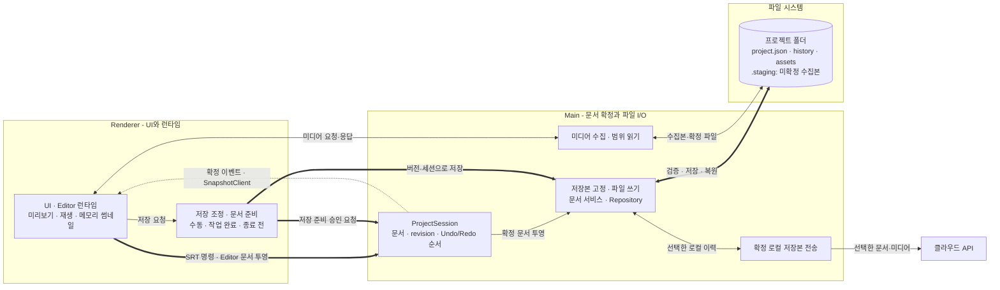

이전 글에서는 한 창에서 수정한 자막이 다른 창의 오래된 상태를 사용한 자동 저장으로 덮어써질 수 있었던 구조를 다뤘다. 공유 프로젝트 문서의 확정 권한을 Main Process에 두면서, 어떤 값을 기준으로 화면과 저장을 연결할지 정할 수 있었다.

그다음에는 저장 시점의 문제가 남았다. 문서를 준비하는 동안 새 편집이 발생할 수 있고, 미디어 전송은 문서 확정보다 오래 걸릴 수 있다. 로컬에 저장한 뒤 클라우드로 보내는 사이에도 사용자는 계속 편집한다.

이번 글은 이 단계들이 같은 저장 대상을 유지하도록 연결한 과정을 설명한다. 핵심은 실행 중 문서의 변경 권한, 저장할 버전을 고정하는 시점, 디스크에 확정된 저장본의 역할을 나누는 것이다.

> 2026-10-28 현재 코드 기준이다. Editor의 로컬 Store와 실행 객체를 모두 Main으로 이전한 구조는 아니다. 구현 경로와 실제 앱에서 추가 검증할 범위를 구분한다.

<details>
<summary>목차 펼쳐보기</summary>

- [1. 상태를 한곳에서 확정한 뒤에도 남는 문제](#상태를-한곳에서-확정한-뒤에도-남는-문제)
- [2. 문서 원본과 런타임, 저장본의 경계](#문서-원본과-런타임-저장본의-경계)
- [3. 현재 코드로 그린 상태와 저장 흐름](#현재-코드로-그린-상태와-저장-흐름)
- [4. 저장 준비와 파일 쓰기 사이에 둔 계약](#저장-준비와-파일-쓰기-사이에-둔-계약)
  - [4-1. 문서와 미디어 목록을 같은 버전으로 준비한다](#문서와-미디어-목록을-같은-버전으로-준비한다)
  - [4-2. 저장 시작 요청에는 승인된 버전과 프로젝트 식별자를 보낸다](#저장-시작-요청에는-승인된-버전과-프로젝트-식별자를-보낸다)
  - [4-3. 저장 완료는 그 뒤의 편집까지 저장됐다는 뜻이 아니다](#저장-완료는-그-뒤의-편집까지-저장됐다는-뜻이-아니다)
- [5. 자동 저장은 작업 완료를 기준으로](#자동-저장은-작업-완료를-기준으로)
- [6. 미디어 원본과 재생성 가능한 캐시 분리](#미디어-원본과-재생성-가능한-캐시-분리)
- [7. 복원과 클라우드 전송은 확정 로컬 이력을 기준으로](#복원과-클라우드-전송은-확정-로컬-이력을-기준으로)
  - [7-1. 과거 버전 복원도 새 저장본을 만든다](#과거-버전-복원도-새-저장본을-만든다)
  - [7-2. 전송 중 편집해도 업로드 대상을 바꾸지 않는다](#전송-중-편집해도-업로드-대상을-바꾸지-않는다)
- [8. 확인한 변화와 남은 검증](#확인한-변화와-남은-검증)
- [9. 다음 저장 설계에서 확인할 기준](#다음-저장-설계에서-확인할-기준)

</details>

<details>
<summary>시리즈 전체 글 바로가기</summary>

1. [Part 1. Electron에서는 공유 데이터를 어디에 둬야 할까?](/posts/electron-main-process-ssot-decision)
2. [Part 2. Main SSOT를 저장까지 확장한 과정](/posts/electron-main-process-ssot-save-recovery)

</details>

## [sort1] 1. 상태를 한곳에서 확정한 뒤에도 남는 문제

파일 쓰기가 성공했다는 사실만으로 사용자의 최신 작업을 보존했다고 판단할 수는 없다. 어느 편집 시점의 문서를 썼는지, 그 문서가 참조하는 미디어도 준비됐는지 확인해야 한다.

예를 들어 문서 revision 42를 기준으로 미디어를 준비하는 동안 revision 43의 편집이 발생했다고 하자. 문서는 42인데 미디어 참조는 43에서 가져오거나, 42의 저장 완료를 받은 뒤 43까지 저장된 것으로 표시하면 일관성이 깨진다. 전송할 때 화면의 현재 값을 다시 조립해도 로컬 저장본과 클라우드 전송본이 달라질 수 있다.

이 사례는 저장 경로가 다뤄야 하는 조건을 설명하기 위한 예시다. 특정 운영 장애의 원인이 이 순서로 재현됐다는 뜻은 아니다.

현재 구현을 판단하는 기준은 다음과 같다. 아래 표는 선택지의 구조적 차이를 비교하며, 모두를 구현해 비교 실험했다는 의미는 아니다.

| 선택지                                      | 얻는 점                                | 비용과 한계                                       |
| ------------------------------------------- | -------------------------------------- | ------------------------------------------------- |
| 저장할 때 화면의 값을 다시 읽는다           | 저장 시작 코드를 단순하게 만들 수 있다 | 준비 중 바뀐 문서·미디어·프로젝트를 구분해야 한다 |
| 미디어 전송이 끝날 때까지 편집을 막는다     | 저장 대상의 변화를 제한할 수 있다      | 큰 파일을 다루는 동안 편집을 기다리게 된다        |
| 승인한 문서를 고정하고 이후 편집을 구분한다 | 저장 대상과 다음 변경을 분리할 수 있다 | 버전·세션·저장 완료 반영 규칙이 필요하다          |

현재 코드는 마지막 방식으로 연결돼 있다. Main이 승인한 문서를 고정하면, 미디어를 전송하는 동안의 다음 편집은 별도 변경으로 남긴다.

## [sort1] 2. 문서 원본과 런타임, 저장본의 경계

SSOT는 모든 값의 복사본을 없앤다는 뜻이 아니다. 이 프로젝트에서는 공유 프로젝트 문서의 최종 변경을 Main의 ProjectSession이 승인한다는 의미다.

Renderer에는 확정 상태의 복사본, 아직 확정하지 않은 입력, Editor Store와 재생 객체가 남아 있다. SRT 변경은 명령으로 Main에 전달하고, Editor는 저장 가능한 문서를 Main에 투영한다. 모든 타임라인 조작이 하나의 Main 명령 처리기로 이전됐다고 설명하면 현재 코드보다 범위를 넓히게 된다.

| 상태                  | 기준과 수명                                                   |
| --------------------- | ------------------------------------------------------------- |
| 실행 중 프로젝트 문서 | Main이 명령과 기준 revision을 검사해 확정한다                 |
| Renderer 읽기 모델    | 확정 이벤트를 반영하고 revision이 비면 스냅샷을 다시 조회한다 |
| Editor·재생 런타임    | Renderer가 입력, 임시 미리보기, 디코딩과 재생을 담당한다      |
| 저장할 문서           | 준비 완료 후 Main에서 복사해 고정한다                         |
| 확정 로컬 저장본      | 현재 문서와 저장 이력으로 디스크에 보존한다                   |
| 클라우드 전송본       | 선택한 로컬 이력 ID의 문서와 미디어를 사용한다                |

실행 중 Undo/Redo와 파일의 저장 이력도 다르다. Main은 문서 patch의 Undo/Redo와 Renderer에 실행을 위임하는 Editor 항목의 순서를 관리한다. 디스크 저장 이력은 앱을 다시 열거나 과거 저장본을 복원하기 위한 별도 기록이다.

## [sort1] 3. 현재 코드로 그린 상태와 저장 흐름

핵심 영역은 Renderer의 입력·저장 준비, Main의 문서 승인·저장 조정, 파일 시스템의 확정 저장본이다. Renderer가 문서를 준비하더라도 파일에 기록할 대상은 Main이 검사한 버전으로 제한한다. 클라우드는 그 뒤에 확정된 로컬 저장본을 읽는다.

다음 구조도는 이 관계를 보여준다. 중심 흐름은 굵은 화살표로, 상태 알림과 열기·복원 경로는 점선으로 구분했다. 클래스가 없는 책임은 역할 이름으로 묶었다. 넓은 구조도는 좌우로 스크롤해 볼 수 있다.

<div style="overflow-x: auto;">
<div style="min-width: 1900px;">



</div>
</div>

문서 확정, 디스크 저장, 클라우드 전송이 각 단계에서 무엇을 기준으로 실행되는지 읽는 것이 이 구조도의 목적이다.

| 구조도의 책임         | 현재 구현                                                     |
| --------------------- | ------------------------------------------------------------- |
| 저장 조정·문서 준비   | Renderer의 ProjectSaveCoordinator · editorProjectPersistence  |
| 확정 이벤트 수신      | ProjectSnapshotClient · 화면 표시용 Cache                     |
| 저장본 고정·파일 쓰기 | ProjectDocumentService · ProjectRepository · JsonProjectStore |
| 미디어 수집·범위 읽기 | projectMediaStaging · projectMediaProtocol                    |
| 확정 저장본 전송      | ProjectCloudService                                           |

가독성을 위해 관련 책임을 묶은 구조도이며, 이 역할들을 하나의 새 서비스로 합쳤다는 뜻은 아니다.

SRT 명령은 SrtProjectCommandClient 경로를 사용하고, Editor 문서는 별도로 투영한다. 저장 대기열도 위치와 역할이 다르다. Renderer의 ProjectSaveCoordinator는 저장 요청을 조정하고, Main의 프로젝트별 쓰기 큐는 같은 프로젝트의 파일 작업을 순차 실행한다. 모든 편집 명령을 Main의 비동기 작업 큐에 넣는 구조는 아니다.

열기·복원에서는 V2/V3 문서 검사와 Renderer의 문서 적용 경로를 거쳐 화면과 재생 객체를 복원한다. ProjectSnapshotClient 하나가 모든 재생 상태를 직접 재구성한다고 그리지 않은 이유다.

## [sort1] 4. 저장 준비와 파일 쓰기 사이에 둔 계약

### [sort2] 4-1. 문서와 미디어 목록을 같은 버전으로 준비한다

수동·자동 저장과 종료·전환 전 저장은 공통 저장 경로를 사용한다. 요청 시점과 작업 대기 조건은 다르지만 같은 준비·전송 과정을 실행한다.

먼저 대기 중인 SRT 변경과 Editor 문서 투영을 Main에 반영한다. 이어 Main의 Script 내용을 기준으로 미디어와 저장용 문서를 준비한다. 이때 만들어진 Editor 문서, Script 내용, 미디어 전송 목록은 하나의 저장 준비 명령으로 Main에 전달한다.

Main은 프로젝트 세션과 기준 revision을 검사한다. 다른 변경이 먼저 확정됐거나 실행 취소가 진행 중이면 저장 준비를 거절할 수 있다. 문서 투영과 저장용 보정은 사용자 편집의 Undo/Redo 항목을 추가하지 않는다.

### [sort2] 4-2. 저장 시작 요청에는 승인된 버전과 프로젝트 식별자를 보낸다

준비가 승인되면 저장 시작 API에 문서 본문을 다시 보내지 않는다. Main이 승인한 revision, 프로젝트 경로와 세션을 전달한다.

아래 코드는 실제 흐름의 의미를 줄여 표현한 예시다.

```ts
const prepared = await prepareSave({
  projectSessionId,
  baseRevision,
  document,
  mediaTransferList,
});

if (!prepared.accepted) {
  throw new Error('저장 준비 중 프로젝트가 변경되었습니다.');
}

const save = await beginSave({
  projectSessionId,
  projectPath,
  expectedRevision: prepared.revision,
});

await transferRequiredMedia(save);
await commitSave(save);
```

이 경계는 저장 때 Renderer의 값을 다시 읽어 승인된 문서를 바꾸는 것을 제한한다. Main이 버전과 프로젝트를 확인하고 문서와 미디어 목록을 복사해 고정한다. 필요한 미디어만 청크로 보내고, 검증한 파일이나 수집본은 재사용할 수 있다.

### [sort2] 4-3. 저장 완료는 그 뒤의 편집까지 저장됐다는 뜻이 아니다

저장본을 고정한 뒤에는 Editor 문서 투영을 다시 허용한다. 사용자가 계속 편집하면 실행 중 문서는 고정한 저장본보다 새로워질 수 있다.

저장 완료 시에는 고정했던 버전과 현재 버전을 구분한다. 뒤늦게 끝난 저장이 새 편집을 덮지 않도록 문서 반영과 수정 상태를 처리한다. 프로젝트 전환은 같은 프로젝트의 추가 편집과 다르므로, 세션과 경로가 바뀌었으면 결과를 현재 프로젝트에 반영하지 않는다.

Main의 문서 revision과 디스크의 저장 revision·이력 UUID도 같은 개념이 아니다. 전자는 실행 중 변경 순서이고, 후자는 실제로 남긴 저장본의 식별자다. 클라우드 전송에서는 이 둘의 연결 정보를 별도로 관리한다.

## [sort1] 5. 자동 저장은 작업 완료를 기준으로

현재 자동 저장은 고정 3초 debounce가 아니다. 입력 확정, 드래그 종료, 비동기 편집 작업과 Undo/Redo 완료 같은 신호로 요청한다.

한글 조합이나 드래그, 비동기 작업이 진행 중이면 저장을 시작하지 않는다. React의 입력 처리가 끝난 다음 작업으로 이어가기 위해 MessageChannel을 사용한다. 일정 시간마다 저장을 반복하는 타이머가 아니다.

Editor 문서를 Main 메모리에 투영하는 경로에는 50ms 대기가 있다. 이 값은 메모리 문서 동기화의 빈도를 조정하며 디스크 자동 저장 간격을 뜻하지 않는다.

수동 저장은 대기 중인 작업 완료를 기다리고, 자동 저장은 작업 중이면 보류한다. 변경 없는 자동 저장은 새 이력을 만들지 않지만, 자동 저장 직후 사용자가 명시적으로 저장하면 수동 체크포인트를 남길 수 있다.

자동 저장 실패 뒤에는 편집 내용과 오류를 유지하고 수동 저장을 안내한다. 저장 실패를 성공처럼 처리하거나 자동 재시도로 숨기지 않는다. 보류된 요청이 이후 작업 완료 신호에 맞춰 이어지는지는 작업 시작·완료 경계에서 검증해야 한다.

## [sort1] 6. 미디어 원본과 재생성 가능한 캐시 분리

문서 JSON에는 File, Blob, AudioBuffer를 직접 넣지 않는다. 파일 ID와 참조를 기록하고, 원본 바이트는 프로젝트 폴더의 미디어 파일로 보관한다.

가져오거나 생성한 미디어는 먼저 프로젝트 내부 .staging에 수집한다. 저장 과정에서 크기와 내용 해시를 확인하고 assets에 반영한다. 수집본은 아직 확정된 저장 이력이 아니므로, 파일이 존재한다는 사실만으로 저장이나 복구가 완료됐다고 보지 않는다.

```text
projects/<project-id>/
├─ project.json
├─ history/<revision-id>.json
├─ assets/<media-type>/<content-hash>.<extension>
└─ .staging/
```

Renderer는 세션을 포함한 dyna-media URL로 파일을 읽는다. Main은 현재 프로젝트 세션을 확인하고 필요한 바이트 범위를 응답한다. 저장 전에는 수집본을 읽고, 저장 후에는 확정 파일을 같은 미디어 참조로 사용할 수 있다.

썸네일은 메모리에서 관리하고 필요한 구간을 다시 만든다. 이전 AudioEditorDB와 ThumbnailCacheDB는 시작 시 정리 대상이며 VoiceCatalogDB는 별도로 유지한다. 현재 미디어 저장 구조를 IndexedDB 프로젝트 저장이나 IndexedDB 썸네일 캐시로 설명하지 않는 이유다.

.dyna는 프로젝트를 공유·이동하기 위한 압축 입출력 형식이다. 기본 저장 위치는 프로젝트 폴더이며, 별도 backup writer가 매번 복구본을 만드는 구조로 설명하지 않는다.

## [sort1] 7. 복원과 클라우드 전송은 확정 로컬 이력을 기준으로

### [sort2] 7-1. 과거 버전 복원도 새 저장본을 만든다

JSON 저장소는 미디어를 검증하고 새 이력과 임시 head 파일을 기록·동기화한 뒤, 한 번의 이름 변경으로 project.json을 교체한다. 기존 현재 파일을 먼저 치워 현재 문서가 없는 구간을 만드는 방식은 사용하지 않는다.

이력 목록은 현재 head에서 이전 이력 ID를 따라간다. 저장 도중 남은 임시 파일을 최신 저장본으로 자동 승격하지 않는다.

복원할 때는 현재 변경을 먼저 저장하고, 선택 문서와 미디어를 확인해 화면에 적용한 뒤 새 이력으로 확정한다. 현재 버전 8에서 버전 3을 복원하면 버전 3의 내용을 가진 버전 9를 만든다. 버전 1부터 8까지의 이력과 미디어는 유지한다.

복원 중에는 자동 저장과 편집 동작을 조정해야 하며, 화면 적용 후 파일 확정이 실패하는 경우도 구분한다. 롤백 경로가 있다는 사실과 실제 파일로 복원에 성공했다는 검증은 별개다.

### [sort2] 7-2. 전송 중 편집해도 업로드 대상을 바꾸지 않는다

클라우드 전송은 요청 시 선택한 로컬 이력 ID를 고정한다. 그 이력의 문서와 미디어를 읽어 서버 형식으로 변환하므로 전송 중 현재 문서가 바뀌어도 선택한 원본은 바뀌지 않는다.

동일한 전송 키의 요청은 실행 결과를 공유하고 다른 전송은 순서대로 처리한다. 결과는 프로젝트 문서와 별도로 기록하며 서버 저장 요청에는 로컬 이력 ID를 멱등성 키로 보낸다. 실제 서버의 멱등성 보장 범위는 서버 계약과 별도로 확인해야 한다.

이 구조를 IndexedDB의 영속 Outbox로 부르지는 않는다. 현재 확인되는 것은 로컬 저장 이력, 별도 전송 기록, 메모리의 전송 조정이다. 앱 재시작 후 모든 미전송 작업의 자동 재개나 기기 간 편집 병합까지 구현됐다는 뜻은 아니다.

## [sort1] 8. 확인한 변화와 남은 검증

현재 코드에서 확인한 변화는 저장 대상의 기준과 실패 경계를 명시한 것이다.

| 경로           | 코드에서 확인한 계약                                           |
| -------------- | -------------------------------------------------------------- |
| 문서 변경      | Main이 세션·기준 revision·명령 ID를 검사한다                   |
| 저장 준비      | Editor 문서·Script 내용·미디어 목록을 하나의 명령으로 반영한다 |
| 저장 시작      | 승인된 버전과 프로젝트 식별자를 확인하고 저장본을 고정한다     |
| 로컬 확정      | 프로젝트별 쓰기 순서를 공유하고 이력과 head를 기록한다         |
| 과거 이력 복원 | 선택한 내용을 새 revision으로 확정한다                         |
| 클라우드 전송  | 선택한 확정 이력의 문서와 미디어를 읽는다                      |

이 글을 작성하면서 실제 Electron에서 다중 창 편집, 대용량 저장, 강제 종료 복구, 네트워크 차단을 실행 검증하지는 않았다. 저장 시간, 오류 발생률, 복구 성공률도 별도로 측정하지 않았다. 따라서 데이터 유실을 완전히 제거했거나 전원 차단까지 견딘다는 결과로 확장하지 않는다.

실제 검증에서는 다음 시나리오가 중요하다.

- 두 창에서 같은 자막을 수정하고 오래된 요청·응답이 도착하는 경우
- 한글 조합·드래그·비동기 생성 작업 중 자동 저장이 요청되는 경우
- 저장 준비 중 다른 편집이나 프로젝트 전환이 발생하는 경우
- 미디어 전송 중 새 편집이 생긴 뒤 이전 저장이 완료되는 경우
- 파일 쓰기·이력 복원 실패 후 기존 문서와 미디어가 유지되는지
- 클라우드 전송 중 새 로컬 저장이 생겨도 선택한 전송본이 유지되는지

저장 이력을 보존하면 디스크 사용량이 늘어난다. 보관 한도와 잔여 파일 정리는 별도 정책이 필요하다. 문서 투영, 작업 완료 신호, 버전 검사도 유지해야 하므로 중앙화만으로 복잡성이 사라지는 것은 아니다.

## [sort1] 9. 다음 저장 설계에서 확인할 기준

이 경험 이후에는 상태를 어디에 둘지와 함께 비동기 작업이 어느 버전을 참조하는지 확인하게 됐다. 저장 시작과 완료 사이에 입력이 바뀔 수 있다면 먼저 저장 대상을 고정하고 뒤의 변경을 어떻게 보존할지 정해야 한다.

비슷한 편집기를 설계한다면 다음 질문부터 확인할 수 있다.

- [ ] 공유 문서의 최종 변경을 승인하는 주체가 정해져 있는가?
- [ ] 준비 중 바뀐 문서와 미디어를 섞지 않는가?
- [ ] 이전 저장 완료가 다음 편집까지 저장됐다고 표시하지 않는가?
- [ ] 프로젝트 전환과 같은 프로젝트의 추가 편집을 구분하는가?
- [ ] 확정 저장본과 임시 수집본·재생성 캐시를 구분하는가?
- [ ] 클라우드 전송 대상을 실행 중 문서와 별도로 고정하는가?
- [ ] 실패 시 보존할 데이터와 사용자에게 표시할 상태가 정해져 있는가?

SSOT의 적용 범위를 설명하려면 상태의 위치뿐 아니라 변경 승인부터 저장·복원·전송까지 각 단계가 믿는 버전을 함께 보여줘야 한다.

## 참고

- [이전 글: Electron에서는 공유 데이터를 어디에 둬야 할까?](/posts/electron-main-process-ssot-decision)
- [로컬 저장과 클라우드 전송을 분리하는 기준](/posts/local-first-media-project-storage)
- 구현 확인 범위: 비공개 Electron 편집기의 프로젝트 문서, 읽기 모델, 공통 저장 조정기, JSON 저장소, 미디어 프로토콜과 클라우드 전송 서비스.
