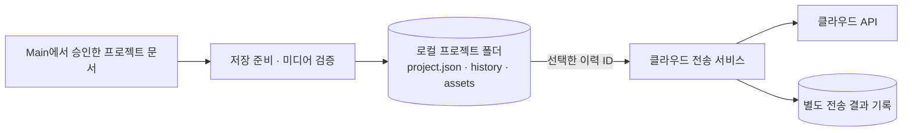

서버 전송이 실패했을 때 로컬 작업까지 저장되지 않은 것으로 처리하면, 사용자는 무엇이 보존됐는지 알기 어렵다. 미디어 편집기에서는 문서뿐 아니라 그 문서가 참조하는 음성과 영상 파일도 함께 확인해야 한다.

현재 Electron 편집기는 프로젝트 문서와 미디어를 로컬 프로젝트 폴더에 확정하고, 클라우드 전송은 선택한 로컬 저장 이력을 기준으로 실행한다. 로컬 파일 확정과 네트워크 전송의 성공 기준을 분리한 구조다.

> 2026-10-28 코드 기준으로 보완했다. 이전 본문의 IndexedDB 프로젝트 저장·영속 Outbox·기기 간 충돌 선택창 설명은 현재 실행 경로와 일치하지 않아 수정했다. 아래 내용은 구현 계약이며, 오프라인 환경 전체나 복구 성공률을 실행 검증한 결과는 아니다.

## [sort1] 1. 로컬 저장 완료와 서버 전송 완료를 구분한다

로컬 저장은 Main의 프로젝트 저장 계층이 문서와 미디어를 검증하고 디스크의 현재 저장본을 확정하는 과정이다. 서버 응답이 이 파일 확정의 완료 조건은 아니다.

클라우드 전송은 이미 확정된 로컬 저장본을 읽어 서버에 보내는 별도 과정이다. 전송에 실패해도 로컬 저장 성공 여부와 구분한다. 다만 필요한 원격 미디어를 아직 확보하지 못했거나 인증이 필요한 기능까지 오프라인에서 사용할 수 있다는 뜻은 아니다.



문서 승인부터 저장·복원까지의 상세 흐름은 [Main SSOT를 저장까지 확장한 과정](/posts/electron-main-process-ssot-save-recovery)에서 다룬다. 이 글에서는 로컬 보존과 네트워크 전송의 완료 기준에 집중한다.

## [sort1] 2. 미디어 원본과 문서를 프로젝트 폴더에 보관한다

프로젝트는 현재 문서, 확정된 저장 이력, 미디어 파일로 구성된다. 문서에는 File·Blob·AudioBuffer 자체를 넣지 않고 파일 참조를 남긴다.

```text
projects/<project-id>/
├─ project.json
├─ history/<revision-id>.json
├─ assets/<media-type>/<content-hash>.<extension>
└─ .staging/
```

가져오거나 생성한 파일은 .staging에 먼저 수집할 수 있다. 실제 저장에서는 미디어의 크기와 내용 해시를 확인하고 assets에 반영한다. 이미 검증한 파일은 재사용할 수 있으며, 새 전송이 필요하면 청크로 보낸다.

수집본은 아직 저장 이력과 연결되지 않은 파일이다. .staging에 미디어가 있다는 사실과 해당 미디어를 참조하는 문서가 저장됐다는 사실을 구분해야 한다.

Renderer는 프로젝트 세션을 포함한 dyna-media URL로 파일을 읽고, Main은 현재 세션을 확인한 뒤 필요한 바이트 범위를 응답한다. 썸네일은 메모리에서 재생성한다. 이전 AudioEditorDB와 ThumbnailCacheDB는 정리 대상이고, 별도 VoiceCatalogDB는 유지한다.

## [sort1] 3. 클라우드는 실행 중 문서 대신 확정 이력을 읽는다

전송 서비스는 선택한 로컬 저장 이력의 ID를 고정한다. 그 문서와 연결된 미디어를 서버 형식으로 변환하므로 전송 도중 새 편집이 발생해도 원본을 바꾸지 않는다.

동일한 전송 키로 들어온 요청은 하나의 실행 결과를 공유한다. 다른 전송은 앞선 작업 뒤에서 순서대로 처리한다. 같은 요청을 공유하는 것과 여러 요청을 순차 실행하는 것은 서로 다른 제어다.

프로젝트가 전환되거나 인증 상태가 바뀌면 늦은 작업이 현재 프로젝트에 적용되지 않도록 세션을 검사한다. 서버 저장 요청에는 로컬 이력 ID를 멱등성 키로 전달하지만, 서버가 실제로 보장하는 중복 처리 범위는 별도 계약으로 확인해야 한다.

## [sort1] 4. 현재 구조를 영속 Outbox라고 부르지 않는 이유

영속 Outbox는 전송할 작업을 저장해 두고 그 기록을 바탕으로 전달하는 구조다. 현재 구현에서 확인되는 것은 로컬 저장 이력, 별도 전송 결과 기록, 메모리의 전송 대기·중복 공유 제어다.

프로젝트 저장과 Outbox 등록을 같은 IndexedDB 트랜잭션으로 확정하는 경로는 현재 구조의 근거로 사용할 수 없다. 앱을 다시 켠 뒤 모든 미전송 작업을 자동 재개한다고 설명할 근거도 없다.

여러 기기가 같은 프로젝트를 오프라인에서 편집한 뒤 자동 병합하거나 사용자에게 충돌 선택창을 제공한다는 동작도 이 로컬 저장 경로만으로 보장되지 않는다. 그런 기능에는 원격 버전 비교와 충돌 정책, 재시작 후 전달 계약이 추가로 필요하다.

## [sort1] 5. 로컬 보존과 복구도 따로 검증한다

현재 JSON 저장소는 새 이력과 임시 head 파일을 기록·동기화한 뒤 현재 문서를 한 번에 교체한다. 과거 버전 복원은 기존 이력을 되감지 않고 선택한 내용을 새 revision으로 남긴다.

이 코드 경로를 확인한 것과 실제 앱의 강제 종료·저장 장치 오류·네트워크 단절에서 복구에 성공한 것은 다른 근거다. 이번 글에서는 저장 시간, 복구 성공률, 문의 감소 같은 수치를 측정하지 않았다.

실제 확인에서는 로컬 저장 성공 뒤 전송 실패, 전송 중 새 편집, 프로젝트 전환 후 늦은 응답, 재실행 후 저장본 읽기, 미디어 누락과 저장 공간 부족을 나누어 봐야 한다. 확정 이력의 자동 보관 한도와 잔여 파일 정리도 별도 정책이 필요하다.

## [sort1] 6. 저장 구조를 판단할 때 남길 질문

로컬 저장과 클라우드 전송을 분리하려면 두 작업의 완료 조건, 읽는 원본, 실패 뒤 보존할 데이터를 명시해야 한다. 파일이 로컬에 있다는 사실만으로 오프라인 편집과 동기화 전체가 완성되는 것은 아니다.

- [ ] 네트워크 전송 없이도 필요한 문서와 미디어를 로컬에 확정할 수 있는가?
- [ ] 전송 실패와 로컬 저장 실패를 사용자에게 구분해서 표시하는가?
- [ ] 업로드 중 새 편집이 생겨도 전송 대상이 바뀌지 않는가?
- [ ] 미확정 수집본과 복구 가능한 저장 이력을 구분하는가?
- [ ] 재시작 후 전송 재개와 기기 간 충돌을 실제 구현 범위 안에서 설명하는가?

## 참고

- [프로젝트 문서의 확정 권한을 Main에 둔 이유](/posts/electron-main-process-ssot-decision)
- [Main SSOT를 저장·복구·클라우드 전송까지 확장한 과정](/posts/electron-main-process-ssot-save-recovery)
