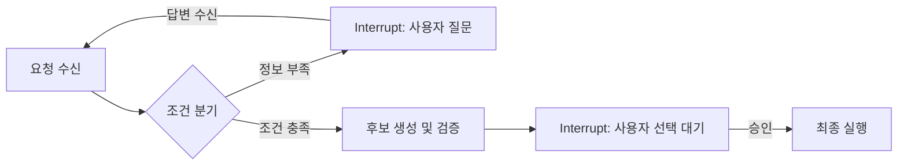

AI 기능을 제품에 붙이려다 보면 **RAG, LangChain, LangGraph**라는 이름이 한꺼번에 쏟아져요. 비슷한 맥락에서 자주 묶여 나오지만, 실제로는 각각 맡고 있는 역할이 완전히 달라요.

## [sort1] 들어가며: 왜 이 세 가지가 늘 함께 언급될까요?

LLM(거대 언어 모델)을 단순히 채팅창으로만 쓸 때는 API 한 번 호출하고 답변을 보여 주면 끝나요. 하지만 실제 제품에 녹여 내려면 곧바로 세 가지 질문에 부딪히게 돼요.
- 모델이 모르는 **우리 제품만의 최신 문서나 매뉴얼**은 어떻게 참고시킬까?
- 모델 호출과 **외부 도구, 출력 형식 검증**은 어떻게 깔끔하게 엮을까?
- 사용자에게 되묻고 답변을 기다리는 **여러 단계의 작업 흐름**은 어떻게 상태를 유지하며 이어갈까?

이 세 질문에 각각 대응하는 개념이 바로 **RAG**, **LangChain**, **LangGraph**예요. 이 글에서는 세 기술의 차이를 한눈에 정리하고, 음악 제작 도구(DAW)인 **어엿비**(Ayotbi)에서는 어떤 기준으로 역할을 나눴는지 살펴볼게요.

## [sort1] 1. RAG: 답하기 전에 관련 자료부터 찾아오는 방식

**RAG**(Retrieval-Augmented Generation, 검색 증강 생성)는 모델이 답을 만들어 내기 전에 외부 문서나 데이터베이스에서 관련 내용을 먼저 검색해 프롬프트에 보태는 기법이에요. ([RAG 원 논문](https://arxiv.org/abs/2005.11401))

모델을 다시 학습시키지 않고도 최신 정보나 제품 매뉴얼을 반영할 수 있다는 점이 가장 큰 장점이에요.
- **잘 맞는 경우:** "이 컴프레서 플러그인에서 어택(Attack) 값을 어떻게 조절해?"처럼 제품 매뉴얼이나 음악 이론 같은 외부 지식을 찾아 답해야 할 때 유용해요.
- **주의할 점:** 지금 열어 둔 프로젝트의 트랙 ID, MIDI 노트 위치, 현재 리비전 번호처럼 **실시간으로 바뀌는 앱 내부 상태**는 문서 검색(RAG)으로 찾으면 안 돼요. 이런 값은 최신 프로젝트 조회 API에서 직접 읽어야 정확해요.

## [sort1] 2. LangChain: 모델과 도구, 구조화 출력을 엮는 연결 계층

**LangChain**은 LLM과 프롬프트, 도구(Tool), 검색기, 구조화 출력(Structured Output)을 조합해 AI 애플리케이션을 만들기 쉽게 도와주는 프레임워크예요. ([LangChain 공식 소개](https://docs.langchain.com/oss/python/langchain/overview))

OpenAI SDK를 직접 호출하면 의존성은 줄어들지만, 나중에 모델을 교체할 때마다 호출부와 응답 파싱 코드를 다시 손봐야 해요. LangChain의 어댑터와 구조화 출력을 쓰면 모델을 바꾸더라도 **정해진 출력 스키마와 평가 파이프라인을 그대로 재사용**할 수 있어요. ([LangChain 구조화 출력](https://docs.langchain.com/oss/javascript/integrations/chat/openai#structured-output))
- **잘 맞는 경우:** "선택한 보컬 트랙 볼륨을 3dB 내려줘"처럼 한 번의 모델 호출로 구조화된 의도(대상 트랙, 상대 변경값)를 뽑아내고, 앱이 미리보기를 띄워 승인받는 짧은 편집 흐름에 가볍게 쓰기 좋아요.
- **주의할 점:** 구조화 출력이 JSON 형식은 맞춰 주지만, '3dB 내려(상대값)'와 '-3dB로 맞춰(절대값)' 같은 의미까지 늘 완벽히 구분해 주는 건 아니에요. 최종 대상과 단위 검증은 반드시 앱 쪽에서 한 번 더 확인해야 해요.

## [sort1] 3. LangGraph: 멈췄다 이어지는 상태 기반 워크플로 엔진

**LangGraph**는 공유 상태(`State`), 작업 단계(`Node`), 단계 간 이동 규칙(`Edge`)을 그래프 형태로 정의해 상태가 있는 워크플로를 실행하는 프레임워크예요. ([LangGraph 공식 소개](https://docs.langchain.com/oss/python/langgraph/overview), [Graph API](https://docs.langchain.com/oss/python/langgraph/graph-api))

단순한 파이프라인과 가장 크게 다른 점은 **실행 도중 멈췄다가(`interrupt`) 체크포인트를 바탕으로 다시 이어갈 수 있다**는 점이에요. ([LangGraph Interrupts](https://docs.langchain.com/oss/python/langgraph/interrupts), [LangGraph의 상태 저장](https://docs.langchain.com/oss/python/langgraph/persistence))

- **잘 맞는 경우:** "킥을 좀 줄여줘"라고 요청했을 때 먼저 구간을 되묻고, 답변을 받으면 리듬 후보 세 개를 렌더링해 들려준 뒤, 사용자가 고른 후보를 적용하는 것처럼 **여러 차례 사용자 입력을 기다리며 분기해야 하는 작업**에 적합해요.
- **주의할 점:** 체크포인트에 진행 단계를 저장해 주더라도, 실행을 재개할 때 중단된 노드의 처음부터 다시 돌 수 있어요. 따라서 대기 노드에는 실제 데이터를 바꾸는 작업을 넣지 말고, 중복 적용 방지와 최신 상태 재검증은 앱의 실행 계층에서 따로 보장해야 해요.

## [sort1] 4. 한눈에 비교하기

| 구분 | 핵심 역할 | 해결하는 문제 | 어엿비(Ayotbi)에서의 활용 기준 |
| --- | --- | --- | --- |
| RAG | 외부 지식 검색 후 입력 보강 | 모델이 모르는 매뉴얼, 도메인 지식 반영 | 플러그인 사용법, DAW 기능 안내 등 문서 기반 질의응답 |
| LangChain | 모델, 도구, 구조화 출력 연결 | 모델 교체 대응 및 구조화된 의도 추출 | "보컬 3dB 내려줘" 같은 단일 턴 한국어 편집 요청 |
| LangGraph | 상태 기반 그래프 및 중단, 재개 | 다중 턴 질문, 후보 선택 대기, 조건 분기 | 향후 "킥을 좀 줄여줘"처럼 구간 확인과 후보 미리듣기가 이어지는 다중 턴 리듬 편곡으로 확장할 때 검토 대상 |

## [sort1] 마치며

세 기술은 어느 하나가 다른 하나를 대체하는 관계가 아니에요. **외부 문서를 찾아야 하면 RAG**, **모델과 구조화 출력을 깔끔하게 엮고 싶으면 LangChain**, **사용자 응답을 기다리며 여러 단계를 오가는 상태 흐름을 통제해야 하면 LangGraph**를 선택하면 돼요.

실제 어엿비에서 이 기준을 바탕으로 단일 턴 자연어 편집을 LangChain으로 어떻게 구현했고, 앞으로 다중 턴 리듬 편곡을 어떤 방향으로 확장하려는지 아래 글에서 이어서 보실 수 있어요.
- 본문으로 돌아가기: [\[Part 6.\] LangChain으로 자연어 음악 편집 기능 구현하기](/posts/ayotbi-langchain-editing)
