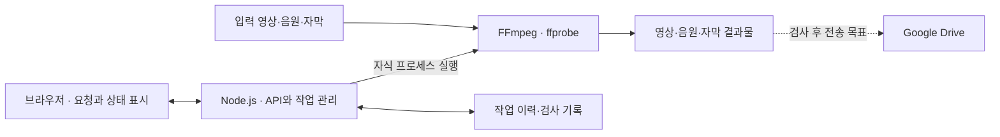

**동료가 파일을 모으고 도구를 실행하느라 쓰는 시간을 줄이려면, 변환 코드뿐 아니라 파일 전달부터 검수·납품까지 연결해야 했습니다.** 미디어 패키징 자동화를 구상하면서, 프론트엔드에서 익숙하게 사용하던 통신과 인증도 서버를 운영하는 관점에서 다시 공부했습니다.

이 기록에는 실제로 정리한 요구사항과 선택, 앞으로 구축하려는 구조를 함께 남겼습니다. 자동화 이후의 처리 시간이나 운영 결과는 아직 이 자료만으로 확인할 수 없습니다.

## 1. 기존 변환 로직보다 사람의 반복 개입이 문제였습니다

AI 더빙 납품에는 원본 영상, 더빙 음원, 대사 자막과 청각장애인용 설명 자막인 SDH를 정해진 규격으로 묶는 패키징 과정이 있었습니다. 파일은 메신저·이메일·NAS처럼 서로 다른 경로로 전달됐고, 담당자가 이를 모아 도구를 실행하고 파일명과 폴더를 정리해야 했습니다. NAS는 네트워크로 접근하는 파일 저장 장치입니다.

전달받은 상황 설명에서는 **20시간 분량의 콘텐츠와 약 1.7TB의 결과물을 패키징하는 데, 2주간 야근과 주말 근무를 포함해 약 150시간 이상의 수작업이 들었다고 했습니다.** 여기서 20시간은 콘텐츠 재생 분량이고, 150시간은 사람이 투입한 작업 시간입니다. 두 수치를 같은 종류의 처리 시간으로 보지 않았습니다.

11월에는 500시간 분량의 납품이 예정돼 있어, 같은 수동 절차를 반복하기 어려운 상황이었습니다. 다만 콘텐츠 분량만으로 필요한 노동 시간이 같은 비율로 늘어난다고 계산하거나, 그 값을 자동화의 절감 성과로 확정할 수는 없습니다.

기존에도 동료가 만든 변환 로직은 있었습니다. 목표는 그 로직을 매번 사람이 실행하는 대신, **필요한 파일이 준비되면 제작·검사·전달을 이어서 수행하는 환경**을 만드는 것이었습니다. 먼저 입력과 결과물의 역할을 정리하고, 불필요한 입력 항목과 오래된 문서를 줄였습니다. 폴더 이름도 실무자가 알아보기 쉽게 정리했습니다.

## 2. 파일을 옮기는 속도와 수정본을 관리하는 비용을 함께 봤습니다

물리적인 저장 장치로 파일을 전달하는 방식도 생각했습니다. 하지만 이번 요구사항에서는 담당자가 파일을 옮기는 단계가 계속 남았습니다. 수정본이 생기면 검수용과 최종 납품용 저장소에 다시 반영해야 한다는 점도 문제였습니다.

그래서 **검수와 납품에 사용하는 Google Drive의 폴더를 기준으로 파일 흐름을 통일하기로 했습니다.** SSOT, 즉 단일 진실 공급원은 어느 파일을 최신본으로 판단할지 정하는 기준입니다. 여기서는 검수자와 납품 담당자가 서로 다른 사본을 기준으로 일하지 않게 하려는 선택이었습니다.

구상한 흐름은 실무자가 정해진 위치에 파일을 올리고, 서버가 주기적으로 확인하는 폴링으로 입력 준비 여부를 판단한 뒤 패키징을 시작하는 것입니다. 수정본이 올라오면 관련 제작 과정을 다시 실행하고, 검수자도 같은 기준의 결과물을 확인하도록 하려 했습니다.

파일을 한곳에 모으는 것과 **업로드 완료·수정본 감지·재실행을 올바르게 처리하는 것**은 별도 과제입니다. 이를 실제로 검증한 결과는 원문에 없어서, 자동화 완료로 기록하지 않았습니다.

## 3. 브라우저는 조작을, 서버는 제작과 상태 관리를 맡도록 구상했습니다

회사에서 지원받은 PC에 Ubuntu를 설치하고, 업무용 Mac에서 원격으로 작업하는 환경을 계획했습니다. 프론트엔드와 백엔드 저장소를 나눠 개발하되, 비개발자인 실무자가 브라우저에서 작업 상태를 보거나 설정을 바꿀 수 있게 하려 했습니다.

입력은 원본 영상·더빙 WAV·대사 VTT·SDH VTT의 네 종류로 정리했습니다. 결과물은 영상 두 종류, 보정한 WAV 하나, VTT 두 종류를 만드는 구조입니다. 세부 납품 규격은 이 기록에 그대로 옮기지 않고, 입력 검증·제작·결과 검사의 책임으로 나눠 봤습니다.

아래는 원문에 남긴 **구축 목표를 단순화한 검토안**입니다. 실제 배포 구조를 검증한 도식은 아닙니다.

Node.js는 요청과 제작 순서·작업 상태를 관리하고, 미디어 제작과 분석은 FFmpeg·ffprobe 프로세스에 맡기는 구상입니다. `child_process.spawn()`은 외부 프로세스를 비동기로 실행할 수 있어 이 경계를 이해하는 데 참고했습니다. [Node.js 자식 프로세스 문서](https://nodejs.org/api/child_process.html#child_processspawncommand-args-options)

초기 구상에는 동시 작업 하나와 서버 디스크의 JSON 기록도 포함돼 있었습니다. NAS 연결과 Drive 전송까지 포함한 전체 흐름이 실제로 동작하는지는 별도 검증이 필요합니다.

## 4. Docker와 Compose는 실행 환경과 서비스 구성을 나눠 이해했습니다

서버를 직접 구성하려니, 개발 환경에서 이미 준비돼 있던 런타임과 도구를 어디까지 설치·관리해야 하는지부터 고민하게 됐습니다. Dockerfile은 이미지를 만드는 정의이고, 이미지는 실행할 애플리케이션과 의존성을 담으며, 컨테이너는 그 이미지를 바탕으로 실행되는 인스턴스로 정리했습니다.

Docker Compose는 서비스들의 실행 설정을 YAML로 묶고, 네트워크·볼륨 등 함께 관리할 구성을 선언하는 도구입니다. API·DB·캐시 등을 같이 실행할 때 어떤 설정을 공유해야 하는지 파악하는 데 도움이 됩니다. [Docker Compose 공식 문서](https://docs.docker.com/compose/intro/features-uses/)

다만 컨테이너를 사용한다고 호스트의 자원, 파일 권한, 외부 저장소 같은 차이까지 사라지는 것은 아닙니다. 이번 기록에서는 **Docker·Compose·Kubernetes의 역할을 복습한 것과 실제 운영에 도입한 것을 구분**했습니다. 특정 배포 도구를 채택해 운영을 검증했다는 근거는 남아 있지 않습니다.

## 5. 제작 요청과 진행 상태 전달은 다른 요구사항이었습니다

브라우저에서 제작을 요청하는 일과, 오래 걸리는 제작의 진행 상태를 계속 보여 주는 일은 나눠 생각해야 했습니다. HTTP 요청·응답, 주기적으로 상태를 조회하는 폴링, SSE와 WebSocket을 복습했습니다.

특히 **SSE는 HTTP 응답을 유지하면서 서버에서 클라이언트로 이벤트를 전달하는 방식**입니다. 일반적인 요청·응답과 SSE를 비교할 때, SSE가 HTTP와 별개의 프로토콜이라고 이해하지 않도록 정리했습니다. [MDN SSE 가이드](https://developer.mozilla.org/en-US/docs/Web/API/Server-sent_events/Using_server-sent_events)

WebSocket은 양방향 메시지 교환이 필요한 경우와 연결해 봤습니다. 패키징 상태를 읽는 화면에 어떤 방식이 적합한지는 필요한 갱신 주기와 양방향 통신 여부를 기준으로 판단할 문제였습니다. 원문에는 통신 방식의 복습이 있고, SSE 구현·운영을 완료했다는 검증은 없습니다.

HTTPS도 다시 확인했습니다. TLS는 통신 구간의 암호화·무결성·상대 인증을 제공하는 프로토콜입니다. 인증서 검증과 안전한 연결 설정을 단순히 “암호화 옵션 하나”로 보지 않게 됐습니다. [MDN TLS 설명](https://developer.mozilla.org/en-US/docs/Web/Security/Defenses/Transport_Layer_Security)

## 6. 저장소 분리와 브라우저의 출처 분리는 다른 문제였습니다

프론트엔드와 백엔드 코드를 별도 저장소에 두는 것만으로 CORS가 발생하지는 않습니다. 브라우저가 요청하는 URL의 **프로토콜·호스트·포트로 결정되는 출처**를 봐야 했습니다.

CORS는 서버가 허용한 출처에 대해 브라우저가 응답 접근을 허용하는 방식입니다. 서버가 응답했어도 JavaScript에서 읽지 못할 수 있고, 프리플라이트가 필요한 요청은 사전 `OPTIONS` 검사를 통과하지 못해 본 요청 자체가 전송되지 않을 수도 있습니다. “CORS 오류면 서버는 항상 200을 보냈다”라고 일반화하면 안 됐습니다. [MDN CORS 가이드](https://developer.mozilla.org/en-US/docs/Web/HTTP/Guides/CORS)

대응 방식으로는 서버의 허용 출처 설정, 개발 서버 프록시, 운영 환경의 리버스 프록시를 복습했습니다. 브라우저가 같은 출처의 `/api`로 요청하고 프록시가 내부 API 서버로 전달하는 구성을 생각해 볼 수 있었습니다. 포워드 프록시는 클라이언트의 외부 요청을 중계하고, 리버스 프록시는 서비스 앞에서 내부 서버로 요청을 전달한다는 역할 차이도 정리했습니다.

이 내용은 배포 구성을 이해하기 위한 학습입니다. 실제로 CORS 장애를 재현하거나 특정 프록시 설정으로 해결한 기록은 제공 자료에 없습니다.

## 7. 쿠키 인증은 요청 옵션과 쿠키 속성을 함께 봐야 했습니다

다른 출처의 API에 쿠키를 포함하는 요청에서는 클라이언트와 서버 설정을 함께 확인해야 합니다. 복습한 항목은 다음과 같습니다.

- Fetch는 `credentials: 'include'`, Axios는 `withCredentials: true`를 사용합니다.
- 서버는 자격 증명을 포함한 응답에 `Access-Control-Allow-Credentials: true`와 허용할 구체적인 출처를 설정합니다. 이때 `Access-Control-Allow-Origin: *`로 대신할 수 없습니다.
- 쿠키 전송은 쿠키 속성과 브라우저의 제3자 쿠키 정책에도 영향을 받습니다. [MDN CORS 인증 요청 설명](https://developer.mozilla.org/en-US/docs/Web/HTTP/Guides/CORS#requests_with_credentials)

**Cross-Origin과 Cross-Site도 구분해야 했습니다.** 서로 다른 서브도메인은 출처가 달라도 같은 사이트에 속할 수 있으므로, 도메인이 다르다는 이유만으로 항상 `SameSite=None`이 필요한 것은 아닙니다. `Domain`은 쿠키를 보낼 호스트 범위를 지정하는 속성이고, `SameSite`는 사이트 간 요청에서 쿠키를 보낼 조건을 다룹니다. `SameSite=None`에는 `Secure`가 필요합니다. [MDN 쿠키 속성 설명](https://developer.mozilla.org/en-US/docs/Web/HTTP/Reference/Headers/Set-Cookie#attributes)

XSS는 페이지에서 악성 스크립트가 실행되는 문제이고, CSRF는 로그인된 사용자의 쿠키 등을 이용해 의도하지 않은 요청을 유도하는 문제로 나눠 봤습니다. `HttpOnly`는 JavaScript가 쿠키 값을 읽는 것을 막지만, 해당 쿠키가 요청에 포함되는 것까지 막지는 않습니다. 따라서 이것만으로 XSS와 CSRF가 모두 해결된다고 볼 수는 없습니다. [MDN HttpOnly 설명](https://developer.mozilla.org/en-US/docs/Web/HTTP/Reference/Headers/Set-Cookie#httponly)

Access Token 만료 때 여러 API가 동시에 401을 받는 상황도 복습했습니다. 갱신 Promise 하나를 공유해 중복 갱신을 막는 single-flight와, 각 요청의 재시도는 구분할 필요가 있었습니다. 이번 자료에서는 이 인증 흐름을 실제로 구현해 검증한 결과까지 확인하지는 않았습니다.

## 8. API 계약과 배포 방식도 분리의 비용에 포함됐습니다

저장소를 나누면 프론트엔드 타입과 실제 API 응답이 어긋나지 않게 관리할 방법도 필요했습니다. OpenAPI 명세를 기준으로 타입을 생성하는 방식과, MSW로 API 응답을 모킹해 화면을 개발하는 방식을 복습했습니다. 명세 변경 감지와 하위 호환성도 함께 생각해야 했습니다.

배포에서는 도메인과 포트가 어떤 실행 프로세스로 연결되는지부터 다시 정리했습니다. A 레코드와 CNAME, 포트 포워딩, 리버스 프록시의 라우팅이 각각 어느 지점에 관여하는지 확인할 질문을 모았습니다. PM2·systemd 같은 프로세스 관리자가 다루는 실행 유지와 재시작도 학습 범위였습니다. 자동 재시작 자체를 무중단 서비스의 보장으로 보지는 않았습니다.

Node.js 클러스터는 여러 워커 프로세스로 요청을 처리하는 구조이며, 워커 간 세션 같은 상태를 메모리에만 두는 데 제약이 있습니다. 여러 대의 서버로 확장하는 것과 한 장비에서 여러 프로세스를 실행하는 것도 구분했습니다. [Node.js 클러스터 문서](https://nodejs.org/api/cluster.html#how-it-works)

스케일업·스케일아웃, 로드 밸런서, 롤링·블루그린·카나리 배포 역시 복습했습니다. 정적 파일 제공과 동적인 API 실행의 요구사항을 나눠 보고, 프론트엔드가 서버 렌더링을 필요로 하는지도 함께 판단해야 한다는 질문으로 이어졌습니다. **이 도구와 전략들을 모두 이번 시스템에 도입했다는 의미는 아닙니다.**

## 9. 자동화의 목표와 실제로 확인한 성과를 나눠 남겼습니다

이번 자료에서 확인할 수 있는 것은 반복 작업의 문제, 파일 흐름을 통일하려는 선택, 서버 실행 구조의 구상과 그 과정에서 복습한 개념입니다. 원문의 결과와 비즈니스 기여 항목은 아직 작성되지 않았습니다. 따라서 **수작업 0시간 달성, 오류율 0%, 향후 절감 시간은 이 TIL의 검증된 결과로 쓰지 않았습니다.**

설계를 구체화하려면 다음을 확인해야겠습니다. 아래 항목은 이번 기록을 정리하면서 도출한 후속 질문입니다.

- 큰 파일의 업로드가 끝났다는 것을 어떤 조건으로 판단할까요?
- 수정본과 기존 작업을 구분하고 중복 실행을 막는 기준은 무엇일까요?
- 제작 중 실패하거나 서버가 재시작돼도 작업 상태와 기존 결과를 보존할 수 있을까요?
- 변환 완료와 자동 검사 통과, 사람의 검수·납품 승인을 어떻게 구분할까요?
- 같은 콘텐츠 분량을 기준으로 사람의 개입 시간과 기계의 처리 시간을 각각 어떻게 측정할까요?

프론트엔드에서 당연하게 호출하던 API도 직접 서버를 운영하려니 실행 환경·네트워크·인증·배포가 이어진 결과였습니다. 앞으로는 화면이 동작하는지에 더해, 그 화면 뒤의 작업을 누가 실행하고 어떤 근거로 완료를 판단하는지 함께 살펴보려 합니다.

관련 글: [150시간의 수작업, 0시간으로 자동화하기](/posts/media-delivery-packaging-automation)

## 기록의 범위

사용자가 제공한 패키징 프로젝트 설명과 인프라 복습 메모를 바탕으로 재구성했습니다. 작성일은 관련 글의 월을 9월로 바꿔 달라는 요청에 맞춰 기존 일자를 유지한 **2026년 9월 30일**로 배치했습니다. 원문에는 실제 작성 시각이 없어, 대화가 이날 발생했다는 사실을 별도로 확인한 기록은 아닙니다.

원문에 있는 요구사항·선택·계획과, 이번에 공식 문서로 보완한 기술 설명을 구분했습니다. 구현 저장소·실행 로그·운영 지표는 이 자료에 포함돼 있지 않으며, 납품 매뉴얼의 상세 규격과 내부 접근 정보는 옮기지 않았습니다.
