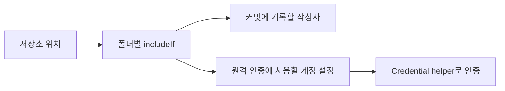

### 1. 개요 및 배경 (Context)

- **질문 요지** 회사 폴더와 개인 폴더에서 Git 인증 계정이 자동으로 바뀌게 할 수 있는가? 커밋 작성자 이름과 이메일도 폴더별로 지정해 달라고 이어서 요청함.
- 같은 컴퓨터에서 회사 저장소와 개인 저장소를 오갈 때, 상위 폴더에 따라 Git 설정이 자동으로 바뀌게 할 수 있는지 질문함.
- 필요한 조건은 커밋에 올바른 작성자가 기록되고, fetch와 push는 해당 저장소에 접근할 수 있는 계정으로 실행되는 것임.

### 2. 핵심 내용 / 문제 해결 과정 (Core / Troubleshooting)

- **답변에서 고른 방법** Git의 조건부 설정 `includeIf`를 폴더에 연결함. 새로 복제하는 저장소에도 위치만으로 설정을 적용할 수 있고, 원격 인증 계정과 커밋 작성자를 각각 지정할 수 있기 때문임. 실제 접속에 쓸 자격 증명의 유무는 별도로 확인함.
- 문제를 **커밋 작성자와 원격 인증**으로 나눔. `user.name`과 `user.email`은 커밋 메타데이터이며, credential helper는 HTTPS 원격 접속에 쓰이는 자격 증명을 찾는 역할임.
- 한 전역 설정을 쓰면 관리 지점은 적지만 회사와 개인 저장소에 같은 값이 적용됨. 저장소마다 지정하면 예외 처리는 쉽고, 새로 복제할 때마다 설정을 반복해야 함.
- 반복 설정을 줄이기 위해 상위 폴더별 Git 조건부 설정인 `includeIf`를 적용함. 저장소 위치에 따라 작성자 설정과 인증에서 사용할 계정이 선택되도록 구성하는 방식임. 저장소 위치를 옮기면 새 위치에서 어떤 설정을 읽는지 다시 확인해야 함.

- 이날 기록에는 조건부 설정 적용까지 남음. 두 계정으로 실제 저장소에 접근하고 설정을 확인한 것은 다음 날이었음.

### 3. 인사이트 및 적용점 (Takeaway & Next Action)

- 작성자를 확인했다는 결과와 원격 인증을 확인했다는 결과를 각각 남겨야 함. 커밋 기록이 올바르더라도 원격 저장소 권한은 계정에 따라 달라짐.
- 비슷한 구성을 점검할 때는 각 폴더의 저장소에서 유효한 설정과 출처를 확인한 뒤 원격 읽기 권한까지 따로 검사할 수 있음.
