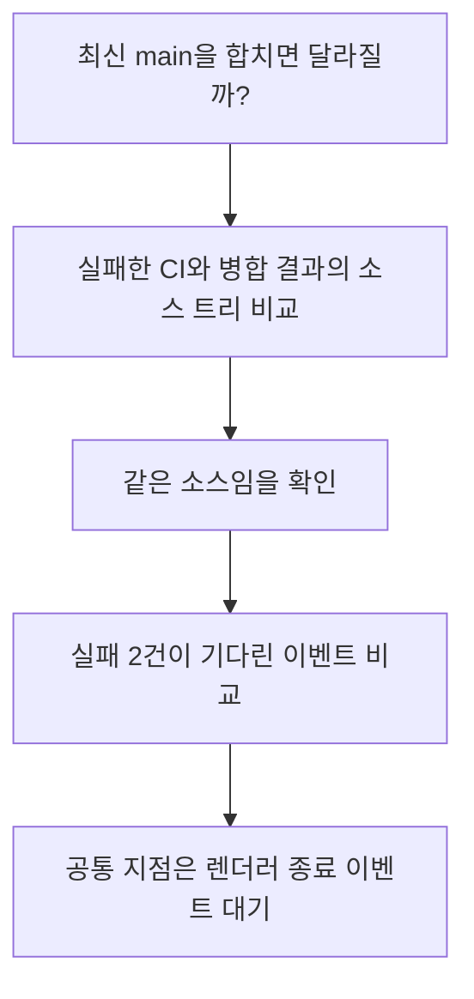

### 1. 개요 및 배경 (Context)

- **질문 요지** E2E가 실패한 변경에 최신 `main`을 병합해도 같은 실패가 남는가?
- Electron 앱의 E2E가 실패했을 때 최신 `main`을 병합하면 해결되는지 확인하는 작업이었음.
- 비교 기준은 로컬 브랜치 이름보다 **실패한 CI가 실제로 검사한 코드**였음. CI가 PR에 기준 브랜치를 합친 결과를 검사하는 경우, 로컬에서 별도로 병합해도 검사 대상 내용은 같을 수 있음.

### 2. 핵심 내용 / 문제 해결 과정 (Core / Troubleshooting)

- **답변에서 고른 방법** 재실행에 앞서 실패한 CI의 소스 트리와 최신 `main`을 병합했을 때의 트리를 대조함. 사용자가 묻는 병합 효과는 실제 검사할 코드가 달라져야 생기므로, 이 비교로 최신 코드 미반영 가설부터 좁힐 수 있었음.
- 실패 실행이 포함한 기준 브랜치 커밋을 확인하고, 최신 `main`을 합쳤을 때의 소스 트리와 비교함. 이미 최신 `main`이 포함돼 있었고 결과 트리도 같았음. 따라서 새로 병합하는 것만으로 코드 차이가 생긴다는 가설을 제거할 수 있었음.
- 기존 실행에서는 **51개 통과, 2개 실패, 1개 제외**로 기록됨. 실패한 두 시나리오는 각각 렌더러 종료 보고서와 네이티브 덤프를 확인했고, 둘 다 **20초 안에 렌더러 종료 이벤트를 받지 못한 지점**에서 중단됨.
- 기준 브랜치 병합을 다시 하는 방법은 소스 차이가 있을 때 의미가 있음. 동일 소스에서 실행을 반복하면 일시적 실패인지 살필 수 있지만, 재실행이 통과하더라도 이벤트가 빠졌던 이유는 추가로 확인해야 함. 당시에는 트리 비교와 기존 CI 분석까지 진행함.

### 3. 인사이트 및 적용점 (Takeaway & Next Action)

- 타임아웃은 테스트가 더 진행하지 못한 위치를 알려 줌. 종료 자체가 일어나지 않았는지, 이벤트가 관찰 경로에 도달하지 못했는지는 이 로그만으로 구분하기 어려움.
- 후속 재현에서는 종료 요청, 실제 프로세스 종료, 테스트의 이벤트 수신을 순서대로 기록하면 어느 단계가 끊겼는지 좁힐 수 있음.
