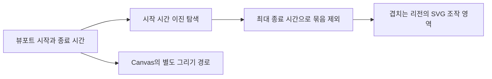

### 1. 개요 및 배경 (Context)

- **질문 요지** 가상 스크롤이 이미 보이는 범위를 고르는데 이진 탐색은 어디서 필요한가? 화면의 픽셀 범위를 다시 초로 바꾸는 이유는 무엇인가?
- 다중 트랙 타임라인에서 가상화 범위를 이미 좁혔는데도, 스크롤할 때 SVG에 표시할 리전을 찾으려고 트랙의 전체 목록을 검사하고 있었음.
- 리전은 타임라인에 배치된 편집 구간임. 조회 기준은 미디어 원본 안의 위치가 아니라 타임라인 위의 시작과 종료 시간임. Canvas는 파형과 썸네일을, SVG는 클릭과 드래그처럼 조작할 영역을 맡았음.

### 2. 핵심 내용 / 문제 해결 과정 (Core / Troubleshooting)

- **답변에서 고른 방법** 가상 스크롤의 `count`부터 확인함. 이 구현에서 `count`는 고정 폭 화면 구간 수였으므로, 해당 구간과 겹치는 리전을 별도로 찾아야 했음. 인덱스를 초 단위로 유지하면 확대 배율이 바뀌어도 색인을 재사용하고 화면 범위만 다시 환산할 수 있음.
- **전체 순회**는 입력 순서나 겹침과 관계없이 찾을 수 있고 별도 색인이 필요 없지만, 화면에 리전이 몇 개만 보여도 조회할 때마다 모든 리전을 검사함.
- 시작 시간순 목록에 **이진 탐색**을 적용하면 화면 오른쪽 바깥에서 시작하는 리전을 한 번에 제외할 수 있음. 화면 왼쪽보다 먼저 시작했더라도 끝이 화면 안까지 이어지는 긴 리전은 여전히 후보임.
- 그래서 리전 묶음의 **최대 종료 시간**을 트리에 함께 보관하는 구조를 확인함. 묶음 전체가 화면 왼쪽에서 끝난 경우에만 건너뜀. 스크롤 중 재사용할 수 있는 대신 리전 목록이 바뀔 때 색인을 다시 만드는 시간과 메모리가 듦.

- **조회 테스트 입력** 2초 길이의 리전 700개를 2.5초 간격으로 배치하고 1,000~~1,024초 구간을 조회함. 전체 순회에서 검사할 리전은 700개이고, 시간 인덱스 테스트의 확인값은 **개별 리전 검사 10회, 반환 10개**였음. 별도 중첩 사례에서 0~~1,800초 리전 하나를 더하고 1,500~1,524초를 조회하자 **검사 11회, 반환 11개**였음. 이 카운터에는 이진 탐색 비교와 트리 노드 방문이 포함되지 않음.
- **앱 성능에 관해 남은 기록** 타임라인 글과 당시 정리에는 18개 트랙, 1,518개 리전에서 시간 인덱스와 스크롤 구독 변경을 함께 적용한 뒤 Long Task 누적 시간이 **4,418 ms → 1,154 ms**로 줄었다고 기록돼 있음. 저장소에서 확인한 계측 코드는 Electron을 자동 조작하고 `PerformanceObserver`로 Long Task를 수집하는 방식임. 이 수치의 원본 실행 로그와 반복 횟수는 확인하지 못했으며, 앞의 조회 테스트나 어느 한 변경의 독립 효과와는 다른 결과임. [타임라인 최적화 글](/posts/timeline-performance-region-index-decision)
- 같은 스크롤에서 Canvas 갱신 알림 때문에 트랙 행이 다시 실행되는 경로도 확인함. 이 비용은 색인과 별개로 [10월 7일의 구독 경로](/til/2026-10-07)에서 다룸.

### 3. 인사이트 및 적용점 (Takeaway & Next Action)

- 가상화 효과를 확인할 때는 **화면에 그린 개수, 표시 후보를 찾는 비용, React 컴포넌트 재실행 횟수**를 따로 봐야 함. 그래야 하나가 줄었을 때 실제 병목도 줄었는지 판단할 수 있음.
- 긴 리전이 짧은 리전과 겹치거나 리전 위치를 자주 편집하는 데이터에서는, 누락 여부와 색인 재구축 비용을 함께 확인할 필요가 있음.
