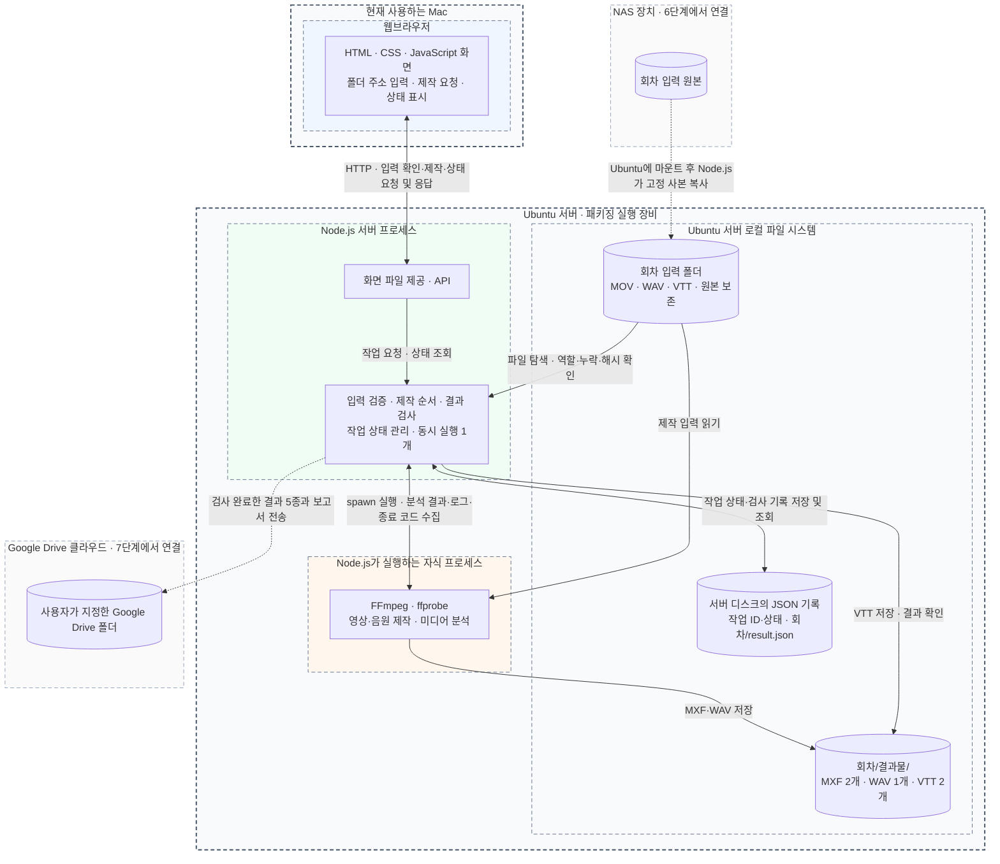
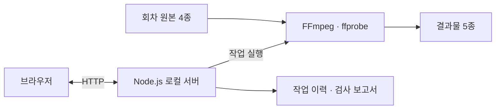

## 1. 프로젝트 기록

<!-- prettier-ignore-start -->

<!-- 프로젝트 원문 시작 -->

- **Situation (상황):** 삼성 TVplus 에 ai 더빙납품할때 패키징 매뉴얼이 있다. 이번에 들어갔던 시간은 20시간에 총 결과물은 1.7테라정도. 기술부 실무진 분이 이 패키징을 담당하였는데 일일이 각 필요한과정을 직접 해야했다. 각 파일들을 챗과 이메일 nas 등 개인마다 전부 다른방식으로 전달해와서 하나하나 취합하고 패키징하느라 매일이 야근에 내내 이 일에만 매달리느라 엄청 고생을 하셨다고한다. 소비한 시간은 2주간 풀 야근 및 주말에도 업무를 하셨으니, 2주간 주말과 야근을 포함해 **약 150시간 이상(약 18~20 Man-Day)**의 순수 수작업 리소스가 단일 패키징 작업 하나에 매몰되던 상황. 이번은 20시간이었으니 망정이지 11월엔 500시간을 들어가게된다고한다. 기하급수적으로 투입 리소스가 늘어나게되는 아찔한 상황이다.
동고동락하는 동료의 힘든 상황을 모른체 할 수 없는 법. 진행하던 프로젝트인 다이나 스튜디오도 안정화되고, 11월이 되기 전까지 이 문제를 어떻게든 해결해봐야겠다. 부장님과 대표님께 의견을 말씀드리니 아주 반가워하며 서포트를 약속해주셨다. 프론트엔드로 일해와서 백엔드쪽은 잘 알지는 못하지만, 하나씩 공부하면서 해나가면 되겠지.
- **Task (목표):** 이 패키징에 프로그램이 아예 없는것은 아니었다. 버튼을 누르고, 설정을 입력해서 하나 하나 프로세스를 거치고 파일을 취합하고, 제목을 직접 바꾸고 하는 추가적인 자동화 과정이 없었을 뿐. 동료 백엔드분이 개발해두신 로직이 있었고, 해당로직을 자동화해서 사람이 아예신경을 쓰지않아도되는 환경으로 만드는것이 목표였다. 본격적으로 들어가기 전 패키징 과정에대해 설명을 간략히 하자면 이렇다.
1. 다음 원본 소스를 입력한다.

    ```markdown
    작품명/
    └── 회차/
        ├── 원어 오디오가 포함된 원본 MOV/
        ├── 영어 더빙 WAV/
        ├── 영어 대사 VTT/
        └── 영어 SDH VTT/
    ```

    1. 기본설정은 다음과 같다. 이 프로세스를 적용한다.
    - 오디오: -24 LUFS, 최대 -2 dBTP, PCM 24bit / 48kHz / 스테레오.
    - 자막: Noto Sans Bold, 크기 42, 흰색 글자, 검은 외곽선 2, 그림자 0, 배경 끔, 여백 10%. VTT의 위치와 줄바꿈은 보존합니다.
    - 영상: 원본 해상도·FPS를 읽고, 기본 오디오 트랙이 있으면 사용하며 없으면 첫 트랙을 선택합니다.
    - FN: 별도 입력이 없으면 SDH에서 추출합니다.
    1. 일정한 형태의 결과물로 패키징한다.

        ```
        결과물/
        ├── 원어 오디오 + 영어 SDH 자막 영상/       # MXF
        ├── 영어 더빙 + 필요한 FN 자막 영상/       # MXF
        ├── 보정한 영어 더빙 음원/                 # WAV
        ├── 영어 대사 자막/                        # VTT
        └── 영어 SDH 자막/                         # VTT
        ```


    정말정말 쉽게 설명해서 이렇게 정리할 수 있겠다. 가장 어려웠던 점은, 해당 업무에대한 지식이 전무한 상태에서 클로드가 짠 레거시 코드와 클로드가 작성한 인간이 알아볼 수 없는 형태의 문서…..
    이것부터 이해하고 단순화해서 작성해야했다. 폴더명도 알아보기 쉽도록 한글로 바꾸었다. 아래는 수정 전 설정된 폴더명(사실상 필요없는 입력소스도 포함되어있어, 제거하였다.)

    !image.png

    ai가 문서를 너무 많이 찍어대고,, 결국엔 stale 해져버린 문서들은 개발에 혼선을 준다고 생각한다. 그래서 문서에도 단일진실공급원을 정해둔다.

    !image.png

    !dyn-ead1a6c695c46b16ec2d1ddbea8edfe2.png

- **Action (행동):** 우리회사는 NAS 를 사용하고있다. 그리고 납품은 클라이언트측에서 정해준 구글드라이브링크에 올리면된다. 가장 효율적인 방식은 무엇일까?
정해진 폴더에 작업을 완료한 실무자가 직접 파일을 업로드하는 방식이라고 생각했다. 그리고 필요한 파일이 모두 업로드되면 패키징이 자동으로 돌아가도록 한다. 이것은 서버에서 폴링을 하면 되겠다.
이전에 업로드시간때문에 많이 고초를 겪었다고 들었는데, usb 를 이용해서 파일을 주고받으면 좋겠지만 자동화가 안된다. 그냥 구글드라이브에 바로 올리기로 한다. 그리고 만약 수정을 해야해서 수정본을 다시 업로드하면? 해당 프로세스가 다시 트리거되어 수정된 파일이 바로 올라가도록. 검수는? 검수자 또한 해당 구글드라이브안에 있는 컨텐츠들로 검수를 한다. 납품되는 컨텐츠를 구글드라이브 SSOT 구조로 통일한 것이다. (이전에는 SSD에 넣어서 전달, 구글드라이브는 검수용이 따로 있고 정말 마지막으로 완료된 버전을 최종 드라이브에 올리는 방식으로 했다고 한다. 하지만 이렇게되면 수정이 일어날때마다 새로 사람이 다시 최종 드라이브에 올리게 되는 일이 분명히 발생하고, 불필요한 비용이 생긴다.)

이 프로세스는 어디에서 돌아가게 할까? 감사하게도 남는 pc 에 서버를 띄울 수 있도록 회사에서 지원해주셨다. ㅎㅎ ububtu 를깔아서 서버를 띄우고, 내 업무용 맥에서 원격으로 접근해서 작업하는방식으로 할 것인데, 이부분도 너무 기대가 된다. 직접 서버를 띄우는것은 처음이다. 서버를 직접 띄우고 백엔드 프론트엔드 리포를 따로 작업하여 (프론트엔드 웹뷰가 필요하지않을 수 있지만, 개발자가 아닌 실무진들이 작업과정을 확인하거나 설정을 변경할 때 용이하도록 제작해보려고 한다. ) A to Z 전부 다 해볼 수 있는 기회인 것이다. 어떠한 권능(?)이 느껴진다…
목표하는 구조는 아래와 같다.



더 단순화하면 이렇다.



<!-- 프로젝트 원문 끝 -->

<!-- prettier-ignore-end -->

이건 이 작업을하면서 다시한번 복습한 내용들.. 여태껏 그냥 당현하게 쓰고 있었던것들이 내가 직접 인프라를 구축해보려니 정말 모르고있는게 많았다. 반성하며 빈 지식들을 메꿔나간다.

## 2. 백엔드·인프라 복습 Q&A

<!-- prettier-ignore-start -->

<!-- 복습 Q&A 원문 시작 -->

**Q. 도커(Docker)와 도커 컴포즈(Docker Compose)는 무엇인가요?**

**A.** 도커는 애플리케이션과 실행에 필요한 런타임 환경을 컨테이너 단위로 패키징하여, 서로 다른 환경에서도 일관되게 실행할 수 있도록 하는 컨테이너 플랫폼입니다.

도커 컴포즈는 프론트엔드, 백엔드, 데이터베이스처럼 여러 컨테이너로 구성된 환경을 `compose.yaml` 또는 `docker-compose.yml` 파일 하나로 정의하고, `docker compose up -d` 명령어로 실행하고 관리하는 도구입니다.

---

**Q. 도커와 가상 머신(VM)의 차이는 무엇인가요?**

**A.** 가상 머신은 하이퍼바이저 위에 각각의 게스트 운영체제를 실행하지만, 도커 컨테이너는 호스트 OS의 커널을 공유하면서 프로세스 수준에서 격리됩니다.

도커는 Namespace와 cgroups를 활용하여 프로세스와 리소스를 격리합니다. 별도의 운영체제를 실행하지 않기 때문에 일반적으로 가상 머신보다 가볍고 빠르게 실행할 수 있습니다.

---

**Q. Dockerfile, Image, Container의 차이는 무엇인가요?**

**A.**
- `Dockerfile`: 도커 이미지를 생성하기 위한 빌드 명령과 설정을 작성한 파일입니다.
- `Image`: 애플리케이션 실행에 필요한 코드, 라이브러리, 런타임 등을 포함한 불변 템플릿입니다.
- `Container`: 이미지를 기반으로 실행된 격리된 프로세스 인스턴스입니다.

즉, Dockerfile로 이미지를 빌드하고, 이미지를 실행하면 컨테이너가 생성됩니다.

---

**Q. 도커는 어떤 문제를 해결하나요?**

**A.** 로컬 개발 환경과 운영 환경 사이의 차이로 발생하는 환경 불일치(Environment Drift) 문제를 줄여줍니다.

예를 들어 Node.js 버전이나 시스템 라이브러리, 패키지 설정이 서로 달라 발생하는 오류를 줄이고, 개발·테스트·배포 환경을 일관되게 관리할 수 있습니다.

---

**Q. 도커 컴포즈는 여러 컨테이너를 어떻게 관리하나요?**

**A.** YAML 파일에 각 서비스의 이미지, 포트, 볼륨, 네트워크, 환경변수, 의존성을 선언합니다.

이를 통해 컨테이너마다 `docker run` 명령어를 반복하지 않고도 `docker compose up -d` 한 번으로 여러 서비스를 실행하고 서로 통신하도록 구성할 수 있습니다.

---

**Q. 도커 컴포즈가 필요한 경우와 필요하지 않은 경우는 언제인가요?**

**A.** 프론트엔드, 백엔드, Redis, PostgreSQL처럼 여러 서비스가 함께 실행되어야 하는 로컬 개발 및 테스트 환경에서 유용합니다.

반대로 단일 애플리케이션만 실행하거나, 외부 관리형 서비스를 사용해 로컬에서 함께 실행할 서비스가 없다면 반드시 필요하지는 않습니다.

대규모 분산 운영 환경에서는 Kubernetes나 AWS ECS 같은 오케스트레이션 도구를 사용할 수 있습니다.

---

**Q. 프론트엔드 개발에서는 도커와 도커 컴포즈를 어떻게 활용하나요?**

**A.** 로컬 개발 환경에서 API 모킹 서버, PostgreSQL, Redis 등을 별도로 설치하지 않고 실행하는 데 활용할 수 있습니다.

또한 CI/CD 과정에서 Next.js 등 Node.js 애플리케이션을 빌드하고, 멀티 스테이지 빌드(Multi-stage Build)로 개발 의존성과 불필요한 파일을 제외하여 배포 이미지 크기를 줄일 수 있습니다.

---

**Q. 도커 컴포즈와 쿠버네티스(Kubernetes)의 차이는 무엇인가요?**

**A.** 도커 컴포즈는 주로 단일 호스트에서 여러 컨테이너를 간단하게 실행하고 관리하기 위한 도구입니다.

쿠버네티스는 여러 서버로 구성된 클러스터에서 컨테이너를 관리하며, 오토스케일링, 셀프 힐링, 로드 밸런싱, 롤링 업데이트 등 분산 운영 기능을 제공합니다.

---

**Q. Redis는 무엇인가요?**

**A.** Redis는 메모리 기반의 고성능 데이터 저장소입니다. 데이터 캐싱, 세션 관리, 작업 큐, 실시간 데이터 처리 등에 활용됩니다.

자주 조회하는 데이터를 메모리에 저장하면 응답 시간을 단축하고 메인 데이터베이스의 부하를 줄일 수 있습니다.

---

**Q. 노드 클러스터링(Node Clustering)이란 무엇인가요?**

**A.** 여러 서버 또는 Node.js 프로세스를 하나의 서비스처럼 구성해 트래픽을 분산 처리하는 기술입니다.

여러 CPU 코어를 활용하여 처리량을 높이고, 특정 인스턴스에 장애가 발생했을 때 다른 인스턴스가 요청을 처리할 수 있도록 구성할 수 있습니다.

---

**Q. 오토스케일링(Auto Scaling)이란 무엇인가요?**

**A.** CPU 사용률, 메모리 사용량, 요청 수 등의 지표에 따라 서버 인스턴스나 파드 수를 자동으로 늘리거나 줄이는 기능입니다.

트래픽이 증가하면 인스턴스를 확장하고, 감소하면 축소하여 서비스 가용성과 비용 효율성을 관리합니다.

---

**Q. 무중단 롤링 배포(Rolling Deployment)란 무엇인가요?**

**A.** 실행 중인 인스턴스를 하나씩 순차적으로 새로운 버전으로 교체하는 배포 방식입니다.

전체 서비스를 한 번에 종료하지 않고 일부 인스턴스가 요청을 처리하는 동안 나머지를 교체하여 서비스 중단을 최소화합니다.

---

**Q. 클라이언트와 서버는 어떻게 통신하나요?**

**A.** 일반적으로 HTTP/HTTPS 프로토콜을 통해 요청과 응답을 주고받습니다.

클라이언트는 REST API나 GraphQL을 이용해 서버에 데이터를 요청하고, 서버는 요청을 처리한 뒤 JSON 등의 형식으로 응답합니다.

브라우저에서는 `fetch`, `Axios`, `TanStack Query` 등을 활용할 수 있습니다.

실시간 양방향 통신이 필요하면 WebSocket을, 서버에서 클라이언트로 지속적인 데이터 전송이 필요하면 SSE를 사용할 수 있습니다.

---

**Q. HTTP 요청과 응답은 어떤 순서로 이루어지나요?**

**A.** 일반적인 HTTP 통신은 다음 순서로 이루어집니다.

1. 클라이언트가 서버와 네트워크 연결을 수립합니다.
2. HTTPS라면 TLS 핸드셰이크를 수행합니다.
3. 클라이언트가 `GET`, `POST`, `PUT`, `DELETE` 등의 HTTP 메서드와 헤더, 본문을 전송합니다.
4. 서버가 요청을 처리합니다.
5. 서버가 `200`, `400`, `500` 등의 상태 코드와 응답 데이터를 반환합니다.
6. 클라이언트가 응답을 처리하여 화면을 갱신합니다.

HTTP 요청과 응답에는 `Cache-Control`, `ETag` 등을 활용한 캐싱 전략도 적용할 수 있습니다.

---

**Q. WebSocket이란 무엇인가요?**

**A.** WebSocket은 클라이언트와 서버가 하나의 연결을 유지하면서 양방향으로 데이터를 주고받을 수 있는 통신 프로토콜입니다.

일반적으로 HTTP 핸드셰이크를 통해 WebSocket 연결로 전환하고, 이후 `ws://` 또는 `wss://` 프로토콜을 사용합니다.

지속적인 연결을 사용하기 때문에 실시간 채팅, 협업 도구, 주식 시세, 실시간 주문 상태 처리 등에 적합합니다.

---

**Q. SSE(Server-Sent Events)란 무엇인가요?**

**A.** SSE는 HTTP 연결을 유지하면서 서버가 클라이언트로 데이터를 지속적으로 전송하는 단방향 스트리밍 기술입니다.

브라우저의 `EventSource` API를 사용할 수 있고, 기본적인 자동 재연결 기능을 지원합니다.

AI 응답 스트리밍, 알림, 실시간 피드, 대시보드 데이터 갱신 등에 활용할 수 있습니다.

---

**Q. HTTP, WebSocket, SSE의 차이는 무엇인가요?**

**A.** HTTP는 클라이언트의 요청에 대해 서버가 응답하는 방식이며, 일반적인 CRUD 작업이나 초기 데이터 조회에 적합합니다.

WebSocket은 연결을 유지하며 양방향 통신을 지원하므로 실시간 채팅이나 공동 편집처럼 양쪽에서 지속적으로 데이터를 전송하는 기능에 적합합니다.

SSE는 서버에서 클라이언트로 데이터를 지속적으로 전송하는 단방향 통신으로, AI 응답 스트리밍이나 알림 등에 적합합니다.

---

**Q. 실시간 데이터 동기화에서 폴링(Polling) 대신 WebSocket이나 SSE를 사용하는 이유는 무엇인가요?**

**A.** 폴링은 일정한 간격으로 서버에 반복적으로 요청하는 방식이므로 데이터 변경이 없어도 네트워크 요청이 발생합니다.

WebSocket과 SSE는 연결을 유지하면서 변경된 데이터를 전송할 수 있기 때문에, 업데이트가 빈번한 서비스에서 불필요한 요청과 네트워크 비용을 줄이는 데 유리합니다.

다만 실시간성 요구가 낮거나 구현 단순성이 중요하면 폴링도 적절한 선택이 될 수 있습니다.

---

**Q. 모바일 웹이나 불안정한 네트워크 환경에서 통신 실패를 어떻게 처리하나요?**

**A.** 네트워크 단절이나 타임아웃을 고려하여 지수 백오프(Exponential Backoff) 기반의 재시도 전략을 적용할 수 있습니다.

오프라인 상태에서도 사용자가 작업을 이어가도록 낙관적 업데이트(Optimistic Update)를 적용하고, 실패한 요청을 IndexedDB 기반 Outbox Queue에 저장한 뒤 연결이 복구되면 재전송할 수 있습니다.

또한 Single-flight 패턴으로 중복 동기화를 방지할 수 있습니다.

---

**Q. HTTP와 HTTPS의 차이는 무엇인가요?**

**A.** HTTP는 클라이언트와 서버가 데이터를 주고받기 위한 애플리케이션 계층 프로토콜입니다. 통신 자체를 암호화하지 않기 때문에 전송 데이터가 노출되거나 변조될 위험이 있습니다.

HTTPS는 HTTP 통신에 TLS 암호화를 적용한 방식입니다. 데이터 기밀성, 무결성, 서버 인증을 제공하여 안전한 통신을 지원합니다.

일반적으로 HTTP는 80번, HTTPS는 443번 포트를 사용합니다.

---

**Q. SSL과 TLS는 무엇인가요?**

**A.** SSL과 TLS는 인터넷 통신 구간에서 데이터의 기밀성, 무결성, 인증을 제공하기 위한 암호화 프로토콜입니다.

SSL은 과거에 사용된 프로토콜이며, 현재는 보안이 강화된 TLS를 사용합니다.

HTTPS는 TLS를 통해 서버 인증서를 검증하고 암호화된 데이터를 전송합니다.

---

**Q. HTTPS의 TLS 핸드셰이크는 어떻게 동작하나요?**

**A.** TLS 핸드셰이크는 클라이언트와 서버가 안전한 통신을 시작하기 위한 과정입니다.

1. 클라이언트가 지원하는 TLS 버전, 암호화 방식, 무작위 데이터 등을 전송합니다.
2. 서버가 사용할 암호화 방식을 선택하고 인증서를 전송합니다.
3. 클라이언트가 인증서의 유효성과 도메인 일치 여부를 확인합니다.
4. 양측이 키 교환 절차를 통해 공통 암호화 키를 생성합니다.
5. 생성한 세션키를 사용해 HTTP 데이터를 암호화하여 통신합니다.

TLS 버전에 따라 구체적인 키 교환 과정은 달라집니다.

---

**Q. HTTPS에서 대칭키와 비대칭키를 함께 사용하는 이유는 무엇인가요?**

**A.** 비대칭키 암호화는 공개키와 개인키를 사용하며, 안전한 키 교환과 신원 인증에 활용할 수 있습니다. 하지만 대용량 데이터를 직접 암호화하기에는 연산 비용이 큽니다.

대칭키 암호화는 동일한 키로 암호화와 복호화를 수행하므로 처리 속도가 빠르지만, 공유 키를 안전하게 확보해야 합니다.

따라서 TLS는 비대칭키 기반 인증·키 교환 기술을 이용해 세션키를 안전하게 생성하고, 실제 데이터 통신에는 빠른 대칭키 암호화를 사용합니다.

---

**Q. 브라우저는 서버 인증서를 어떻게 신뢰하나요?**

**A.** 브라우저와 운영체제에는 신뢰할 수 있는 루트 인증기관(CA)의 인증서가 저장되어 있습니다.

서버가 인증서를 전달하면 브라우저는 인증서의 서명과 인증서 체인, 유효기간, 도메인 일치 여부 등을 검증합니다.

이를 통해 접속한 서버가 신뢰할 수 있는 인증서를 가지고 있는지 확인합니다.

---

**Q. TLS 1.3은 이전 버전보다 무엇이 개선되었나요?**

**A.** TLS 1.3은 핸드셰이크 과정을 단순화하여 일반적인 새 연결 수립에 필요한 왕복 횟수를 1-RTT로 줄였습니다.

과거 TLS 1.2의 일반적인 전체 핸드셰이크는 2-RTT가 필요했습니다.

TLS 1.3은 세션 재개 시 0-RTT Early Data를 지원하여 일부 데이터를 더 빠르게 전송할 수도 있습니다.

---

**Q. HTTPS를 사용해도 중간자 공격(MITM)이 가능한가요?**

**A.** 정상적으로 인증서를 검증하는 HTTPS 연결은 중간자 공격을 방어하지만, 신뢰할 수 없는 루트 인증서가 기기에 설치되거나 인증서 검증이 우회되는 경우 트래픽이 가로채질 수 있습니다.

고보안 환경에서는 특정 서버 인증서나 공개키를 검증하는 Certificate Pinning 기법을 추가로 적용하기도 합니다.

---

**Q. 프론트엔드에서 HTTPS를 사용해야 하는 이유는 무엇인가요?**

**A.** HTTPS는 개인정보와 인증 정보를 안전하게 전송하기 위한 기본적인 보안 수단입니다.

또한 Service Worker, Geolocation API, 카메라·마이크 접근 등 여러 브라우저 기능은 보안 컨텍스트에서만 사용할 수 있습니다.

HTTPS는 이러한 보안 요구사항을 충족하고 최신 웹 기능을 안전하게 사용하는 기반이 됩니다.

---

**Q. 멀티플렉싱(Multiplexing)이란 무엇인가요?**

**A.** 멀티플렉싱은 하나의 연결을 통해 여러 데이터 스트림을 동시에 처리하는 기술입니다.

HTTP/2는 요청과 응답을 프레임 단위로 나누고 스트림 식별자를 부여하여 하나의 TCP 연결 안에서 여러 요청을 병렬로 처리합니다.

이를 통해 HTTP/1.1에서 발생하던 요청 처리상의 비효율을 줄일 수 있습니다.

---

**Q. HOL Blocking(Head-of-Line Blocking)이란 무엇인가요?**

**A.** 먼저 처리해야 할 요청이나 데이터가 지연되면서 뒤에 있는 요청이나 데이터의 처리까지 지연되는 현상입니다.

HTTP/1.1에서는 하나의 연결에서 요청과 응답을 처리하는 방식 때문에 이러한 문제가 발생할 수 있습니다.

HTTP/2는 멀티플렉싱으로 애플리케이션 계층의 HOL Blocking을 완화하지만, TCP 계층의 HOL Blocking 문제는 남아 있습니다.

---

**Q. Mixed Content 오류란 무엇이며 어떻게 해결하나요?**

**A.** HTTPS 페이지에서 HTTP로 제공되는 이미지, 스크립트, API 등의 리소스를 요청할 때 발생하는 보안 문제입니다.

브라우저는 리소스 유형에 따라 요청을 차단하거나 HTTPS로 자동 업그레이드합니다.

이를 해결하려면 정적 파일과 API 엔드포인트를 HTTPS로 통일하고, 필요한 경우 Content Security Policy의 `upgrade-insecure-requests` 지시문을 사용할 수 있습니다.

---

**Q. 프론트엔드와 백엔드를 분리할 때 무엇을 고려해야 하나요?**

**A.** 주요 고려사항은 네트워크 보안, 인증, API 계약, 타입 동기화, 독립적인 배포 구조입니다.

서로 다른 출처에서 통신한다면 CORS 정책을 설정해야 하고, 쿠키나 토큰을 사용하는 인증 방식을 설계해야 합니다.

또한 OpenAPI 기반 타입 자동 생성이나 MSW를 활용하여 API 계약을 유지하고, 프론트엔드와 백엔드가 독립적으로 개발하고 배포할 수 있도록 CI/CD를 구성해야 합니다.

---

**Q. CORS(Cross-Origin Resource Sharing)란 무엇인가요?**

**A.** CORS는 브라우저의 동일 출처 정책(SOP)에 따라 제한되는 다른 출처의 리소스 접근을 서버가 명시적으로 허용할 수 있도록 하는 메커니즘입니다.

출처(Origin)는 프로토콜, 호스트, 포트의 조합으로 결정됩니다.

서버가 적절한 `Access-Control-Allow-Origin` 등의 응답 헤더를 제공하면 브라우저가 다른 출처의 응답을 자바스크립트에서 사용할 수 있도록 허용합니다.

---

**Q. 단순 요청(Simple Request)과 프리플라이트 요청(Preflight Request)의 차이는 무엇인가요?**

**A.** 단순 요청은 정해진 메서드와 헤더 등의 조건을 만족하면 별도의 사전 확인 없이 전송되는 CORS 요청입니다.

프리플라이트 요청은 브라우저가 실제 요청을 전송하기 전에 `OPTIONS` 메서드로 서버의 허용 정책을 확인하는 방식입니다.

서버가 출처, 메서드, 헤더 등을 허용하면 실제 요청을 전송하고, 조건에 맞지 않으면 브라우저가 차단합니다.

---

**Q. 프리플라이트 요청은 어떤 경우에 발생하나요?**

**A.** 단순 요청의 조건을 벗어난 교차 출처 요청에서 발생합니다.

대표적으로 `Content-Type: application/json`을 사용하거나, `Authorization` 같은 비단순 요청 헤더를 포함하거나, `PUT`, `PATCH`, `DELETE` 등의 메서드를 사용할 때 발생합니다.

---

**Q. 실무에서 프리플라이트 요청이 자주 발생하는 이유는 무엇인가요?**

**A.** 현대 웹 애플리케이션은 JSON 기반 API, 토큰 인증, 다양한 HTTP 메서드를 사용하기 때문입니다.

단순 요청에서 허용되는 대표적인 Content-Type은 `text/plain`, `application/x-www-form-urlencoded`, `multipart/form-data`입니다.

반면 JSON API의 `application/json`이나 `Authorization` 헤더는 단순 요청 조건을 벗어나기 때문에 프리플라이트 검증이 필요할 수 있습니다.

---

**Q. 프리플라이트 요청의 성능을 어떻게 최적화하나요?**

**A.** 서버 응답에 `Access-Control-Max-Age` 헤더를 설정하여 프리플라이트 결과를 일정 시간 캐싱할 수 있습니다.

예를 들어 `Access-Control-Max-Age: 86400`을 설정하면 브라우저가 허용하는 범위 내에서 결과를 재사용하여 반복적인 `OPTIONS` 요청을 줄일 수 있습니다.

---

**Q. 서버는 200 OK를 반환했는데 프론트엔드에서 CORS 오류가 발생하는 이유는 무엇인가요?**

**A.** CORS는 브라우저가 적용하는 보안 정책이기 때문입니다.

서버가 요청을 정상적으로 처리하고 200 OK를 반환해도, 브라우저가 응답 헤더를 확인했을 때 올바른 `Access-Control-Allow-Origin`이 없다면 자바스크립트에서 응답 데이터를 읽지 못하도록 차단할 수 있습니다.

---

**Q. Credentialed Request란 무엇인가요?**

**A.** 쿠키 등 인증 정보를 포함하여 전송하는 요청입니다.

교차 출처 요청에서 쿠키를 사용하려면 클라이언트가 `fetch`의 `credentials: 'include'` 또는 Axios의 `withCredentials: true` 등을 설정해야 합니다.

서버도 적절한 `Access-Control-Allow-Credentials: true`와 구체적인 `Access-Control-Allow-Origin`을 반환해야 합니다.

---

**Q. 인증 정보를 포함하는 CORS 요청에서 와일드카드(*)를 사용할 수 없는 이유는 무엇인가요?**

**A.** 인증 정보가 포함된 교차 출처 요청의 응답을 브라우저에서 사용할 수 있도록 허용할 때는 `Access-Control-Allow-Origin: *`를 사용할 수 없습니다.

서버는 허용할 출처를 명시해야 하며, `Access-Control-Allow-Credentials: true`도 함께 설정해야 합니다.

이는 인증된 응답이 임의의 웹사이트에 노출되는 위험을 줄이기 위한 정책입니다.

---

**Q. CORS 문제는 어떻게 해결하나요?**

**A.** 대표적으로 세 가지 방식이 있습니다.

1. 백엔드에서 허용할 Origin을 화이트리스트로 관리하고 CORS 응답 헤더를 설정합니다.
2. 운영 환경에서 Nginx나 API Gateway 같은 리버스 프록시를 사용해 브라우저 기준으로 동일한 출처에서 요청하도록 구성합니다.
3. 개발 환경에서는 Vite, Next.js, Webpack 등의 프록시 기능으로 로컬 요청을 중계합니다.

필요에 따라 `Access-Control-Allow-Methods`, `Access-Control-Allow-Headers`, `Access-Control-Allow-Credentials`, `Access-Control-Max-Age` 등을 설정합니다.

---

**Q. 개발 서버 프록시(Dev Server Proxy)는 어떻게 동작하나요?**

**A.** 브라우저가 로컬 개발 서버의 `/api` 경로로 요청하면 개발 서버가 해당 요청을 실제 백엔드 서버로 전달하고 응답을 중계합니다.

예를 들어 브라우저는 `localhost:3000/api`로 요청하고, 개발 서버는 이를 `localhost:8080`으로 전달할 수 있습니다.

브라우저는 동일 출처로 요청하기 때문에 CORS 문제를 피할 수 있으며, 개발 서버와 백엔드 사이의 통신에는 브라우저의 동일 출처 정책이 적용되지 않습니다.

---

**Q. application/json이란 무엇인가요?**

**A.** HTTP 메시지 본문이 JSON 형식의 데이터임을 나타내는 MIME 타입입니다.

`Content-Type: application/json` 헤더를 설정하면 데이터를 수신하는 쪽에서 본문을 JSON 형식으로 해석할 수 있습니다.

React, Next.js 등의 프론트엔드와 REST API 서버 사이에서 구조화된 데이터를 주고받을 때 자주 사용합니다.

---

**Q. 리버스 프록시(Reverse Proxy)란 무엇인가요?**

**A.** 클라이언트와 내부 서버 사이에 위치하여 요청을 대신 받고 적절한 내부 서버로 전달한 뒤, 서버의 응답을 클라이언트에 반환하는 중계 서버입니다.

주로 Nginx, Cloudflare, API Gateway 등을 사용하며, 로드 밸런싱, 요청 라우팅, TLS 종료, 내부 서버 구조 은닉 등의 역할을 수행합니다.

---

**Q. 리버스 프록시를 사용하는 이유는 무엇인가요?**

**A.** 내부 서버의 주소와 포트를 직접 노출하지 않고, 하나의 진입점에서 여러 서버로 요청을 분산할 수 있기 때문입니다.

예를 들어 `service.com/` 요청은 프론트엔드로, `service.com/api/` 요청은 백엔드로 전달할 수 있습니다.

또한 TLS 종료, 로드 밸런싱, 보안 정책 적용 등을 리버스 프록시에서 처리할 수 있습니다.

---

**Q. SSL Termination(TLS Termination)이란 무엇인가요?**

**A.** 클라이언트와의 HTTPS 연결에서 TLS 암호화와 복호화 처리를 리버스 프록시나 로드 밸런서가 담당하는 방식입니다.

이를 통해 각 내부 서버가 TLS 연결을 직접 처리해야 하는 부담을 줄이고 인증서 관리를 중앙화할 수 있습니다.

내부 서버와의 통신은 보안 요구사항에 따라 HTTP 또는 HTTPS로 구성할 수 있습니다.

---

**Q. 포워드 프록시(Forward Proxy)란 무엇인가요?**

**A.** 클라이언트와 외부 인터넷 사이에서 클라이언트의 요청을 대신 전달하는 중계 서버입니다.

외부 서버는 직접 요청한 클라이언트 대신 프록시 서버의 IP를 확인하게 됩니다.

회사나 학교의 내부망에서 접근 제어, 보안 필터링, 캐싱, 클라이언트 IP 은닉 등에 활용됩니다.

---

**Q. 포워드 프록시와 리버스 프록시의 차이는 무엇인가요?**

**A.** 포워드 프록시는 클라이언트 측에 위치하여 클라이언트를 대신해 외부 서버로 요청을 보냅니다. 주로 접근 제어, 클라이언트 IP 은닉, 캐싱에 활용됩니다.

리버스 프록시는 서버 측에 위치하여 서버를 대신해 요청을 받아 처리합니다. 주로 로드 밸런싱, 내부 서버 은닉, TLS 종료, 단일 도메인 라우팅에 활용됩니다.

---

**Q. withCredentials와 SameSite의 차이는 무엇인가요?**

**A.** `withCredentials`는 Axios에서 교차 출처 요청에 쿠키 등의 자격 증명을 포함하도록 설정하는 클라이언트 옵션입니다. `fetch`에서는 `credentials` 옵션을 사용합니다.

`SameSite`는 쿠키가 같은 사이트 또는 다른 사이트에서 발생한 요청에 어떻게 포함될지를 제어하는 쿠키 속성입니다.

`SameSite=Strict`, `Lax`, `None` 등의 값을 사용하며, `SameSite=None`에는 `Secure`가 필요합니다.

---

**Q. 프론트엔드와 백엔드의 도메인이 다를 때 쿠키 인증을 어떻게 처리하나요?**

**A.** 먼저 두 도메인이 단순히 출처만 다른지, 서로 다른 사이트인지 구분해야 합니다.

교차 출처 요청에서 쿠키를 사용한다면 프론트엔드에서는 `credentials: 'include'` 또는 `withCredentials: true`를 설정하고, 백엔드에서는 자격 증명을 허용하는 CORS 헤더를 반환해야 합니다.

서로 다른 사이트 간에 쿠키를 전송해야 한다면 `SameSite=None; Secure` 설정이 필요할 수 있으며, 브라우저의 서드파티 쿠키 정책도 고려해야 합니다.

---

**Q. 쿠키 기반 인증과 토큰 기반 인증은 어떻게 설계하나요?**

**A.** 핵심은 인증 상태를 안전하게 유지하면서 XSS와 CSRF 위험을 고려하는 것입니다.

장기 보관하는 Refresh Token이나 세션 정보는 JavaScript에서 직접 읽을 수 없는 `HttpOnly`, `Secure` 쿠키에 저장하는 방식을 고려할 수 있습니다.

Access Token은 짧은 만료 시간을 설정하고 메모리에 유지하는 방식 등을 사용할 수 있습니다.

쿠키를 사용하는 경우 `SameSite`나 CSRF 토큰 등의 방어 전략을 함께 고려해야 합니다.

---

**Q. XSS(Cross-Site Scripting)란 무엇인가요?**

**A.** 공격자가 악의적인 자바스크립트를 웹페이지에 삽입하여 다른 사용자의 브라우저에서 실행되도록 만드는 보안 취약점입니다.

이를 통해 로컬 스토리지에 저장된 인증 정보가 탈취되거나, 가짜 입력 화면을 통해 개인정보가 유출될 수 있습니다.

방어 방법으로는 사용자 입력의 안전한 출력 처리, HTML 이스케이프, CSP(Content Security Policy), `HttpOnly` 쿠키 등이 있습니다.

---

**Q. CSRF(Cross-Site Request Forgery)란 무엇인가요?**

**A.** 사용자가 이미 인증된 웹사이트의 권한을 악용하여 사용자의 의도와 무관한 요청을 발생시키는 공격입니다.

브라우저가 쿠키를 자동으로 전송하는 특성을 악용할 수 있습니다.

이를 방어하기 위해 `SameSite` 쿠키 속성, CSRF 토큰 검증, Origin 검증, 중요한 작업에 대한 추가 인증 등을 적용합니다.

---

**Q. localStorage, sessionStorage, HttpOnly 쿠키의 차이는 무엇인가요?**

**A.** `localStorage`는 브라우저에 데이터를 지속적으로 저장하고, `sessionStorage`는 탭 세션 동안 데이터를 저장합니다. 두 저장소 모두 같은 출처의 자바스크립트에서 접근할 수 있으므로 XSS 공격에 취약할 수 있습니다.

`HttpOnly` 쿠키는 자바스크립트에서 직접 읽을 수 없기 때문에 인증 토큰을 스크립트로 탈취하는 위험을 줄일 수 있습니다.

다만 쿠키는 요청 시 자동 전송될 수 있으므로 CSRF 방어도 필요합니다.

---

**Q. Access Token 만료로 여러 API 요청이 동시에 401 응답을 받으면 어떻게 처리하나요?**

**A.** Single-flight 패턴을 적용하여 토큰 재발급 요청이 중복으로 발생하지 않도록 처리할 수 있습니다.

첫 번째 401 응답에서 토큰 갱신 Promise를 생성하고, 이후 발생한 요청들은 동일한 Promise의 완료를 기다리도록 합니다.

갱신에 성공하면 새로운 토큰으로 실패한 요청들을 재실행하고, 갱신에 실패하면 인증 상태를 해제하거나 재로그인을 요청합니다.

이 방식은 중복 발급과 경쟁 상태(Race Condition)를 줄이는 데 도움이 됩니다.

---

**Q. 서로 다른 서브도메인에서 쿠키를 공유하려면 어떻게 해야 하나요?**

**A.** 예를 들어 `fe.toss.im`과 `api.toss.im`에서 쿠키를 공유해야 한다면, 쿠키 발급 시 `Domain=toss.im`을 설정하여 해당 도메인의 서브도메인에서 사용할 수 있도록 구성할 수 있습니다.

두 주소는 서로 다른 Origin이지만 일반적으로 같은 Site로 취급됩니다.

따라서 교차 출처 요청을 위한 CORS 및 credentials 설정과 쿠키의 Domain, Path, SameSite, Secure 속성을 함께 확인해야 합니다.

---

**Q. 프론트엔드와 백엔드의 API 계약 및 타입을 어떻게 동기화하나요?**

**A.** API 스키마의 단일 진실 공급원(SSOT)을 정의하고 이를 기반으로 타입을 자동 생성하는 방식을 사용할 수 있습니다.

예를 들어 백엔드에서 OpenAPI(Swagger) 스펙을 정의하면 프론트엔드에서 `openapi-typescript`나 `Orval`을 사용하여 TypeScript 타입과 API 호출 코드를 생성할 수 있습니다.

이를 통해 수동으로 타입을 작성할 때 발생하는 불일치를 줄이고, API 변경을 빌드 단계에서 감지할 수 있습니다.

---

**Q. 백엔드 API 개발이 완료되지 않았을 때 프론트엔드는 어떻게 개발하나요?**

**A.** 먼저 OpenAPI 명세를 바탕으로 데이터 타입과 API 계약을 정의합니다.

이후 MSW(Mock Service Worker)를 사용하여 실제 API와 동일한 형태의 응답을 반환하도록 모킹합니다.

이를 통해 백엔드 구현을 기다리지 않고 UI와 비즈니스 로직을 개발하고 테스트할 수 있습니다.

백엔드가 준비되면 모킹을 비활성화하고 실제 API로 전환할 수 있습니다.

---

**Q. API Breaking Change는 어떻게 대응하나요?**

**A.** 기존 클라이언트가 정상적으로 동작할 수 있도록 하위 호환성을 유지하는 것이 중요합니다.

기존 필드를 즉시 삭제하기보다 `deprecated` 처리한 뒤 새 필드를 병행 제공하고, 점진적으로 이전 버전을 제거할 수 있습니다.

또한 CI에서 OpenAPI 스펙 변경 사항을 비교하여 필드 삭제나 타입 변경 같은 호환성 문제를 사전에 탐지할 수 있습니다.

---

**Q. 프론트엔드와 백엔드의 CI/CD를 독립적으로 구성해야 하는 이유는 무엇인가요?**

**A.** 서로 다른 배포 주기와 실행 환경을 가지기 때문입니다.

프론트엔드는 정적 에셋 캐싱과 캐시 무효화 전략을 중심으로 배포할 수 있고, 백엔드는 컨테이너 기반 롤링 배포나 블루-그린 배포 등을 활용할 수 있습니다.

양쪽의 배포를 독립적으로 관리하면 한쪽 변경으로 다른 서비스의 배포가 불필요하게 지연되는 문제를 줄일 수 있습니다.

---

**Q. 포트(Port)란 무엇인가요?**

**A.** 하나의 IP 주소에서 여러 네트워크 서비스나 프로세스를 구분하기 위해 사용하는 번호입니다.

예를 들어 웹 서버는 80 또는 443번, 백엔드 API는 8080번, PostgreSQL은 5432번 포트를 사용할 수 있습니다.

IP가 서버를 식별한다면 포트는 서버 내에서 통신할 서비스를 구분하는 역할을 합니다.

---

**Q. 포트 포워딩(Port Forwarding)이란 무엇인가요?**

**A.** 공유기나 방화벽 등의 외부 네트워크 장치로 들어온 특정 포트의 트래픽을 내부 네트워크의 특정 서버와 포트로 전달하는 설정입니다.

예를 들어 외부의 8080번 포트로 들어온 요청을 내부 서버의 3000번 포트로 전달하도록 구성할 수 있습니다.

---

**Q. DNS의 A 레코드와 CNAME 레코드의 차이는 무엇인가요?**

**A.** A 레코드는 도메인 이름을 IPv4 주소에 직접 연결하는 DNS 레코드입니다.

예를 들어 `api.service.com`을 `13.125.1.20`에 연결할 수 있습니다.

CNAME 레코드는 도메인을 다른 도메인의 별칭으로 연결합니다.

예를 들어 `fe.service.com`을 `d123.cloudfront.net`과 같은 CDN 도메인에 연결할 수 있습니다.

---

**Q. Node.js 서버를 배포할 때 PM2 같은 프로세스 관리자를 사용하는 이유는 무엇인가요?**

**A.** Node.js 애플리케이션을 백그라운드에서 지속적으로 실행하고 상태를 관리하기 위해 사용합니다.

PM2나 systemd는 프로세스 자동 재시작, 로그 관리, 실행 상태 모니터링 등을 지원합니다.

PM2는 클러스터 모드도 제공하여 하나의 애플리케이션을 여러 프로세스로 실행하고 CPU 코어를 활용할 수 있도록 합니다.

---

**Q. Node.js의 클러스터 모드(Cluster Mode)는 무엇인가요?**

**A.** 여러 개의 독립적인 Node.js 워커 프로세스를 실행하여 서버의 여러 CPU 코어를 활용하는 방식입니다.

각 워커가 요청을 나누어 처리하므로 단일 프로세스보다 높은 처리량을 확보할 수 있습니다.

또한 특정 워커가 종료되면 새로운 워커를 실행하도록 구성하여 서비스의 가용성을 높일 수 있습니다.

---

**Q. Node.js 클러스터 모드에서 워커 간 메모리는 공유되나요?**

**A.** 기본적으로 각 워커는 독립적인 프로세스이므로 자바스크립트 힙 메모리를 직접 공유하지 않습니다.

따라서 한 워커의 전역 변수에 저장한 세션이나 캐시를 다른 워커에서 바로 읽을 수 없습니다.

여러 워커에서 공유해야 하는 세션이나 캐시 데이터는 Redis 같은 외부 저장소에 보관하는 방식이 적합합니다.

---

**Q. Stateless(무상태) 서버란 무엇인가요?**

**A.** 개별 요청을 처리하는 데 필요한 사용자 상태를 특정 서버 프로세스의 로컬 메모리에 의존하지 않는 서버 구조입니다.

세션이나 공유 상태를 Redis, 데이터베이스 등의 외부 저장소에 관리하면 여러 서버 인스턴스가 같은 사용자 요청을 처리하기 쉬워집니다.

이를 통해 로드 밸런싱과 수평 확장이 수월해집니다.

---

**Q. 스케일업(Scale-Up)과 스케일아웃(Scale-Out)의 차이는 무엇인가요?**

**A.** 스케일업은 기존 서버의 CPU, RAM 등 하드웨어 성능을 높이는 수직적 확장입니다.

스케일아웃은 서버 인스턴스의 수를 늘리는 수평적 확장입니다.

스케일업은 구조가 단순하지만 한 대의 서버에서 확보할 수 있는 성능에 한계가 있고, 스케일아웃은 여러 서버로 트래픽을 분산하여 확장할 수 있습니다.

---

**Q. 로드 밸런서(Load Balancer)란 무엇인가요?**

**A.** 여러 서버 인스턴스에 네트워크 요청을 분산하는 장치 또는 소프트웨어입니다.

라운드로빈 등 다양한 알고리즘을 사용하여 요청을 분배하고, 헬스 체크를 통해 장애가 발생한 서버를 요청 대상에서 제외할 수 있습니다.

이를 통해 트래픽 처리량과 서비스 가용성을 높일 수 있습니다.

---

**Q. 헬스 체크(Health Check)란 무엇인가요?**

**A.** 서버나 애플리케이션이 정상적으로 요청을 처리할 수 있는지 주기적으로 확인하는 기능입니다.

로드 밸런서는 헬스 체크 결과를 바탕으로 정상적인 서버에만 요청을 전달하고, 장애가 발생한 서버는 트래픽 대상에서 제외할 수 있습니다.

---

**Q. 무중단 배포(Zero-Downtime Deployment)란 무엇인가요?**

**A.** 새로운 버전의 애플리케이션을 배포하는 동안 서비스 이용 중단을 방지하거나 최소화하는 배포 방식입니다.

대표적인 전략으로 롤링 배포, 블루-그린 배포, 카나리 배포가 있습니다.

---

**Q. 롤링 배포, 블루-그린 배포, 카나리 배포의 차이는 무엇인가요?**

**A.** 롤링 배포는 기존 인스턴스를 순차적으로 새 버전으로 교체합니다. 추가 리소스를 상대적으로 적게 사용할 수 있지만 배포 중 이전 버전과 새 버전이 공존할 수 있습니다.

블루-그린 배포는 기존 환경(Blue)과 신규 환경(Green)을 별도로 구성하고 트래픽을 전환합니다. 빠른 롤백에 유리하지만 추가 인프라 비용이 발생합니다.

카나리 배포는 일부 사용자나 트래픽에만 새 버전을 먼저 제공한 뒤 오류율 등을 확인하면서 점진적으로 배포 범위를 확대합니다.

---

**Q. 프론트엔드와 백엔드의 배포 아키텍처가 다른 이유는 무엇인가요?**

**A.** 애플리케이션의 실행 방식과 리소스 특성이 다르기 때문입니다.

정적 프론트엔드는 HTML, JavaScript, CSS 파일을 S3 같은 객체 스토리지에 배포하고 CloudFront 같은 CDN을 이용해 제공할 수 있습니다.

백엔드는 데이터베이스 통신과 비즈니스 로직을 실행해야 하므로 Node.js나 JVM 등의 서버 런타임을 유지하는 환경이 필요합니다.

따라서 EC2, ECS, Kubernetes 같은 환경에서 컨테이너 배포, 오토스케일링, 로드 밸런싱 등을 적용할 수 있습니다.

---

**Q. 글로벌 엣지 캐싱(Global Edge Caching)이란 무엇인가요?**

**A.** 전 세계에 분산된 CDN 엣지 서버에 정적 리소스를 캐싱하여 사용자와 가까운 위치에서 콘텐츠를 제공하는 기술입니다.

원본 서버까지 데이터를 요청하는 횟수를 줄이고 네트워크 지연 시간(RTT)을 단축하여 응답 속도를 개선할 수 있습니다.

---

**Q. 런타임 환경(Runtime Environment)이란 무엇인가요?**

**A.** 프로그램이 실행되는 동안 필요한 실행 엔진, 메모리, 라이브러리, 시스템 리소스 등이 구성된 환경입니다.

예를 들어 Node.js 애플리케이션은 Node.js 런타임을 사용하며, Java 애플리케이션은 JVM 환경에서 실행됩니다.

---

**Q. 라운드로빈(Round Robin)이란 무엇인가요?**

**A.** 여러 대상에게 작업을 순서대로 돌아가며 분배하는 스케줄링 알고리즘입니다.

예를 들어 서버 A, B, C가 있다면 요청을 A → B → C → A 순서로 분배할 수 있습니다.

구현이 단순하며 로드 밸런싱이나 프로세스 스케줄링 등에 활용됩니다.

---

**Q. Node.js 클러스터 모드에서 라운드로빈은 어떻게 동작하나요?**

**A.** 메인 프로세스가 여러 워커 프로세스를 관리하고, 들어오는 연결을 워커에 분배할 수 있습니다.

라운드로빈 방식을 사용하면 요청을 워커들에 순서대로 할당하여 여러 CPU 코어에서 병렬로 처리하도록 구성할 수 있습니다.

각 워커는 독립된 프로세스이므로 공유 상태는 별도의 저장소로 관리해야 합니다.

---

**Q. 서버의 고가용성(High Availability)이란 무엇인가요?**

**A.** 일부 서버나 구성 요소에 장애가 발생해도 서비스를 계속 사용할 수 있도록 설계하는 특성입니다.

로드 밸런싱, 다중 인스턴스, 헬스 체크, 자동 재시작, 무중단 배포, 오토스케일링 등의 기술을 조합하여 가용성을 높일 수 있습니다.

<!-- 복습 Q&A 원문 끝 -->

<!-- prettier-ignore-end -->

관련 글: [150시간의 수작업, 0시간으로 자동화하기](/posts/media-delivery-packaging-automation)

## 기록의 범위

프로젝트 기록과 복습 Q&A는 사용자가 제공한 원문을 수록했습니다. 프로젝트 도식은 렌더링에 필요한 들여쓰기와 줄 끝 공백만 조정했습니다. 작성일은 사용자 요청에 따라 **2026년 10월 6일**로 배치했으며, 원문에 실제 작성 시각이 포함된 것은 아닙니다.

프로젝트 원문의 이미지 세 곳은 파일명 표기만 전달됐고 실제 이미지 파일은 첨부되지 않아 원문의 표기를 그대로 남겼습니다. 복습 Q&A는 학습 자료이며, 이 기술들을 모두 프로젝트에 도입하거나 운영 검증을 마쳤다는 의미는 아닙니다.
