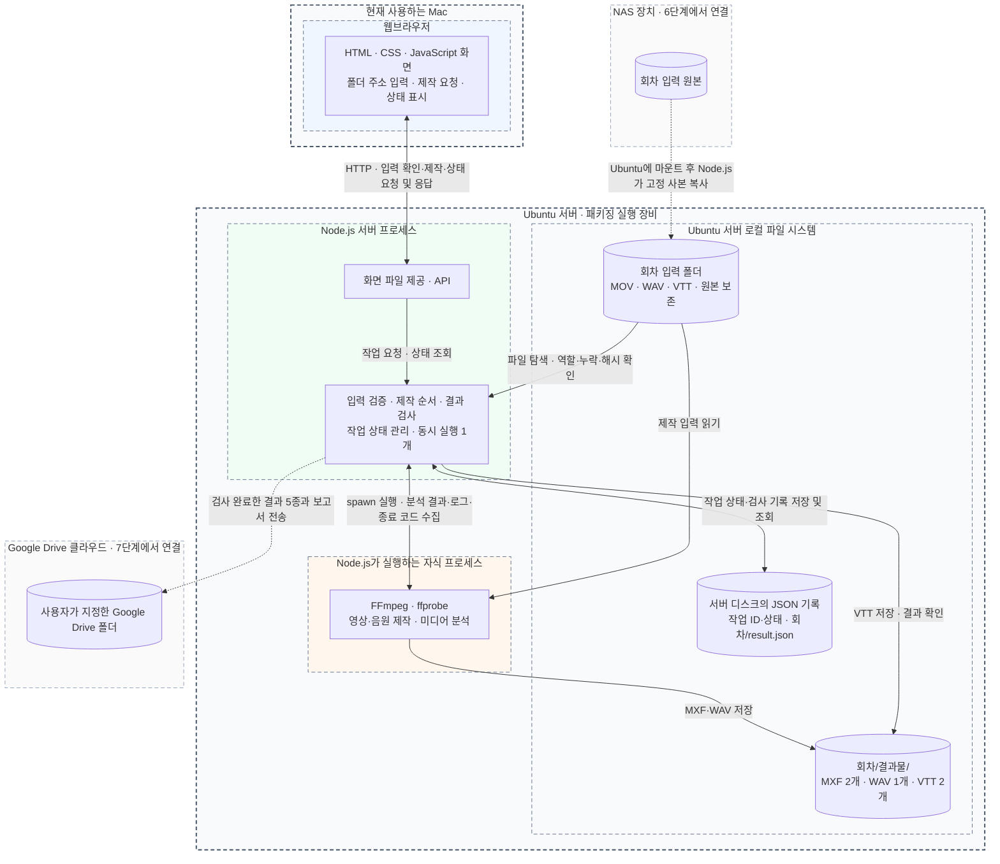
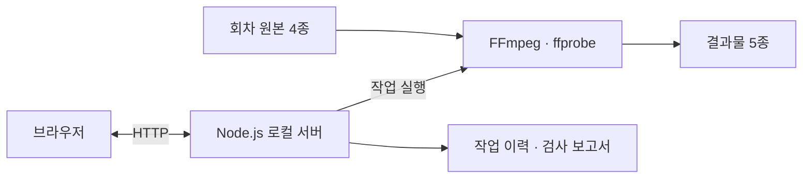

## 1. 프로젝트 기록

<!-- prettier-ignore-start -->

<!-- 프로젝트 원문 시작 -->

- **Situation (상황):** 삼성 TVplus 에 ai 더빙납품할때 패키징 매뉴얼이 있다. 이번에 들어갔던 시간은 20시간에 총 결과물은 1.7테라정도. 기술부 실무진 분이 이 패키징을 담당하였는데 일일이 각 필요한과정을 직접 해야했다. 각 파일들을 챗과 이메일 nas 등 개인마다 전부 다른방식으로 전달해와서 하나하나 취합하고 패키징하느라 매일이 야근에 내내 이 일에만 매달리느라 엄청 고생을 하셨다고한다. 소비한 시간은 2주간 풀 야근 및 주말에도 업무를 하셨으니, 2주간 주말과 야근을 포함해 **약 150시간 이상(약 18~20 Man-Day)**의 순수 수작업 리소스가 단일 패키징 작업 하나에 매몰되던 상황. 이번은 20시간이었으니 망정이지 11월엔 500시간을 들어가게된다고한다. 기하급수적으로 투입 리소스가 늘어나게되는 아찔한 상황이다.
동고동락하는 동료의 힘든 상황을 모른체 할 수 없는 법. 진행하던 프로젝트인 다이나 스튜디오도 안정화되고, 11월이 되기 전까지 이 문제를 어떻게든 해결해봐야겠다. 부장님과 대표님께 의견을 말씀드리니 아주 반가워하며 서포트를 약속해주셨다. 프론트엔드로 일해와서 백엔드쪽은 잘 알지는 못하지만, 하나씩 공부하면서 해나가면 되겠지.
- **Task (목표):** 이 패키징에 프로그램이 아예 없는것은 아니었다. 버튼을 누르고, 설정을 입력해서 하나 하나 프로세스를 거치고 파일을 취합하고, 제목을 직접 바꾸고 하는 추가적인 자동화 과정이 없었을 뿐. 동료 백엔드분이 개발해두신 로직이 있었고, 해당로직을 자동화해서 사람이 아예신경을 쓰지않아도되는 환경으로 만드는것이 목표였다. 본격적으로 들어가기 전 패키징 과정에대해 설명을 간략히 하자면 이렇다.
1. 다음 원본 소스를 입력한다.

    ```markdown
    작품명/
    └── 회차/
        ├── 원어 오디오가 포함된 원본 MOV/
        ├── 영어 더빙 WAV/
        ├── 영어 대사 VTT/
        └── 영어 SDH VTT/
    ```

    1. 기본설정은 다음과 같다. 이 프로세스를 적용한다.
    - 오디오: -24 LUFS, 최대 -2 dBTP, PCM 24bit / 48kHz / 스테레오.
    - 자막: Noto Sans Bold, 크기 42, 흰색 글자, 검은 외곽선 2, 그림자 0, 배경 끔, 여백 10%. VTT의 위치와 줄바꿈은 보존합니다.
    - 영상: 원본 해상도·FPS를 읽고, 기본 오디오 트랙이 있으면 사용하며 없으면 첫 트랙을 선택합니다.
    - FN: 별도 입력이 없으면 SDH에서 추출합니다.
    1. 일정한 형태의 결과물로 패키징한다.

        ```
        결과물/
        ├── 원어 오디오 + 영어 SDH 자막 영상/       # MXF
        ├── 영어 더빙 + 필요한 FN 자막 영상/       # MXF
        ├── 보정한 영어 더빙 음원/                 # WAV
        ├── 영어 대사 자막/                        # VTT
        └── 영어 SDH 자막/                         # VTT
        ```


    정말정말 쉽게 설명해서 이렇게 정리할 수 있겠다. 가장 어려웠던 점은, 해당 업무에대한 지식이 전무한 상태에서 클로드가 짠 레거시 코드와 클로드가 작성한 인간이 알아볼 수 없는 형태의 문서…..
    이것부터 이해하고 단순화해서 작성해야했다. 폴더명도 알아보기 쉽도록 한글로 바꾸었다. 아래는 수정 전 설정된 폴더명(사실상 필요없는 입력소스도 포함되어있어, 제거하였다.)

    !image.png

    ai가 문서를 너무 많이 찍어대고,, 결국엔 stale 해져버린 문서들은 개발에 혼선을 준다고 생각한다. 그래서 문서에도 단일진실공급원을 정해둔다.

    !image.png

    !dyn-ead1a6c695c46b16ec2d1ddbea8edfe2.png

- **Action (행동):** 우리회사는 NAS 를 사용하고있다. 그리고 납품은 클라이언트측에서 정해준 구글드라이브링크에 올리면된다. 가장 효율적인 방식은 무엇일까?
정해진 폴더에 작업을 완료한 실무자가 직접 파일을 업로드하는 방식이라고 생각했다. 그리고 필요한 파일이 모두 업로드되면 패키징이 자동으로 돌아가도록 한다. 이것은 서버에서 폴링을 하면 되겠다.
이전에 업로드시간때문에 많이 고초를 겪었다고 들었는데, usb 를 이용해서 파일을 주고받으면 좋겠지만 자동화가 안된다. 그냥 구글드라이브에 바로 올리기로 한다. 그리고 만약 수정을 해야해서 수정본을 다시 업로드하면? 해당 프로세스가 다시 트리거되어 수정된 파일이 바로 올라가도록. 검수는? 검수자 또한 해당 구글드라이브안에 있는 컨텐츠들로 검수를 한다. 납품되는 컨텐츠를 구글드라이브 SSOT 구조로 통일한 것이다. (이전에는 SSD에 넣어서 전달, 구글드라이브는 검수용이 따로 있고 정말 마지막으로 완료된 버전을 최종 드라이브에 올리는 방식으로 했다고 한다. 하지만 이렇게되면 수정이 일어날때마다 새로 사람이 다시 최종 드라이브에 올리게 되는 일이 분명히 발생하고, 불필요한 비용이 생긴다.)

이 프로세스는 어디에서 돌아가게 할까? 감사하게도 남는 pc 에 서버를 띄울 수 있도록 회사에서 지원해주셨다. ㅎㅎ ububtu 를깔아서 서버를 띄우고, 내 업무용 맥에서 원격으로 접근해서 작업하는방식으로 할 것인데, 이부분도 너무 기대가 된다. 직접 서버를 띄우는것은 처음이다. 서버를 직접 띄우고 백엔드 프론트엔드 리포를 따로 작업하여 (프론트엔드 웹뷰가 필요하지않을 수 있지만, 개발자가 아닌 실무진들이 작업과정을 확인하거나 설정을 변경할 때 용이하도록 제작해보려고 한다. ) A to Z 전부 다 해볼 수 있는 기회인 것이다. 어떠한 권능(?)이 느껴진다…
목표하는 구조는 아래와 같다.



더 단순화하면 이렇다.



<!-- 프로젝트 원문 끝 -->

<!-- prettier-ignore-end -->

이건 이 작업을하면서 다시한번 복습한 내용들.. 여태껏 그냥 당현하게 쓰고 있었던것들이 내가 직접 인프라를 구축해보려니 정말 모르고있는게 많았다. 반성하며 빈 지식들을 메꿔나간다.

## 2. Docker와 Compose는 실행 환경과 서비스 구성을 나눠 이해했습니다

서버를 직접 구성하려니, 개발 환경에서 이미 준비돼 있던 런타임과 도구를 어디까지 설치·관리해야 하는지부터 고민하게 됐습니다. Dockerfile은 이미지를 만드는 정의이고, 이미지는 실행할 애플리케이션과 의존성을 담으며, 컨테이너는 그 이미지를 바탕으로 실행되는 인스턴스로 정리했습니다.

Docker Compose는 서비스들의 실행 설정을 YAML로 묶고, 네트워크·볼륨 등 함께 관리할 구성을 선언하는 도구입니다. API·DB·캐시 등을 같이 실행할 때 어떤 설정을 공유해야 하는지 파악하는 데 도움이 됩니다. [Docker Compose 공식 문서](https://docs.docker.com/compose/intro/features-uses/)

다만 컨테이너를 사용한다고 호스트의 자원, 파일 권한, 외부 저장소 같은 차이까지 사라지는 것은 아닙니다. 이번 기록에서는 **Docker·Compose·Kubernetes의 역할을 복습한 것과 실제 운영에 도입한 것을 구분**했습니다. 특정 배포 도구를 채택해 운영을 검증했다는 근거는 남아 있지 않습니다.

## 3. 제작 요청과 진행 상태 전달은 다른 요구사항이었습니다

브라우저에서 제작을 요청하는 일과, 오래 걸리는 제작의 진행 상태를 계속 보여 주는 일은 나눠 생각해야 했습니다. HTTP 요청·응답, 주기적으로 상태를 조회하는 폴링, SSE와 WebSocket을 복습했습니다.

특히 **SSE는 HTTP 응답을 유지하면서 서버에서 클라이언트로 이벤트를 전달하는 방식**입니다. 일반적인 요청·응답과 SSE를 비교할 때, SSE가 HTTP와 별개의 프로토콜이라고 이해하지 않도록 정리했습니다. [MDN SSE 가이드](https://developer.mozilla.org/en-US/docs/Web/API/Server-sent_events/Using_server-sent_events)

WebSocket은 양방향 메시지 교환이 필요한 경우와 연결해 봤습니다. 패키징 상태를 읽는 화면에 어떤 방식이 적합한지는 필요한 갱신 주기와 양방향 통신 여부를 기준으로 판단할 문제였습니다. 원문에는 통신 방식의 복습이 있고, SSE 구현·운영을 완료했다는 검증은 없습니다.

HTTPS도 다시 확인했습니다. TLS는 통신 구간의 암호화·무결성·상대 인증을 제공하는 프로토콜입니다. 인증서 검증과 안전한 연결 설정을 단순히 “암호화 옵션 하나”로 보지 않게 됐습니다. [MDN TLS 설명](https://developer.mozilla.org/en-US/docs/Web/Security/Defenses/Transport_Layer_Security)

## 4. 저장소 분리와 브라우저의 출처 분리는 다른 문제였습니다

프론트엔드와 백엔드 코드를 별도 저장소에 두는 것만으로 CORS가 발생하지는 않습니다. 브라우저가 요청하는 URL의 **프로토콜·호스트·포트로 결정되는 출처**를 봐야 했습니다.

CORS는 서버가 허용한 출처에 대해 브라우저가 응답 접근을 허용하는 방식입니다. 서버가 응답했어도 JavaScript에서 읽지 못할 수 있고, 프리플라이트가 필요한 요청은 사전 `OPTIONS` 검사를 통과하지 못해 본 요청 자체가 전송되지 않을 수도 있습니다. “CORS 오류면 서버는 항상 200을 보냈다”라고 일반화하면 안 됐습니다. [MDN CORS 가이드](https://developer.mozilla.org/en-US/docs/Web/HTTP/Guides/CORS)

대응 방식으로는 서버의 허용 출처 설정, 개발 서버 프록시, 운영 환경의 리버스 프록시를 복습했습니다. 브라우저가 같은 출처의 `/api`로 요청하고 프록시가 내부 API 서버로 전달하는 구성을 생각해 볼 수 있었습니다. 포워드 프록시는 클라이언트의 외부 요청을 중계하고, 리버스 프록시는 서비스 앞에서 내부 서버로 요청을 전달한다는 역할 차이도 정리했습니다.

이 내용은 배포 구성을 이해하기 위한 학습입니다. 실제로 CORS 장애를 재현하거나 특정 프록시 설정으로 해결한 기록은 제공 자료에 없습니다.

## 5. 쿠키 인증은 요청 옵션과 쿠키 속성을 함께 봐야 했습니다

다른 출처의 API에 쿠키를 포함하는 요청에서는 클라이언트와 서버 설정을 함께 확인해야 합니다. 복습한 항목은 다음과 같습니다.

- Fetch는 `credentials: 'include'`, Axios는 `withCredentials: true`를 사용합니다.
- 서버는 자격 증명을 포함한 응답에 `Access-Control-Allow-Credentials: true`와 허용할 구체적인 출처를 설정합니다. 이때 `Access-Control-Allow-Origin: *`로 대신할 수 없습니다.
- 쿠키 전송은 쿠키 속성과 브라우저의 제3자 쿠키 정책에도 영향을 받습니다. [MDN CORS 인증 요청 설명](https://developer.mozilla.org/en-US/docs/Web/HTTP/Guides/CORS#requests_with_credentials)

**Cross-Origin과 Cross-Site도 구분해야 했습니다.** 서로 다른 서브도메인은 출처가 달라도 같은 사이트에 속할 수 있으므로, 도메인이 다르다는 이유만으로 항상 `SameSite=None`이 필요한 것은 아닙니다. `Domain`은 쿠키를 보낼 호스트 범위를 지정하는 속성이고, `SameSite`는 사이트 간 요청에서 쿠키를 보낼 조건을 다룹니다. `SameSite=None`에는 `Secure`가 필요합니다. [MDN 쿠키 속성 설명](https://developer.mozilla.org/en-US/docs/Web/HTTP/Reference/Headers/Set-Cookie#attributes)

XSS는 페이지에서 악성 스크립트가 실행되는 문제이고, CSRF는 로그인된 사용자의 쿠키 등을 이용해 의도하지 않은 요청을 유도하는 문제로 나눠 봤습니다. `HttpOnly`는 JavaScript가 쿠키 값을 읽는 것을 막지만, 해당 쿠키가 요청에 포함되는 것까지 막지는 않습니다. 따라서 이것만으로 XSS와 CSRF가 모두 해결된다고 볼 수는 없습니다. [MDN HttpOnly 설명](https://developer.mozilla.org/en-US/docs/Web/HTTP/Reference/Headers/Set-Cookie#httponly)

Access Token 만료 때 여러 API가 동시에 401을 받는 상황도 복습했습니다. 갱신 Promise 하나를 공유해 중복 갱신을 막는 single-flight와, 각 요청의 재시도는 구분할 필요가 있었습니다. 이번 자료에서는 이 인증 흐름을 실제로 구현해 검증한 결과까지 확인하지는 않았습니다.

## 6. API 계약과 배포 방식도 분리의 비용에 포함됐습니다

저장소를 나누면 프론트엔드 타입과 실제 API 응답이 어긋나지 않게 관리할 방법도 필요했습니다. OpenAPI 명세를 기준으로 타입을 생성하는 방식과, MSW로 API 응답을 모킹해 화면을 개발하는 방식을 복습했습니다. 명세 변경 감지와 하위 호환성도 함께 생각해야 했습니다.

배포에서는 도메인과 포트가 어떤 실행 프로세스로 연결되는지부터 다시 정리했습니다. A 레코드와 CNAME, 포트 포워딩, 리버스 프록시의 라우팅이 각각 어느 지점에 관여하는지 확인할 질문을 모았습니다. PM2·systemd 같은 프로세스 관리자가 다루는 실행 유지와 재시작도 학습 범위였습니다. 자동 재시작 자체를 무중단 서비스의 보장으로 보지는 않았습니다.

Node.js 클러스터는 여러 워커 프로세스로 요청을 처리하는 구조이며, 워커 간 세션 같은 상태를 메모리에만 두는 데 제약이 있습니다. 여러 대의 서버로 확장하는 것과 한 장비에서 여러 프로세스를 실행하는 것도 구분했습니다. [Node.js 클러스터 문서](https://nodejs.org/api/cluster.html#how-it-works)

스케일업·스케일아웃, 로드 밸런서, 롤링·블루그린·카나리 배포 역시 복습했습니다. 정적 파일 제공과 동적인 API 실행의 요구사항을 나눠 보고, 프론트엔드가 서버 렌더링을 필요로 하는지도 함께 판단해야 한다는 질문으로 이어졌습니다. **이 도구와 전략들을 모두 이번 시스템에 도입했다는 의미는 아닙니다.**

## 7. 자동화의 목표와 실제로 확인한 성과를 나눠 남겼습니다

이번 자료에서 확인할 수 있는 것은 반복 작업의 문제, 파일 흐름을 통일하려는 선택, 서버 실행 구조의 구상과 그 과정에서 복습한 개념입니다. 원문의 결과와 비즈니스 기여 항목은 아직 작성되지 않았습니다. 따라서 **수작업 0시간 달성, 오류율 0%, 향후 절감 시간은 이 TIL의 검증된 결과로 쓰지 않았습니다.**

설계를 구체화하려면 다음을 확인해야겠습니다. 아래 항목은 이번 기록을 정리하면서 도출한 후속 질문입니다.

- 큰 파일의 업로드가 끝났다는 것을 어떤 조건으로 판단할까요?
- 수정본과 기존 작업을 구분하고 중복 실행을 막는 기준은 무엇일까요?
- 제작 중 실패하거나 서버가 재시작돼도 작업 상태와 기존 결과를 보존할 수 있을까요?
- 변환 완료와 자동 검사 통과, 사람의 검수·납품 승인을 어떻게 구분할까요?
- 같은 콘텐츠 분량을 기준으로 사람의 개입 시간과 기계의 처리 시간을 각각 어떻게 측정할까요?

프론트엔드에서 당연하게 호출하던 API도 직접 서버를 운영하려니 실행 환경·네트워크·인증·배포가 이어진 결과였습니다. 앞으로는 화면이 동작하는지에 더해, 그 화면 뒤의 작업을 누가 실행하고 어떤 근거로 완료를 판단하는지 함께 살펴보려 합니다.

관련 글: [150시간의 수작업, 0시간으로 자동화하기](/posts/media-delivery-packaging-automation)

## 기록의 범위

프로젝트 기록은 사용자가 제공한 원문을 그대로 수록했습니다. 렌더링에 필요한 들여쓰기와 줄 끝 공백만 조정했고, 문구와 도식 내용은 바꾸지 않았습니다. 이후 인프라 학습 내용은 별도로 제공한 복습 메모를 바탕으로 정리했습니다. 작성일은 사용자 요청에 따라 관련 글과 같은 **2026년 10월 6일**로 배치했습니다. 원문에는 실제 작성 시각이 없어, 대화가 이날 발생했다는 사실을 별도로 확인한 기록은 아닙니다.

프로젝트 원문의 이미지 세 곳은 파일명 표기만 전달됐고 실제 이미지 파일은 첨부되지 않아 원문의 표기를 그대로 남겼습니다. 인프라 학습 내용에서는 원문에 있는 요구사항·선택·계획과 공식 문서로 보완한 기술 설명을 구분했습니다. 구현 저장소·실행 로그·운영 지표는 이 자료에 포함돼 있지 않습니다.
