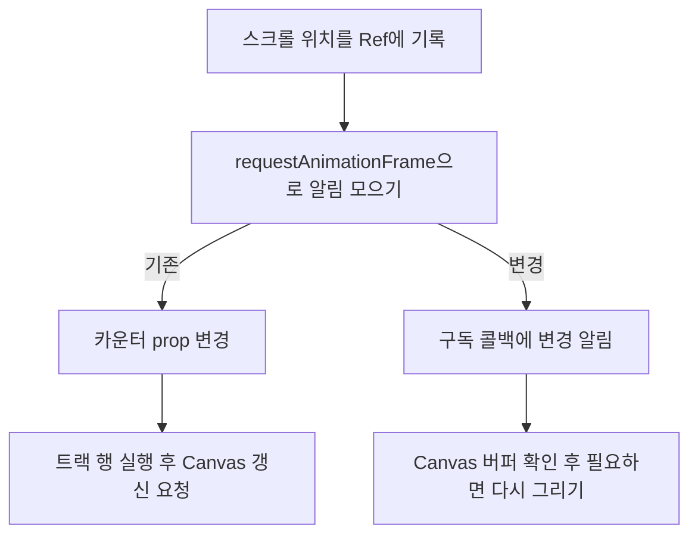

### 1. 개요 및 배경 (Context)

- **질문 요지** 스크롤 알림을 받는 경로가 바뀐 코드를 찾아 전후를 비교해 달라고 요청함. 기존 프레임 예약과 새로 도입한 구독의 역할을 알고 싶었음.
- 타임라인 스크롤 중 트랙 행 전체를 다시 실행하는 경로를 Canvas 갱신 구독으로 바꾼 전후 코드를 비교함.
- 코드에서 `Signal`이라고 부르던 객체가 계산된 값을 제공하는 반응형 상태인지, **변경을 알리는 발행과 구독 객체**인지도 함께 확인함.

### 2. 핵심 내용 / 문제 해결 과정 (Core / Troubleshooting)

- **답변에서 고른 방법** 스크롤 핸들러부터 프레임 콜백, 트랙 행의 갱신 함수까지 전후 호출 경로를 따라감. Ref와 프레임 예약은 기존에도 있었으므로, 알림이 숫자 prop을 거치는지 Canvas 구독 콜백에 직접 도착하는지를 비교해야 실제 변경이 드러났음.
- 기존에도 스크롤 위치를 Ref에 저장하고 `requestAnimationFrame`으로 알림을 모았음. 프레임 콜백에서 올리는 변경 카운터가 각 트랙 행의 prop에 들어가면서, `React.memo`가 있어도 숫자가 달라진 행은 다시 실행됐음.
- 변경 후 각 행에는 참조가 유지되는 객체를 전달함. 객체는 콜백을 `Set`에 등록하고 발행 시 콜백을 호출함. 콜백은 최신 위치를 Ref에서 읽을 수 있는 Canvas 갱신 경로를 호출함. 행이 해제되거나 구독 대상이 바뀌면 Effect 정리에서 기존 구독을 해제함.
- **prop 전달**은 React 데이터 흐름에서 읽기 쉽지만, 화면 구성에 필요 없는 알림에도 행을 실행시킴. **Pub/Sub**는 같은 알림을 Canvas에 전달하는 데 드는 React 작업을 줄이고, 구독의 등록과 해제를 관리할 책임을 추가함.

- 코드 비교로 **스크롤 알림만으로 트랙 행의 prop 비교가 달라지던 경로가 제거**됐음을 확인함. 발행은 구독한 행에 전달되며, 실제로 다시 그릴지는 Canvas가 현재 버퍼 범위를 검사해 결정함.
- **React 통합 테스트** 트랙 행 15개를 마운트한 뒤 부모를 갱신하면서 스크롤 신호를 240회 발행함. 테스트는 행 실행 횟수가 최초 **15회**에 머물고, Canvas 갱신 요청은 행마다 들어와 총 **3,600회**임을 확인하도록 구성됨. 모의 갱신 함수의 호출 횟수여서 실제 픽셀을 그린 횟수와 프레임 시간은 별도 지표임.

### 3. 인사이트 및 적용점 (Takeaway & Next Action)

- 이름보다 **값 보관 위치, 알림 전달 방식, 소비 시점**을 따라가면 패턴의 역할이 드러남. 이 객체에서 최신 좌표를 보관하는 곳은 Ref이고, 구독 객체는 읽을 시점을 알림.
- 최적화 효과를 다시 잴 때는 발행 횟수, React 행 실행 횟수, 실제 Canvas 그리기 횟수를 같이 기록해야 어떤 비용이 줄었는지 설명할 수 있음.
