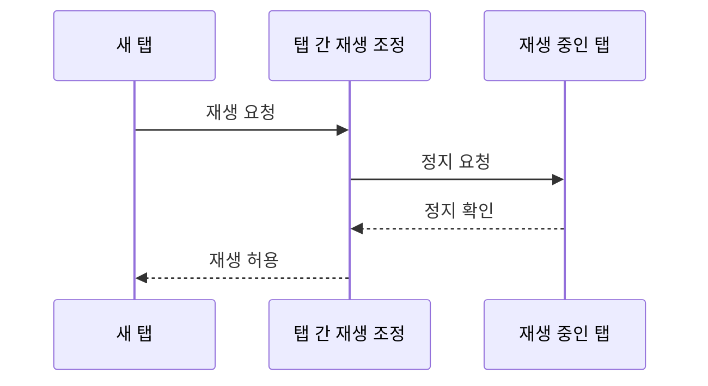

### 1. 개요 및 배경 (Context)

- 같은 사이트의 탭 두 개에서 영상을 열었을 때, 새 탭의 재생 요청이 들어오면 기존 재생이 멈춘 다음 새 영상이 재생되도록 설계함.
- 한 탭 안에서도 컨트롤 버튼, 영상 요소의 실제 재생 상태, 다른 탭과 조정하는 권한의 수명이 다름. 이를 한 UI 상태에서 관리하면 다른 탭이나 모달 때문에 정지했을 때 버튼 표시와 실재생이 어긋날 수 있음.

### 2. 핵심 내용 / 문제 해결 과정 (Core / Troubleshooting)

- **영상 요소**가 재생과 일시 정지를 실행하고, React 연결부는 미디어 이벤트를 읽어 화면에 반영하도록 나눔. 탭 간 조정 모듈은 새 재생 요청을 받고 기존 탭에 중지를 요청하는 책임을 맡음.
- 새 영상을 먼저 시작하고 나중에 기존 탭을 멈추면 조작 반응은 빠르지만, 탭 간 메시지가 늦을 때 두 음성이 겹칠 수 있음. 기존 탭의 정지 확인 뒤에 새 재생을 허용하는 순서를 택함. 이 경우 정지 확인이 오지 않거나 탭이 닫히는 경계 조건을 별도로 다뤄야 함.
- 모달이 닫힌 뒤에는 열기 직전에 재생 중이었는지와 그사이 다른 탭으로 권한이 넘어갔는지를 확인할 필요가 있음. 모달 열기와 닫기만으로 항상 재생을 복구하면 탭 간 단일 재생 규칙을 다시 깰 수 있음.

- 단일 재생 조정, 모달 재개 조건, Toast 알림을 구현한 Draft PR이 작성됨. 당일 검증 기록에서 **단위 테스트 196개와 브라우저 검사 17개**가 통과함. 실제 상세 페이지의 인증, 컨트롤, 리뷰 모달 연결은 후속 통합 범위였음.

### 3. 인사이트 및 적용점 (Takeaway & Next Action)

- 영상의 재생 여부는 미디어 이벤트에서 읽고, 어떤 탭이 재생을 시작할 수 있는지는 별도의 규칙으로 다룰 수 있음.
- 후속 통합 때는 탭 전환, 모달을 열어 둔 동안의 권한 변경, 재생 요청 실패에서 **화면 상태와 실제 영상 동작**을 함께 보는 것이 중요함.
