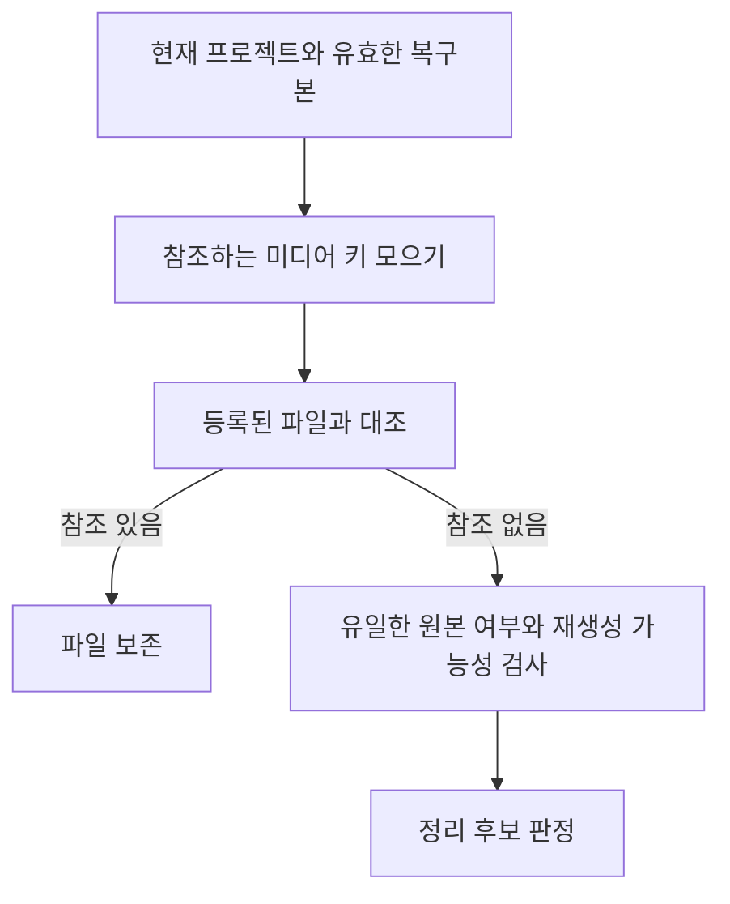

### 1. 개요 및 배경 (Context)

- **질문 요지** 자동저장할 때 영상 원본까지 IndexedDB에 들어가는가? 영상과 오디오로 공간이 차면 어떤 일이 생기며, 앱이 자동으로 지우지 않는 이유는 무엇인가?
- 자동저장에 연결된 IndexedDB에서 영상과 오디오 저장량이 커졌고, 저장소 전체를 지워도 되는지 질문함. 이후 대화에서는 폴더 날짜를 정리 기준으로 삼을 수 있는지까지 확인함.
- 원본 미디어가 오래전에 들어왔더라도 최근 프로젝트 또는 복구본이 같은 파일을 참조할 수 있음. **저장 공간 증가의 원인**과 **안전하게 지울 수 있는 파일의 조건**을 따로 살펴야 했음.

### 2. 핵심 내용 / 문제 해결 과정 (Core / Troubleshooting)

- **답변에서 고른 방법** 자동저장의 실제 쓰기 경로를 확인하고, 브라우저 저장소 정책과 앱에서 삭제할 개별 파일의 기준을 나눠 설명함. 정책을 알면 공간이 계속 쓰이는 배경을 설명할 수 있고, 파일 삭제를 판단하려면 현재 문서나 복구본의 참조를 추가로 확인해야 했음.
- 당시 코드 조사에서 자동저장 경로가 미디어 메타데이터와 함께 전체 미디어 파일을 IndexedDB에 보관할 수 있음을 확인함. 자동저장이 실행됐다는 사실만으로 같은 바이트가 매번 새 객체로 중복 저장됐다고 결론 내릴 수는 없음. 저장 키 재사용과 중복 참조를 별도로 확인해야 함.
- **날짜 기준 삭제**는 구현이 간단하고 대상의 양을 계산하기 쉬움. 오래된 파일을 여전히 참조하는 문서까지 복구할 수 없게 될 수 있음. **참조 기준 정리**는 문서와 복구본에서 필요한 파일을 남길 수 있지만, 모든 참조 경로를 읽어야 하며 검사 직후 새로 생기는 참조도 고려해야 함.
- 재생성할 수 있는 캐시와 앱이 보유한 유일한 원본을 분리하고, 현재 문서 및 유효한 복구본에서 도달하지 못하는 파일을 정리 후보로 보는 방향을 검토함.

- 이날 확인 범위는 저장 경로 조사와 정리 기준 검토임. 실제 정리 실행의 공간 회수량과 복구 성공 여부는 남아 있었음.

### 3. 인사이트 및 적용점 (Takeaway & Next Action)

- 저장 공간 문제는 **어디서 데이터가 늘어나는가**와 **지금 어떤 데이터를 버려도 되는가**라는 서로 다른 질문임. 파일 이름과 수정 시각을 알아도 살아 있는 참조가 있는지는 알 수 없음.
- 후속 검증에서는 같은 미디어를 다시 저장할 때 실제 보관 바이트가 늘어나는지와, 정리 뒤 현재 프로젝트 및 복구본이 다시 열리는지를 따로 살펴볼 필요가 있음.
