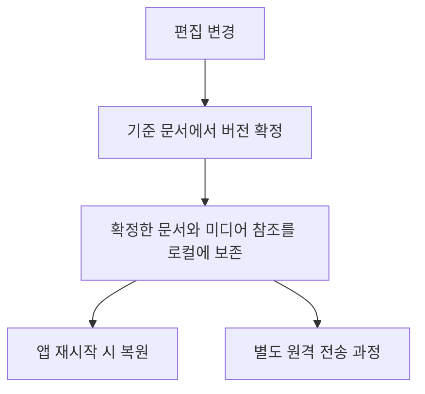

### 1. 개요 및 배경 (Context)

- 네트워크가 잠시 끊겨도 편집은 계속할 수 있고, 다시 앱을 열 때 마지막으로 확정된 문서와 미디어가 복원돼야 함.
- Local-first 저장을 설명하면서 **무엇을 먼저 확정하는지**와 **원격 전송을 언제 다시 시도하는지**를 나눠 봄. 또 다른 편집기의 저장 코드를 비교하며 같은 로컬 저장 경로에서도 파일을 쓰는 함수와 저장할 문서를 고르는 규칙이 다를 수 있음을 확인함.

### 2. 핵심 내용 / 문제 해결 과정 (Core / Troubleshooting)

- 프로젝트 문서는 자르기와 배치 같은 편집 상태를 담고, 미디어 원본은 그 편집에 필요한 실제 재생 데이터를 제공함. 전송 대기 기록은 네트워크가 복구된 뒤 어떤 변경을 다시 전송할지 표현하는 설계의 일부임.
- 저장 함수를 한 곳으로 합치면 중복된 파일 쓰기 절차를 줄일 수 있음. 당시 비교에서 기존 수동 저장도 Main의 문서를 우선했고, 통합 경로 안에도 상황에 따라 Renderer 문서로 우회하는 분기가 남아 있었음.
- **확정한 문서 버전 하나를 기록**하는 구조를 목표로 살펴봄. 어떤 화면에서 저장해도 데이터의 기준을 맞출 수 있지만, 저장하기 전에 대기 중인 편집을 어떻게 확정할지와 쓰기 실패를 어떻게 돌려줄지 정해야 함. 원격 전송까지 묶으면 동기화 실패가 편집 저장에 영향을 주므로 수명을 나누는 편이 적합함.

- 도식은 로컬 저장의 판단 기준을 설명하는 개념도임. 당일 편집기 코드에서는 Renderer 문서의 우회 경로까지 확인했으며, 원격 전송 대기열은 글에서 다룬 별도의 설계 개념이었음.

### 3. 인사이트 및 적용점 (Takeaway & Next Action)

- 공통 저장 함수는 **쓰기 방법**을 모으고, 문서의 기준을 한 곳에 두는 규칙은 **무엇을 써도 되는지**를 정함. 저장 경로를 읽을 때 호출부가 실제로 넘긴 버전까지 따라가야 함.
- 후속 확인에서는 로컬 쓰기 성공 후 전송이 끊긴 경우, 편집이 반영되기 직전에 저장한 경우, 앱을 재시작한 경우를 나눠 비교할 수 있음.
