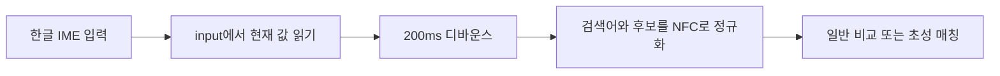

### 1. 개요 및 배경 (Context)

- 검색창에서 한글 이름을 입력하면 Enter 없이 결과를 좁히고, 초성으로도 후보를 찾을 수 있도록 개선함.
- 확인할 문제는 두 가지였음. **조합 중인 글자가 검색 로직에 언제 전달되는가**, 그리고 **같게 보이는 한글이 다른 코드 포인트 조합으로 저장되면 어떻게 비교하는가**임.

### 2. 핵심 내용 / 문제 해결 과정 (Core / Troubleshooting)

- Vue의 기본 `v-model`은 IME 조합 중 값을 모델에 반영하지 않음. 확정 시점에만 검색하면 불완전한 글자로 요청하지 않지만, 사용자는 입력 중 결과가 갱신되지 않는다고 느낄 수 있음. 검색창에서는 **`input` 이벤트**에서 값을 읽고 200ms 디바운스를 적용해 한글과 영문이 같은 방식으로 갱신되도록 함.
- 검색어와 후보 문자열에 **NFC 정규화**를 적용해 완성형과 분리형 한글을 같은 기준에서 비교함. NFC는 문자열 표현을 정리하고, 초성 매칭은 별도의 비교 규칙이 담당함. 예를 들어 `ㄴㄴ`을 `남남`과 연결하는 것은 초성 규칙의 동작임.
- API 경로와 목업 경로에 필터링 및 정렬 로직을 공유하도록 변경함. 입력 빈도가 높은 실시간 검색은 반응성이 좋은 대신 조합 도중 값도 처리하므로, 디바운스와 동일한 필터 계약이 필요함.

- 최종 기록에서 **관련 테스트 142개와 빌드가 통과**함. 전체 테스트는 **265개 중 262개 통과**였고, 남은 3건은 기존 채팅과 탐색 경로에서도 재현됐음.

### 3. 인사이트 및 적용점 (Takeaway & Next Action)

- 한글 입력 문제는 **이벤트가 언제 전달됐는지**부터 살핀 뒤, 값이 전달됐다면 **무슨 문자열을 어떤 기준으로 비교했는지** 확인하는 편이 빠름.
- 재발 검사에는 조합 중 입력, 조합 완료, 같은 글자의 서로 다른 표현, 초성 입력을 서로 독립된 사례로 둘 수 있음.
