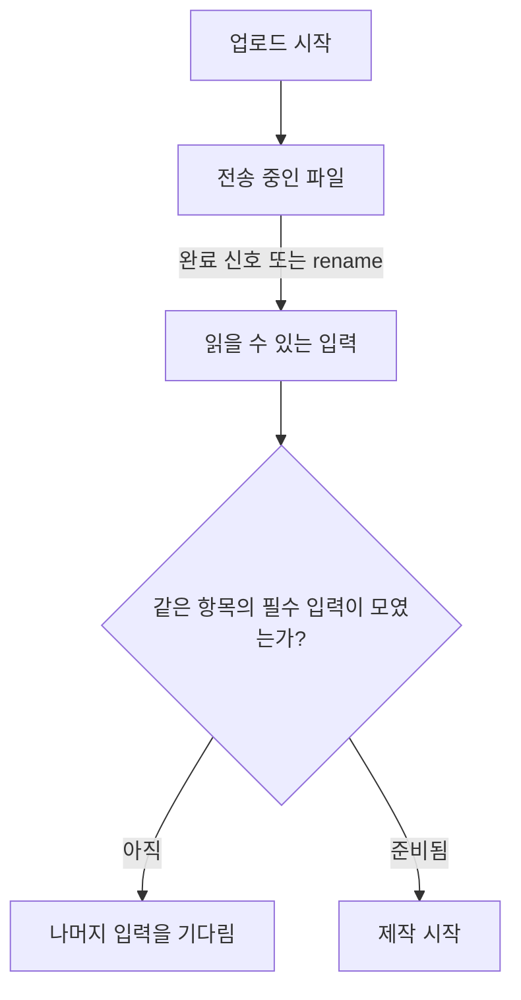

### 1. 개요 및 배경 (Context)

- 공유 폴더에 새 영상이나 자막이 나타나는 순간 제작을 시작해도 되는지 검토함. 영상처럼 큰 파일은 전송 중에도 경로와 파일명이 먼저 보일 수 있음.
- 제작에는 같은 회차의 여러 입력이 필요함. **파일마다 전송이 끝났는지**와 **제작에 필요한 입력 조합이 완성됐는지**를 함께 판단해야 함.

### 2. 핵심 내용 / 문제 해결 과정 (Core / Troubleshooting)

- 파일 생성 이벤트만 보고 시작하는 방식은 즉시 반응하지만, 전송 중인 파일과 완성된 파일을 같은 상태로 취급함. 가장 먼저 도착한 파일만 읽었을 때 나머지 입력이 누락됐다고 잘못 판단할 수도 있음.
- **전송 도구에서 완료 신호를 전달**하는 방식과 **임시 이름으로 쓰고 완료 후 정식 이름으로 rename**하는 방식을 검토함. 전자는 전송 쪽과 약속한 신호가 필요하고, 후자는 작성자와 감시자가 같은 이름 규칙을 따르며 파일시스템에서 rename의 동작을 확인해야 함.
- 접수 책임은 완료 신호를 본 다음에도 남음. 완성된 파일을 항목별로 묶고, 그 시점에 필요한 입력이 모두 준비된 단계만 실행하는 쪽으로 설계를 정리함.

- 당일 실제 경로는 로컬 앱에서 폴더를 직접 지정해 수동 실행하는 방식이었음. 도식의 감시와 자동 접수는 당시 제안 단계였음.

### 3. 인사이트 및 적용점 (Takeaway & Next Action)

- **디렉터리 이벤트는 관찰 사실이고, 제작 가능은 검증 뒤 확정하는 상태**임. 둘을 분리하면 입력 대기와 실제 제작 오류를 구분할 수 있음.
- 다음 검증에서는 전송 중단, 같은 이름으로 재업로드, 이미 검증한 입력의 교체 상황을 따로 재현해 접수 상태가 언제 바뀌는지 확인할 수 있음.
