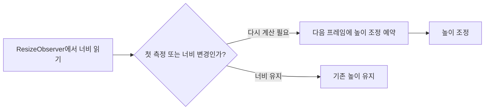

### 1. 개요 및 배경 (Context)

- **질문 요지** ResizeObserver 경고는 어디서 생겼는가? 관찰 너비가 처음에 `undefined`인 것이 전체화면이나 반복 경고의 원인인가?
- 입력창에서 발생한 ResizeObserver 경고의 원인을 추적하면서, 첫 측정 전 너비를 `undefined`로 두는 이유도 함께 확인함.
- 검토한 경로는 콜백에서 너비를 읽고 같은 입력창의 높이를 다시 맞추는 코드였음. 측정 직후의 쓰기가 레이아웃과 후속 관찰에 영향을 줄 수 있음.

### 2. 핵심 내용 / 문제 해결 과정 (Core / Troubleshooting)

- **답변에서 고른 방법** 입력창 높이 갱신을 다음 프레임에 예약하고 해제 시 예약도 취소하도록 수정함. 감시 중인 레이아웃을 콜백에서 바로 바꾸면 같은 주기에 후속 변화가 이어졌기 때문임. 초깃값은 첫 관찰 전 상태로 두고 이후 비교에는 같은 기준으로 얻은 너비를 사용함.
- ResizeObserver 콜백에서 크기를 바꾸면 브라우저가 레이아웃을 다시 계산할 수 있음. 그 결과 다음 크기 알림이 같은 렌더링 주기에 이어지면서 일부 알림이 다음 주기로 미뤄질 수 있음. 경고를 숨기면 로그는 줄지만 크기를 다시 계산하는 경로는 남음.
- 검토한 변경에서는 **관찰 콜백이 너비를 읽고, 높이 조정은 `requestAnimationFrame`에 예약**하도록 나눔. 같은 콜백 내에서 관찰 대상의 크기를 다시 쓰는 일을 줄이는 선택임. 예약 사용 시 해제된 요소에 대한 작업 정리와, 다음 프레임에서도 높이가 계속 바뀌는지를 확인해야 함.
- `number | undefined`는 아직 유효한 측정값이 없는 상태를 표현함. 실제 너비로 초기화하는 대안도 가능하나 초기값과 이후 비교값의 기준이 같아야 함. 당시 비교한 `clientWidth`와 `contentRect.width`는 padding 포함 여부가 달랐음.

- 당일 격리 Chromium 시험의 경고가 수정 전 **6건에서 수정 후 0건**으로 줄었음. 타입 검사, 린트와 빌드가 통과했으며 앱 전체 E2E는 당시 실행 기록에 없음.

### 3. 인사이트 및 적용점 (Takeaway & Next Action)

- **타입은 어느 상태가 존재하는지 설명하고, 스케줄링은 변경이 언제 일어날지 정함.** 둘을 구분하면 초기화 변경에 경고 수정의 효과를 잘못 귀속시키지 않게 됨.
- 후속 검사에서는 최초 진입과 연속 크기 변경을 각각 재현하고, 너비가 달라질 때만 높이 조정이 예약되는지 확인할 수 있음.
