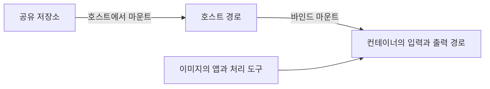

### 1. 개요 및 배경 (Context)

- 미디어 처리 앱을 Ubuntu에서 실행할 때, 프로그램과 의존성을 어떻게 설치하고 호스트에 연결한 입력과 결과 디렉터리를 어디에 둘지 검토함.
- 판단할 항목은 **실행 환경 재현성**, **실제 공유 저장소 접근**, **컨테이너를 다시 만들어도 결과를 복구할 수 있는가**였음.

### 2. 핵심 내용 / 문제 해결 과정 (Core / Troubleshooting)

- 호스트에서 `uv`로 Python 의존성을 관리하고 `systemd`로 서비스를 띄우는 방식은 기존 공유 폴더를 직접 쓰기 쉬움. 호스트마다 시스템 도구와 런타임을 맞춰야 하는 비용이 있음.
- **Docker 이미지**에 앱과 시스템 의존성을 묶으면 동일한 실행 환경을 배포하기 쉬움. 컨테이너에서 파일을 읽으려면 호스트가 공유 저장소를 먼저 마운트하고, 그 경로를 **바인드 마운트**로 컨테이너에 연결해야 함. 입력과 출력에 허용할 권한도 운영 조건에 따라 설정해야 함.

- 단순한 호스트 실행 경로도 검토한 뒤, 당일 Dockerfile과 Compose 설정을 추가함. 이미지 빌드와 기본 기동은 확인됐고, 실제 공유 저장소 권한이나 컨테이너 재생성 후 결과 보존은 당시 검증 범위에 없었음.

### 3. 인사이트 및 적용점 (Takeaway & Next Action)

- 이미지에 실행 환경을 고정해도 파일의 저장 위치와 소유권은 **호스트 경로와 실행 사용자**가 결정함. 배포 문서에 컨테이너 경로만 적으면 장애가 난 위치를 좁히기 어려움.
- 검증 항목은 이미지 빌드, 프로세스 기동, 실경로 파일 접근, 재생성 뒤 결과 보존으로 나누는 편이 적합함.
