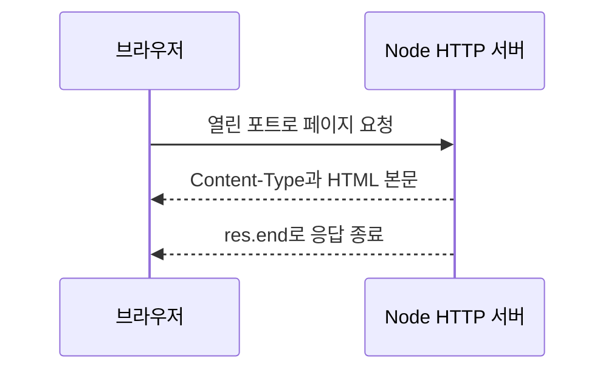

### 1. 개요 및 배경 (Context)

- **질문 요지** Ubuntu에서 실행할 서비스인데 먼저 Mac에서 로컬 HTTP 서버를 만들면 되는가? 타입 검사를 통과한 뒤 직접 무엇부터 구현해야 하는가?
- 별도 장비에 배포하기 전에 Mac에서 작은 Node.js HTTP 서버를 직접 만들어 보기로 함. 브라우저에서 화면을 열 수 있는지 확인하고, 다음 단계에서 폴더 입력을 서버로 보낼 계획이었음.
- 작업을 잘게 나누기 위해 **서버가 포트에서 요청을 받는 것**, **요청의 응답을 끝내는 것**, **브라우저가 본문을 HTML로 해석하는 것**을 각각 확인함.

### 2. 핵심 내용 / 문제 해결 과정 (Core / Troubleshooting)

- **답변에서 고른 방법** 로컬 Node.js로 HTML 한 장을 보내고 브라우저가 응답을 받는 것부터 확인하도록 안내함. 원격 전송이나 미디어 처리에 들어가기 전에 포트, 헤더, 응답 종료 중 어디서 막혔는지 좁힐 수 있기 때문임.
- `listen`은 프로세스가 지정한 포트에서 요청을 받게 함. 요청 핸들러에서는 헤더로 `Content-Type`을 보내 본문이 HTML임을 알리고, `res.end()`로 해당 응답을 종료함. 서버 프로세스는 그 뒤에도 다음 요청을 받을 수 있음.
- 처음부터 파일 처리 기능까지 붙이면 브라우저에 아무것도 나오지 않을 때 포트, HTTP 응답, 처리 오류를 함께 의심해야 함. 먼저 HTML 한 장을 응답으로 보내는 방식을 택해 출력 확인을 앞당김. 이 작은 실습은 실제 제작 경로를 확인할 수 있는 단계까지 이어져야 함.

- 당시 학습 기록에는 HTML 파일을 읽어 브라우저에 표시한 단계까지 남아 있음. `tsc --noEmit`은 코드의 타입 확인에 쓰였으며, 응답을 실제로 받을 수 있는지는 브라우저 요청으로 따로 확인함.

### 3. 인사이트 및 적용점 (Takeaway & Next Action)

- **타입 오류가 없다는 사실, 포트가 열렸다는 사실, 브라우저가 의도한 내용을 받았다는 사실**은 각각 다른 확인 결과임.
- 다음 단계의 폴더 입력도 먼저 브라우저에서 실제 값이 전송되는지 확인한 뒤 서버의 경로 검사와 파일 처리를 연결할 수 있음.
