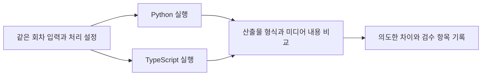

### 1. 개요 및 배경 (Context)

- 기존 Python 미디어 처리 도구를 TypeScript로 옮기면서, **동작이 유지됐다**고 판단할 기준이 필요했음. 특히 출력 컨테이너와 그 안의 영상, 음성, 자막이 서로 다른 수준의 비교 대상이었음.
- 당시에는 기존 MVP 명세와 개발 계획을 옮긴 뒤 그 범위 안에서 로컬 앱, API, 실제 회차의 결과를 비교함.

### 2. 핵심 내용 / 문제 해결 과정 (Core / Troubleshooting)

- **타입 검사와 단위 테스트**는 잘못된 호출이나 개별 변환 오류를 찾기 쉬움. 실제 입력에서 원래 구현과 같은 결과를 내는지 보려면 두 구현을 같은 조건으로 실행하는 비교가 추가로 필요함.
- 파일 전체를 바이트 단위로 비교하면 결과는 명확하지만, 컨테이너의 메타데이터나 기록 방식 차이에도 불일치가 남음. **컨테이너와 미디어 내용**을 구분해 판정하고, 입력 누락과 자막 오류처럼 기존 구현이 드러내던 실패도 이전 과정에서 숨겨지지 않는지 확인함.

- 당일 로컬 이전과 실제 회차 비교 기록에서 **테스트 54개와 CI 검사 3개가 통과**함. 최종 산출물 5종의 미디어 내용은 일치했고 MXF 컨테이너 바이트에는 차이가 남음. 기존 자막 문제는 그대로 보고됐으며 사람 검수와 외부 저장소 연동은 남아 있었음.

### 3. 인사이트 및 적용점 (Takeaway & Next Action)

- 마이그레이션 범위를 정할 때 **사용자에게 보여야 하는 결과, 내부 표현, 오류 계약**에서 무엇의 동등성이 필요한지 먼저 적어 두는 것이 좋음.
- 성공한 입력만 비교하면 실패를 조용히 무시하는 회귀를 놓칠 수 있음. 정상 회차와 함께 필수 입력 누락, 중복, 유효하지 않은 자막도 같은 조건으로 비교할 수 있음.
