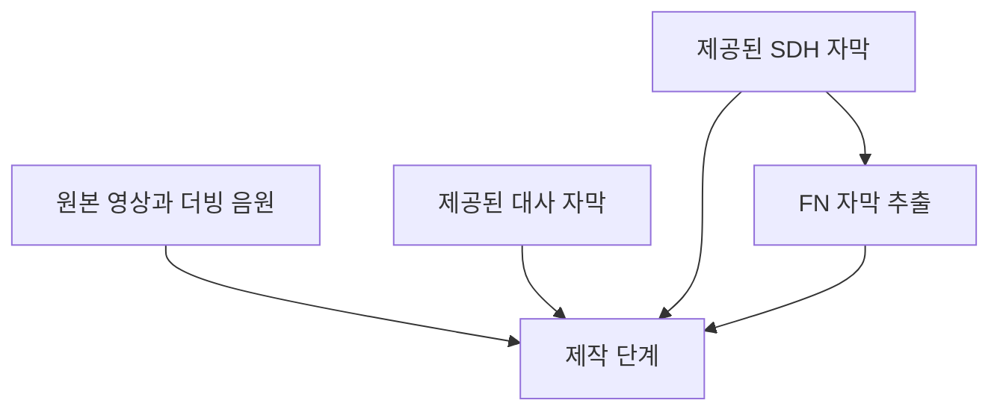

### 1. 개요 및 배경 (Context)

- **질문 요지** 문서의 파일 목록이 아닌 실제 프로그램 기준으로, 원본 MOV와 더빙 WAV만 넣어도 최종 납품 파일을 모두 만들 수 있는가?
- 영상과 더빙 음원만 있으면 최종 납품 파일을 모두 만들 수 있는지, 제작 중에 만드는 FN 자막도 사전에 제공해야 하는지 확인함.
- 필수 입력이 과하게 적혀 있으면 제작을 시작해도 되는 회차가 대기하고, 빠져 있으면 처리 도중에 작업이 멈춤. 실제 변환 흐름을 기준으로 입력 계약을 정리해야 했음.

### 2. 핵심 내용 / 문제 해결 과정 (Core / Troubleshooting)

- **답변에서 고른 방법** 자막 준비 코드가 파일을 만드는지 공급받아 읽는지 추적하고, 서로 다른 입력 조합을 실제 입력 검색 함수로 비교함. 어느 파일이 없을 때 프로그램이 제작할 수 있다고 판단하는지가 질문이었으므로 입력 접수 단계에서 직접 확인할 수 있었음.
- **원본 영상, 더빙 음원, 대사 자막, SDH 자막**을 외부에서 받아야 하는 네 입력으로 정리함. SDH에는 대사에 더해 효과음 등의 정보를 담을 수 있음. 프로그램이 원본 영상이나 음원에서 대사와 SDH를 새로 작성하는 단계는 당시 경로에 없었음.
- **FN 자막**은 화면 속 문구를 번역해 표시하기 위한 파일이며, 제공된 SDH에서 필요한 자막을 추출할 수 있는 중간 산출물로 구분함. 별도 파일을 먼저 받으면 이미 검수된 텍스트를 쓸 수 있지만, 회차마다 추가 입력을 준비해야 함. SDH에서 추출하면 접수 부담을 줄일 수 있고 추출 규칙과 검수 기준을 갖춰야 함.

- **입력 검색 실행 결과** 같은 입력 검색 함수에 두 파일 조합을 넣고, 최종 산출물 5종 중 제작 가능으로 표시된 수를 비교함.

| 입력 조합                        | 입력 검색의 제작 가능 판정                                 |
| -------------------------------- | ---------------------------------------------------------- |
| MOV와 더빙 WAV                   | **1/5종**. 음량 보정 WAV만 가능했고 나머지 4종은 입력 부족 |
| MOV, 더빙 WAV, 대사 VTT, SDH VTT | **5/5종**. 두 MXF, 보정 WAV, 두 VTT에 필요한 입력을 찾음   |

- 이 결과는 입력 검색의 판정임. 실제 인코딩 완료와 최종 납품물 검사는 별도였음.

### 3. 인사이트 및 적용점 (Takeaway & Next Action)

- 입력 목록은 받고 싶은 파일 이름을 모으기보다 **어떤 단계가 무엇을 소비하고 어떤 입력으로 다시 만들 수 있는지**를 따라 정의해야 함.
- 다음 검사에서는 필수 자막이 없는 회차, FN을 추출할 수 있는 회차, FN이 필요 없는 회차를 준비하면 접수 규칙과 후속 제작 규칙을 나눠 확인할 수 있음.
