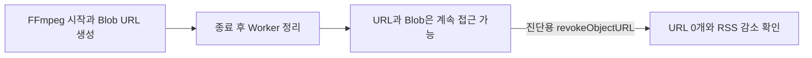

### 1. 개요 및 배경 (Context)

- FFmpeg를 반복해 시작하고 종료한 뒤에도 로딩에 쓴 데이터가 남는지 실제 Electron에서 조사함.
- 전체 메모리가 늘었다는 관찰로는 JavaScript 객체, Worker, 네이티브 메모리, Blob을 구분하기 어려움. **종료 후 접근 가능한 리소스**와 **프로세스 메모리 추이**를 동시에 측정함.

### 2. 핵심 내용 / 문제 해결 과정 (Core / Troubleshooting)

- 재현 경로에서는 로딩할 때 Worker와 WASM 등에 쓰는 **Blob URL 3개**를 만들었음. FFmpeg 종료는 Worker를 멈췄지만, URL을 발급한 쪽에서 해제하는 처리가 빠져 있었음.
- 프로세스 메모리만 비교하면 요동의 원인을 설명하기 어려움. 워밍업 때 생성된 URL을 정리한 뒤 기준값을 기록하고, 8회 로딩과 종료 후 URL이 여전히 읽히는지 확인함. 이어 진단 코드에서 URL을 명시적으로 해제해 같은 실행 안에서 변화를 측정함.
- **macOS arm64, RAM 32 GiB, Electron 42.3.3**에서 FFmpeg 시나리오를 독립 프로세스로 **3회** 실행함. 아래 프로세스 RSS는 기준값과 비교한 중앙값임.

| 지표                        | 로딩과 종료 8회 뒤 | 진단용 URL 해제 뒤 |
| --------------------------- | -----------------: | -----------------: |
| 접근 가능한 Blob URL        |               24개 |                0개 |
| URL이 참조하는 Blob 데이터  |        246.809 MiB |              0 MiB |
| Browser 프로세스 RSS 변화량 |       +247.297 MiB |         +8.094 MiB |

- 진단용 해제 직후 Browser RSS는 실행별 감소량의 중앙값 기준 **239.219 MiB 감소**함. URL의 데이터 크기와 RSS는 다른 지표임. 이 결과는 짧은 격리 시험에서 확인한 리소스 보유와 해제 효과이며, 제품 수정이나 장시간 사용 검증은 별도였음.

### 3. 인사이트 및 적용점 (Takeaway & Next Action)

- **Worker의 종료와 Blob URL의 수명**을 각각 확인해야 함. 생성한 주체, 사용하는 주체, 해제 시점을 짝지으면 메모리 그래프에서 수치만 볼 때보다 원인을 정확하게 좁힐 수 있음.
- 제품에 적용한다면 성공뿐 아니라 로딩 도중 오류, 취소, 반복 생성에서도 더 이상 필요한 소비자가 없는 시점에 정리되는지 확인할 필요가 있음.
