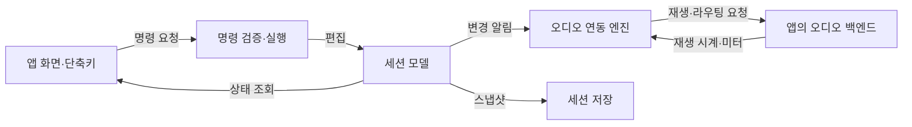

오늘은 **코드가 어디에 속하는지 설명하는 일과, 실제로 동작한다고 확인하는 일의 경계**를 정리했습니다. 미디어 프로그램에서는 도메인별 폴더 정리 결과를 확인했고, 오디오 편집 엔진에서는 모델과 재생 백엔드의 책임을 따라갔습니다. 별도의 오디오 제작 앱에서는 로컬 테스트와 화면 동작을 검증했지만, 실제 AI 품질이나 출시 준비까지 확인한 것은 아닙니다.

## 1. 도메인별 폴더 정리와 저장소 분리는 다른 범위였습니다

미디어 패키징 프로그램에서는 서버와 공유 모듈을 도메인별 폴더로 나누는 작업을 진행했습니다. 도메인은 오디오·자막·검사·제작처럼 함께 이해하고 변경하는 기능 영역을 뜻합니다. 코드가 서버에서 실행되는지 구분하는 것에 더해, 어떤 기능을 담당하는지 경로에서 찾을 수 있도록 정리했습니다.

해당 날짜의 커밋에서는 파일 이동과 import 경로 변경, 실행 진입점과 문서 경로 갱신을 확인했습니다. **폴더가 나뉘었다는 사실만으로 결합도가 낮아졌거나 독립 배포가 가능해졌다고 판단하지는 않았습니다.** 그런 효과는 의존 방향과 실제 호출 관계를 추가로 확인해야 합니다.

프론트엔드 저장소를 별도로 만들려는 요청도 남겼습니다. 다만 이번 자료만으로 새 저장소 생성과 API 계약 분리까지 완료됐다고 기록할 수는 없습니다. 같은 프로그램 안의 폴더 정리와 저장소를 나누는 작업을 각각의 상태로 남겼습니다.

## 2. 오디오 엔진은 편집 상태와 재생 실행을 나눠 봤습니다

별도의 DAW 엔진에서는 전체 구조도와 특징, 사용법을 확인했습니다. DAW는 소리를 녹음·편집하는 도구입니다. 이 저장소는 편집 모델·명령·실행 이력·오디오 연동을 제공하는 TypeScript 라이브러리에 가까웠습니다. 사용하는 앱에서 화면과 오디오 백엔드를 연결하는 구조였습니다.

핵심은 **세션 모델이 편집 상태를 관리하고, 오디오 백엔드가 실제 재생 시계와 버퍼를 관리한다는 점**이었습니다. 명령이 모델을 변경하면 엔진이 변경 알림을 받아 백엔드에 반영합니다. 현재 재생 위치 같은 실행 정보는 백엔드에서 읽어 옵니다.

아래는 코드 확인으로 파악한 중심 흐름을 역할 이름으로 줄인 구조도입니다.

저장에서도 같은 구분이 필요했습니다. 세션 스냅샷은 편집 상태와 소스 참조를 담으며, **원본 오디오 바이트까지 포함하지는 않습니다.** 세션과 오디오를 함께 묶으려면 호출자가 오디오 데이터를 제공하는 별도 경로가 필요했습니다. 자동 저장도 관련 기능을 명시적으로 시작해야 작동했습니다.

파형·타임라인 좌표 같은 화면 계산 도구가 있다는 사실과 실제 화면이 완성됐다는 사실도 구분했습니다. 오디오 처리용 클래스가 존재하더라도 재생 경로에 자동 연결된 것은 아니었습니다. 이번 확인은 코드 분석이며, 이 엔진의 재생·녹음·내보내기를 실행한 검증은 아닙니다.

어제 질문한 플러그인 확장과 연결해 보면, 외부에 무엇을 공개할지 판단하기 전에 현재 모델의 변경 권한과 오디오 실행 책임을 이해해야겠다는 후속 기준을 얻었습니다. 플러그인 구조의 최종 선택은 별도의 과제입니다.

## 3. 로컬 검증 결과를 실제 AI 품질과 분리했습니다

별도의 오디오 제작 앱에서는 현재 진행 상태를 확인한 뒤 로컬 실행 환경과 검증을 진행했습니다. 기존 체크리스트의 완료 표시를 읽는 단계에서, 이 컴퓨터에서 테스트와 브라우저 동작을 확인하는 단계로 나아갔습니다.

| 검증 영역                 | 이날 기록에서 확인한 결과                                        |
| ------------------------- | ---------------------------------------------------------------- |
| 웹 테스트                 | 233개 통과                                                       |
| 네이티브 CTest            | 13개 통과                                                        |
| 네이티브 브리지 회귀 시험 | 51개 통과                                                        |
| 네이티브 AI 계획 시험     | 6개 통과, 설치된 플러그인이 필요한 1개 생략                      |
| 브라우저 동작             | 합성 WAV 가져오기·파형 표시·편집·Undo/Redo·새로고침 후 복원 확인 |
| 실제 AI 모델 호출         | 0회, 품질 평가 미실행                                            |

브라우저에서는 게인을 바꾸고 실행 취소·다시 실행한 뒤, 새로고침해 변경값이 복원되는 흐름을 확인했습니다. 게인은 소리의 크기를 조절하는 값입니다. 다만 **오디오 출력은 비활성 상태여서 실제 소리를 듣고 평가하지는 않았습니다.** 편집 상태 복원은 확인했지만, 청감과 실제 장치 동작은 별도로 남았습니다.

AI 관련 시험도 실행 계획과 연결 경로를 검사하는 것과 실제 모델의 응답 품질을 평가하는 것을 나눴습니다. 실제 호출을 위한 설정과 모델 평가가 남아 있으므로, AI 기능의 품질 검증 완료로 설명할 수 없습니다. 서명·공증과 사용자 검증 역시 이번 로컬 시험의 범위에 포함되지 않았습니다.

## 4. 원격 CI의 비용 문제는 로컬 통과와 별개였습니다

GitHub Actions의 비용 한도 문제가 해결됐는지도 질문했습니다. 이날 조회한 최신 원격 실행 기록에는 결제 실패 또는 지출 한도로 작업을 시작하지 못한 상태가 남아 있었습니다. 중복 실행 취소와 실행 조건·시간 제한처럼 사용량을 줄이는 조치는 있었지만, **원격 실행 재개는 확인하지 못했습니다.**

CI는 변경을 원격 환경에서 자동으로 검사하는 절차입니다. 로컬 테스트 통과는 유용한 근거지만, 원격 작업이 다시 실행됐다는 증거가 되지는 않았습니다. 현재 결제 설정 자체는 확인하지 않았으므로, 계정의 한도가 이후에도 그대로라고 단정할 수도 없습니다.

다음에는 원격 작업이 실제로 시작되는지, 어느 커밋을 검사했는지, 로컬과 같은 검사를 수행하는지 연결해 봐야겠습니다. 이는 이번 기록에서 정리한 후속 확인 항목입니다.

## 5. TIL에도 질문·제안·완료의 구분을 남겼습니다

블로그에는 날짜별 공부 일지와 달력, 목록·상세 페이지를 연결하는 작업이 있었습니다. 같은 날짜의 파일을 홈과 게시판이 함께 읽고, 초안이나 비공개 일지는 공개 경로에서 제외하는 구조를 확인했습니다.

글쓰기에서는 **대화를 시간순으로 복사하기보다 요구사항에서 선택과 결론까지의 흐름을 복원하는 것**이 기준이었습니다. 질문만 남은 내용은 질문으로, 전달받은 설계안은 제안으로 적어야 합니다. 접근하지 못한 대화를 읽었다고 하거나, 결정되지 않은 내용을 채택한 설계로 바꾸지 않아야 했습니다.

오늘은 컨벤션을 확인하고 어제와 오늘의 일지를 별도 워크트리에서 작성하도록 요청했습니다. 워크트리는 같은 Git 저장소를 별도 작업 디렉터리에서 체크아웃하는 기능입니다. 기존 작업과 분리해 글을 검토하는 데 사용했습니다.

파일로 일지를 추가하는 것과 대화 자동 수집·매일 작성·원격 푸시 자동화를 운영하는 것도 다른 범위입니다. 이번 기록에서는 정기 자동화를 새로 설정했다고 설명하지 않습니다.

## 기록의 범위

한국 시간 2026년 10월 30일 중 이 글을 작성할 때까지 접근 가능한 작업 대화와 저장소를 바탕으로 작성했습니다. 오디오 엔진 구조 설명 대화, 오디오 제작 앱의 로컬 검증 기록, 블로그 TIL 구현·컨벤션 대화를 확인했습니다. 미디어 프로그램의 도메인별 폴더 정리는 당일 커밋과 변경 경로로 확인했습니다.

일부 미디어 프로그램 대화는 목록의 요청 요약만 확인할 수 있었고 본문은 조회하지 못했습니다. 따라서 프론트엔드 저장소 분리의 완료 여부나 구체적인 설계 선택은 보충하지 않았습니다. 모든 Work 대화와 하루 전체를 확인한 기록은 아니며, 비공개 원문·내부 경로·접근 정보는 공개 본문에 넣지 않았습니다.
