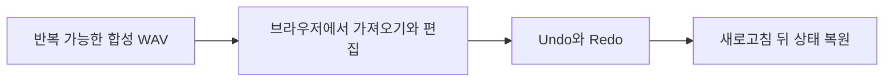

### 1. 개요 및 배경 (Context)

- 디지털 오디오 워크스테이션(DAW)의 로컬 검증에서, 화면을 열 수 있는 상태와 실제 오디오 편집 및 출시 준비 상태를 구분함.
- 웹 편집기, 네이티브 엔진, 둘 사이의 브리지가 각각 실패할 수 있어 한 종류의 테스트로 전체 상태를 판단하기 어려웠음.

### 2. 핵심 내용 / 문제 해결 과정 (Core / Troubleshooting)

- **웹 테스트**로 편집기 상태와 화면 로직을, **CTest**로 네이티브 엔진의 동작을, **브리지 회귀 시험**으로 두 실행 환경 사이의 연결을 확인함. 개별 계층의 시험은 실패 지점을 좁히기 쉽지만 한 동작이 세 경계를 모두 통과하는지 보여 주지는 못함.
- 브라우저에서 **합성 WAV 가져오기 → 편집 → Undo/Redo → 새로고침 복원**을 이어서 확인함. 합성 입력은 매번 같은 조건으로 재현하기 쉽고 외부 API를 호출하지 않아도 됨. 실제 오디오 장치와 제3자 플러그인, 음질을 평가하기에는 범위가 제한됨.
- 당일 기록에서 **웹 233개, CTest 13개, 브리지 51개가 통과**함. 네이티브 AI 실행 계획 테스트는 6개 통과, 플러그인이 필요한 1개를 건너뜀. 브라우저 확인은 오디오 출력이 꺼진 상태였고 실제 AI 모델 호출은 0회였음.

### 3. 인사이트 및 적용점 (Takeaway & Next Action)

- 통과 개수는 테스트 범위를 찾는 출발점임. **실제로 사용한 입력, 호출된 구성 요소, 확인한 결과**까지 함께 남겨야 다른 사람이 같은 결론을 재현할 수 있음.
- 출시 판단에는 실제 장치 출력과 청감, 플러그인 호환성, 실제 모델의 응답 품질을 각각 확인하는 증거가 필요함.
