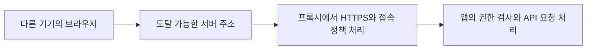

### 1. 개요 및 배경 (Context)

- Mac에서만 열던 웹 도구를 다른 기기에서도 쓰려면 셸 계정을 나눠 줘야 하는지, Ubuntu에 올리려면 서버 프레임워크도 먼저 바꿔야 하는지 검토함.
- 당시 코드가 **`127.0.0.1`로만 요청을 받고 로컬 Host와 Origin을 전제로 검사**하는 것을 확인함. 같은 `localhost`를 다른 기기에서 열면 그 기기 자신에게 요청을 보냄.

### 2. 핵심 내용 / 문제 해결 과정 (Core / Troubleshooting)

- 서버가 어떤 네트워크 인터페이스에서 요청을 받을지 정하는 **바인딩**, 사용자의 기기에서 실제 서버로 요청이 닿는지 결정하는 **네트워크 경로**, 접속 후 기능을 사용할 권한은 서로 다른 확인 지점임.
- 기존 서버에서 웹 빌드 결과와 API를 함께 제공하면 브라우저의 요청을 한 주소로 모을 수 있음. 포트를 직접 노출하면 구성은 단순하지만 HTTPS와 접속 정책을 앱 쪽에서 더 많이 맡게 됨. **리버스 프록시**를 두면 브라우저가 접속하는 주소와 내부 API 주소를 나눌 수 있는 대신, 프록시와 서버의 경로 및 헤더 설정을 함께 관리해야 함.
- 웹과 API를 같은 출처로 제공하면 브라우저가 같은 프로토콜, 호스트, 포트로 두 요청을 보낼 수 있음. HTTP 포트는 요청의 도착점을 정함. 전송 암호화는 HTTPS로, 화면과 파일의 접근 범위는 인증과 서버 권한 검사로 각각 보장해야 함.
- Ubuntu에서 최소 실행을 확인한 뒤 필요하면 인증, 공통 오류 처리와 요청 로그를 구성하기 쉬운 HTTP 계층을 검토하기로 함. Express 도입 여부보다 웹 요청이 운영 경로를 통과하고 API가 사용자 권한을 판정하는지가 접속의 조건임.

- 당시 코드와 설정에서 원격 접속의 제약을 확인했고, 도식은 배포 검토안임. 외부 기기에서 접속하거나 Ubuntu에서 미디어 제작을 완료한 검증은 그날 설명의 범위에 없었음.

### 3. 인사이트 및 적용점 (Takeaway & Next Action)

- 접속 문제를 볼 때는 **주소, 네트워크 경로, 서버의 수신, HTTP 응답, 앱 권한** 순서로 확인하면 원인 범위를 줄일 수 있음.
- 유선과 무선이라는 이름만으로 접속 가능 여부를 판단하기 어려움. 배포 검증은 실제 사용자가 연결할 네트워크와 사용자 권한으로 해야 함.
