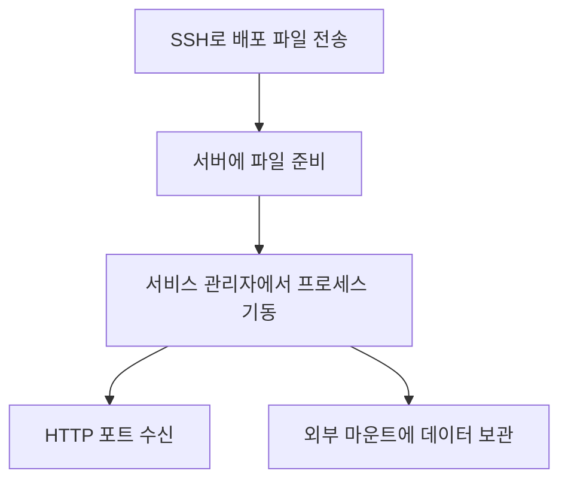

### 1. 개요 및 배경 (Context)

- **질문 요지** Ubuntu에 파일을 전송하는 것과 서버 프로세스를 실행하는 일은 왜 다른가? SSH가 끊겨도 서비스를 유지하는 설명에서 실제로 사용했던 것이 Docker인지 다시 물음.
- Ubuntu 서버에 파일을 옮긴 상태에서 서비스가 준비됐는지 확인함. 원격 셸에 접속할 수 있고 실행 파일도 있었지만, 조사 시점에는 서비스 설정과 웹 배포 파일이 없었고 앱 포트가 열려 있지 않았음.
- SSH를 닫은 뒤에도 앱이 동작하고, 다시 배포하더라도 필요한 데이터가 남으려면 **전송, 실행, 저장 위치**를 각각 정해야 함.

### 2. 핵심 내용 / 문제 해결 과정 (Core / Troubleshooting)

- **답변에서 고른 방법** 원격 장비의 런타임, 서비스 등록, 포트 수신을 확인하고 Git 이력에서 과거 Docker 구성과 당시 준비한 systemd 구성을 대조함. 두 시점의 실행 관리자가 달랐으므로 설정 파일이 있다는 근거만으로 이미 운영 중이라고 설명할 수 없었음. Docker 복구 요청 뒤에는 Compose 구성을 다시 적용하고 컨테이너 동작을 별도로 확인함.
- SSH 전송은 실행에 필요한 파일을 원격 장비에 준비함. 수동 실행은 즉시 로그를 보고 점검하기 쉽지만 세션에서 실행한 프로세스의 수명과 재부팅 후 기동을 따로 관리해야 함.
- **systemd**로 호스트에서 서비스를 관리하면 포트와 재시작 정책을 서비스 단위로 정의할 수 있음. **Docker 데몬**이 컨테이너를 관리하는 구성은 실행 환경을 이미지로 재현할 수 있고, 데몬과 컨테이너의 재시작 설정 및 외부 저장 위치를 함께 관리해야 함.
- 실행 파일과 별개로 보존할 데이터는 호스트 볼륨이나 마운트 경로에 연결하는 구성을 검토함. 컨테이너가 재시작되는 상황과 삭제된 뒤 새로 만들어지는 상황에서는 내부 파일 보존 조건이 달라짐.

- 당시 원격 점검에서 런타임과 미디어 도구 설치는 확인함. 이 점검 시점에는 앱 수신과 NAS 연결이 준비되지 않았으며, 재시작과 복구 검증은 별도였음.

### 3. 인사이트 및 적용점 (Takeaway & Next Action)

- 운영에서 말하는 배포 성공은 **파일 복사 이후에도 여러 조건**이 필요함. SSH 접속을 종료한 뒤 HTTP 응답이 오는지, 서비스를 다시 만들었을 때 필요한 데이터가 읽히는지까지 각각 확인할 수 있음.
