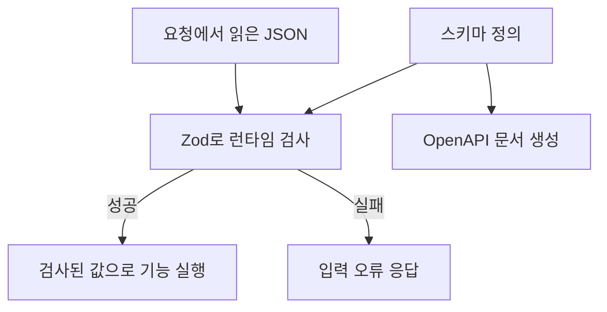

### 1. 개요 및 배경 (Context)

- API 핸들러가 어떤 값을 받는지 읽다가, TypeScript에 입력 타입이 있고 OpenAPI 문서도 생성된다면 외부 JSON은 어디서 검사되는지 질문함.
- 브라우저와 서버가 같은 타입 이름을 사용해도 실제 요청에는 잘못된 필드, 빠진 값, 구버전 클라이언트의 데이터가 들어올 수 있음.

### 2. 핵심 내용 / 문제 해결 과정 (Core / Troubleshooting)

- **TypeScript 타입 검사**는 작성한 코드의 호출 계약을 확인함. JSON을 파싱한 값에 타입 단언을 붙이면 코드에서 취급하는 타입은 달라지지만, 그 값 자체를 검사하는 동작이 생기지는 않음.
- Zod의 `safeParse`는 스키마를 실제 값에 적용해 성공 데이터 또는 검증 실패를 반환함. 검토한 핸들러에서는 이 지점에서 잘못된 입력을 처리하고, 검증을 통과한 값으로 기능을 실행하는 흐름을 확인함.
- 스키마에서 **OpenAPI**까지 생성하면 문서와 검증 규칙을 같은 정의에서 관리하기 쉬움. 대신 문서 생성과 요청 검사는 서로 다른 실행 경로임. 응답의 타입이나 문서 형식에 맞는지까지 보려면 해당 응답을 검사하는 지점을 별도로 두어야 함.

### 3. 인사이트 및 적용점 (Takeaway & Next Action)

- **스키마의 존재와 파싱 호출의 존재**를 구별해야 데이터가 검증 경계를 실제로 지나가는지 알 수 있음.
- 후속 검증에는 필수 필드를 빼서 전송한 요청과 계약 밖의 응답을 넣고, 어느 경계에서 해당 값이 거절되는지 확인하는 사례를 둘 수 있음.
