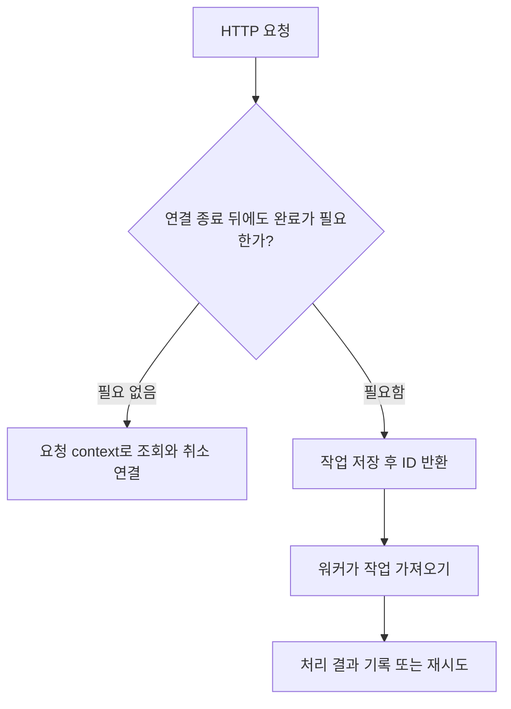

### 1. 개요 및 배경 (Context)

- **질문 요지** 현재 설계에서 어떤 Go 개념이 어떤 기능에 필요한가? 각 개념을 실제로 적용할 지점을 짧은 코드 예시와 함께 설명해 달라고 요청함.
- 오디오 파일 확인과 파형 생성처럼 오래 걸리는 처리를 Go API에서 바로 실행할지 별도 워커에 넘길지 설계에서 검토함.
- 판단 기준은 처리 시간 자체보다 **브라우저가 연결을 끊거나 서버 프로세스가 재시작돼도 끝내야 하는 일인가**였음.

### 2. 핵심 내용 / 문제 해결 과정 (Core / Troubleshooting)

- **답변에서 고른 방법** API 요청의 `context`와 미디어 워커의 영속 작업을 서로 다른 예시로 설명함. 요청에 답할 때만 필요한 작업은 연결 종료에 맞춰 중단할 수 있고, 접수한 미디어 작업은 브라우저가 닫히거나 프로세스가 재시작돼도 이어갈 상태가 필요하기 때문임.
- 요청에 답하는 데만 필요한 조회는 HTTP 요청의 `context`를 하위 작업에 전달해 연결이 취소되면 함께 멈출 수 있음. 별도 상태 저장이 없어 경로가 단순하지만, 재시작 뒤 이어서 실행할 근거가 남지 않음.
- 접수 이후 완료가 필요한 미디어 변환은 **PostgreSQL에 작업을 기록하고 워커가 가져가는 설계**를 검토함. API는 저장된 작업 ID를 반환하고, 워커가 파일을 확인해 재생용 파일과 파형을 생성함. 브라우저 연결 바깥에서 실행되며 워커 재시작 시 찾아갈 상태가 남음.
- 이 구조에는 **누가 작업을 처리 중인지**, **실패가 재시도 가능한지**, **같은 작업을 다시 수행해도 결과가 중복되지 않는지**를 결정하는 비용이 추가됨. 프로세스 안에서 비동기 함수만 실행하는 경우에는 프로세스 종료 시 해당 작업의 진행 정보도 사라질 수 있음.

- 도식은 당시 Go API와 워커를 나눈 검토안임. 구현 완료나 워커가 끊긴 뒤 작업을 복구한 결과는 당시 기록에 없음.

### 3. 인사이트 및 적용점 (Takeaway & Next Action)

- **클라이언트가 응답을 기다리는 시간과 작업을 보존해야 하는 시간**을 따로 정하면 요청 핸들러에 남길 일과 워커에 넘길 일이 구체화됨.
- 후속 검증은 브라우저 닫기, 변환 중 워커 종료, 완료 직전 응답 유실처럼 수명이 어긋나는 시점에 수행할 수 있음.
