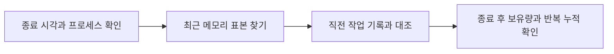

### 1. 개요 및 배경 (Context)

- 오랫동안 켜 둔 Electron 앱이 갑자기 종료된다는 제보를 설명하려 했음. 종료 시점의 오류만으로는 그 전에 어떤 작업이 자원을 늘렸는지 알기 어려웠음.
- **어느 프로세스가**, **어떤 작업부터**, **작업이 끝난 뒤에도** 메모리를 더 보유하는지를 찾는 순서로 조사 기준을 정리함.

### 2. 핵심 내용 / 문제 해결 과정 (Core / Troubleshooting)

- Main과 Renderer의 오류를 따로 수집하고 로컬 진단에서는 **30초마다 프로세스별 메모리**를 기록하는 경로를 확인함. 종료나 멈춤 전 마지막 표본을 직전 작업의 기록과 비교하도록 구성함.
- 디코딩, 파형, 썸네일, 편집 명령에 작업 식별자를 붙이면 합계만 볼 때보다 후보를 좁힐 수 있음. 같은 작업 종료 뒤에도 증가분이 남고 반복 때마다 쌓이는지 확인해야 함. 메모리 스냅샷은 그중 어떤 객체가 남았는지 살피는 후속 수단임.
- 코드에서 누적 가능한 편집 이력과 캐시는 개수와 용량 상한을 두고, 세션 종료 뒤 정리하는 완화 조치를 확인함. 상한은 한 세션이 보관할 리소스를 제한하는 대신 오래된 이력과 재사용 가능한 캐시를 잃을 수 있음. 제보된 종료의 실제 원인이 같은 캐시였는지는 장시간 재현이 필요했음.

- 당시 확인 범위는 진단 코드와 캐시 완화 조치까지였음. 작업별 메모리 진단은 미병합 상태였고 장시간 실사용에 대한 재현 결과는 확보되지 않았음.

### 3. 인사이트 및 적용점 (Takeaway & Next Action)

- **메모리가 늘어난 시점과 오류가 난 시점이 가깝다는 사실**은 재현 후보를 알려 줌. 종료 원인을 확정하려면 반복해서 같은 작업 뒤 자원이 남는지 확인해야 함.
- 다음 시험에서는 작업 직전, 직후, 정리 뒤의 Main과 Renderer 지표를 비교하고, 재현에 필요한 객체를 스냅샷에서 확인할 수 있음.
