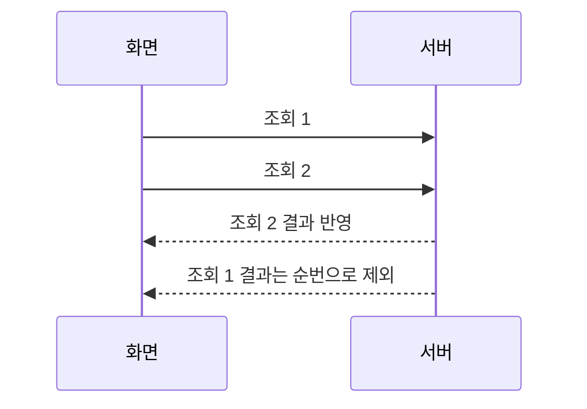

### 1. 개요 및 배경 (Context)

- 저장 화면에서 같은 대상을 연달아 조회하거나 명령을 보낸 뒤 화면을 떠나면, 화면이나 서버에 이전 값이 적용될 수 있는지 조사함.
- **조회 응답의 최신성**, **변경 명령의 중복 적용**, **저장 성공 이후의 새 조회**를 따로 추적함. 보호해야 하는 값과 실행 위치가 각각 다르기 때문임.

### 2. 핵심 내용 / 문제 해결 과정 (Core / Troubleshooting)

- 모의 API로 같은 대상의 두 조회를 역순으로 완료시켰더니 과거 응답이 최신 설정을 덮는 경로를 재현함. **조회 순번**은 늦은 응답이 화면에 반영되는 것을 막을 수 있고, **이전 조회 취소**는 아직 할 수 있는 불필요한 작업도 줄일 수 있음. 동일 대상을 다시 조회할 때도 순번이 달라져야 함.
- 화면을 나가며 버튼 잠금을 풀어도 이미 보낸 명령은 계속 처리될 수 있었음. 논리적으로 같은 작업의 재시도에는 **같은 작업 ID와 요청 본문**을 사용하고, 서버가 기존 접수 결과를 찾는 멱등성 계약이 필요함. 화면 잠금은 조작을 막기 쉽고, 서버 계약은 응답 유실이나 새로고침에도 같은 요청을 식별할 수 있음.
- 명령 성공 후 재조회를 요청하더라도 기존 조회가 진행 중이면 새 조회를 건너뛰는 경로를 확인함. 이전 결과를 무효화하고 바로 새로 조회하거나, 기존 조회가 끝난 뒤 후속 조회를 한 번 보장하는 대안을 검토함.

- 당일 모의 API에서 **응답 역전, 화면 이동으로 잠금 해제, 성공 후 새 조회 누락**을 재현함. 기존 관련 테스트 12개는 통과했고, 제품 코드 수정과 서버의 중복 방지 동작 검증은 후속 범위였음.

### 3. 인사이트 및 적용점 (Takeaway & Next Action)

- **조회 순번은 어떤 결과를 화면에 쓸지**, **작업 ID는 같은 쓰기를 다시 적용할지**를 정함. 최신 응답 표시를 고쳐도 서버의 변경 순서나 중복 적용 위험은 남을 수 있음.
- 회귀 확인은 지연 응답, 접수 뒤 응답 유실, 저장 시 이미 진행 중인 조회를 각각 만들어야 어떤 보장이 깨졌는지 알 수 있음.
