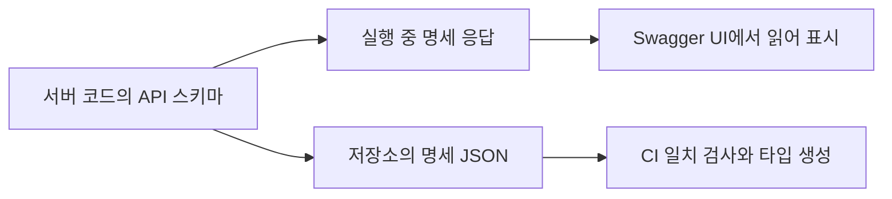

### 1. 개요 및 배경 (Context)

- **질문 요지** Swagger UI는 어디에서 API 정보를 읽는가? 이미 서버가 OpenAPI JSON을 제공한다면 저장소의 명세 파일을 지워도 되는가?
- 서버가 제공하는 Swagger UI가 저장소에 있는 `openapi.json`을 읽는지, 파일을 지워도 화면과 검증이 유지되는지 확인함.
- 먼저 **실행 중 UI가 읽는 명세**와 **CI 및 클라이언트 타입 생성이 사용하는 저장본**의 소비 경로를 비교함.

### 2. 핵심 내용 / 문제 해결 과정 (Core / Troubleshooting)

- **답변에서 고른 방법** Swagger UI의 명세 요청 주소와 CI의 검증 스크립트를 각각 찾아봄. 화면은 실행 중인 서버 주소에서 명세를 받지만 검증과 타입 생성은 저장된 파일에 의존했으므로, 제거할 때는 CI가 생성한 명세를 임시 결과물로 사용하도록 함께 바꾸는 방안을 제안함.
- **OpenAPI**는 경로, 요청, 응답을 기술하는 명세이고, **Swagger UI**는 그 명세를 브라우저에서 읽기 쉽게 표시하는 도구임. 당시 코드는 서버가 UI 화면과 별도의 명세 응답을 제공하며, 브라우저가 그 명세 응답을 불러오는 구조였음.
- 저장소의 JSON은 서버 코드에서 생성한 명세의 저장본으로, 변경 이력을 보고 CI에서 생성 결과를 대조하거나 타입을 만드는 데 쓰였음. 정적 JSON 하나로 화면까지 제공하면 배포 구성이 단순해질 수 있고, 실제 코드에서 다시 생성하는 경로는 구현과 명세를 맞추기 쉬우며 저장본과의 차이 검사가 필요함.

- 당시 코드 조사에서 UI가 저장소의 파일을 직접 읽지 않아도, 파일만 지우면 CI의 검사 계약이 깨지는 것을 확인함. 삭제 전후 배포 화면을 비교한 작업은 아니었음.

### 3. 인사이트 및 적용점 (Takeaway & Next Action)

- 문서 화면에 문제가 있으면 **명세 주소의 응답 확인 → UI가 요청한 주소 확인 → 명세 해석 확인** 순서로 좁힐 수 있음.
- 생성 파일을 정리할 때는 제품 실행뿐 아니라 CI, 클라이언트 생성 도구, 변경 이력에서 그 파일을 읽는지도 확인해야 함.
